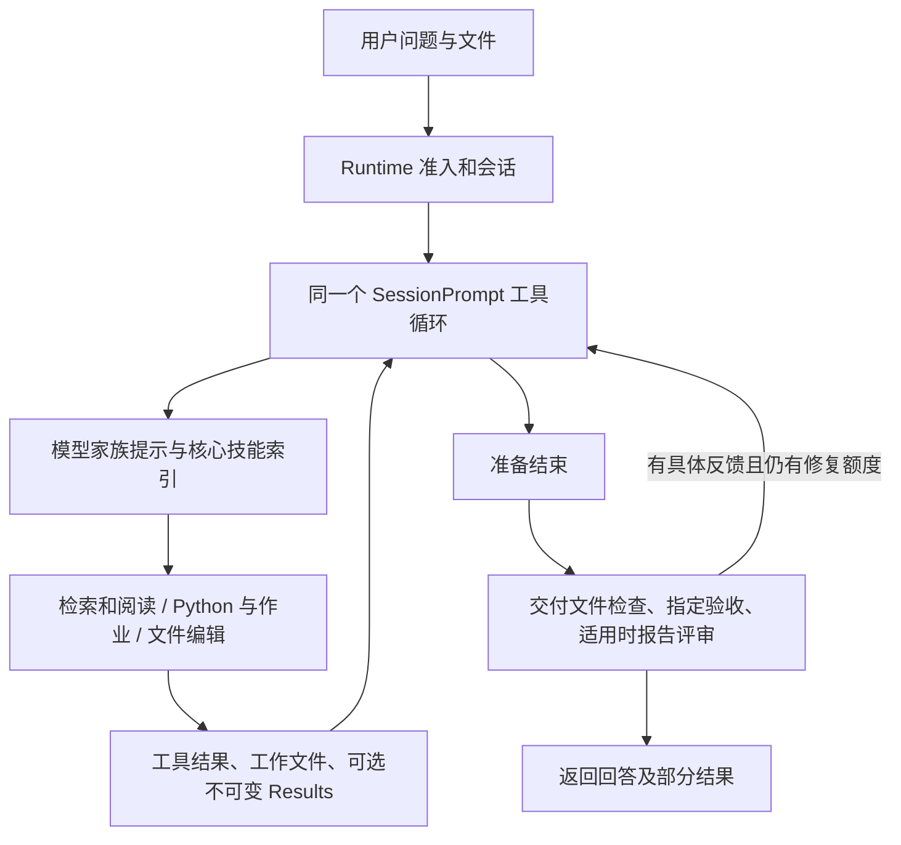

# OpenScience 研究机制源码审计：对 Codey 12B 的借鉴与限制

审计日期：2026-11-01。参考仓库：`https://github.com/synthetic-sciences/openscience`。

本地 `reference-projects/openscience` 已从 `a29cfabb419cd37c8cf5c3bec5634dece1bed58d` 快进更新到 `a08e0ad0ad3d6448123039ee4659163eb2e35d99`，版本 `2.0.153`，前进 740 个提交。更新前工作区干净，更新后 `main` 与 `origin/main` 一致且工作区干净。没有覆盖本地修改，也没有向远端推送。

本文以当前可达调用链为准。旧 README、历史设计记录和仍在目录中的旧模块不等于当前运行机制。本轮更新参考仓库、检查源码并读取既有 Codey 实验；未修改 Codey 生产逻辑，未安装 OpenScience 依赖，未调用模型。

## 1. 判断先行

OpenScience 值得借鉴，但不是一个已经证明能让本地 12B 稳定完成 Research 的现成答案。

它把研究做成“一个主代理使用科学工具和工作文件，按需加载方法，执行结果驱动后续行动”，主要优势是科学能力接入、实际执行、长任务、结果留存和具体反馈。它没有普遍替模型解决证据蕴含、条件完整性、跨动作比较和缺证据判断。

对 Codey 最有价值的启发是：让程序提供事实、检查和明确动作入口，减少模型维护运行状态的工作；让本轮只出现需要的方法和材料；每个新增组件都用真实失败及成本收益证明必要性。这些原则可以进入原 kernel，不要求移植它的整套代理、后台驱动和存储。

对照还发现 Codey 一个实际存在的指令冲突：局部工作流要求 `submit_research_answer`，而 `save_finding` 成功回执仍指向旧全局 `done.report_sections.coverage`。已确认冲突进入真实模型请求，应优先修复，详见第 7 节。

## 2. 当前项目实际怎样研究

### 2.1 普通研究：一个工具循环，模型负责科学判断

主要路径：



入口不是“必须先规划代理、再执行代理、再审查代理”的固定链。`research` 是 primary agent；当前定义没有自带独立 Research prompt，继而通过 LLM 的提示选择使用模型家族 header。依据：

- [agent/agent.ts:203](../reference-projects/openscience/backend/cli/src/agent/agent.ts#L203)：Research 的权限和 primary 定义。
- [session/llm.ts:72](../reference-projects/openscience/backend/cli/src/session/llm.ts#L72)：自带提示与家族提示的实际选择。
- [session/system.ts:43](../reference-projects/openscience/backend/cli/src/session/system.ts#L43)：模型 ID 到家族的映射；Qwen、Gemma 会落到 default。
- [session/prompt.ts:998](../reference-projects/openscience/backend/cli/src/session/prompt.ts#L998)：执行主循环。

`science.txt` 要求读取材料、核对声明、保留失败和部分结果、用保存脚本复算数字、明确交付要求。这里多数是模型行为指令，不能等同于程序强制执行了每条要求。

### 2.2 规划主要是按需使用方法和 todo

持续研究由主代理识别交付物、证据和步骤，使用规划工具跟踪。`todowrite` 写会话 todo，成功结果只回传计数及正在做的项，不把完整计划再重复一遍。见 [tool/todo.ts:19](../reference-projects/openscience/backend/cli/src/tool/todo.ts#L19)。

todo 的“已完成”仍是模型声明；它不是研究结论的语义证明。对 Codey，也不能把新 todo 表变成原计划和结算回执之外的第二份可写研究进度。

### 2.3 科学方法放在按需加载的技能中

Research 常驻的是核心技能索引，正文通过 `skill` 按需加载。核心索引涵盖检索、文献综述、假设、复现、统计、验收、图表、报告、引用等；其他专业库通过精确名称或查询发现。见 [session/system.ts:205](../reference-projects/openscience/backend/cli/src/session/system.ts#L205)。

这减少了常驻方法正文，但没有消除模型选择方法的责任，也不保证加载的长方法适合 12B。适合 Codey 的是“当前阶段需要什么，才提供什么”；不必为此立即增加完整技能框架。

### 2.4 工具可见性由权限、默认集合和技能解锁决定

当前 `ToolVisibility` 明确没有关键词选择。主代理默认可见读写、搜索、文献、todo、Task、Python、计算作业、artifact 等一组通用工具；专业工具由已加载技能、显式权限及扩展解锁。未配置搜索服务的 `research_search` 不暴露给模型。

依据：[tool/visibility.ts:5](../reference-projects/openscience/backend/cli/src/tool/visibility.ts#L5)、[tool/registry.ts:283](../reference-projects/openscience/backend/cli/src/tool/registry.ts#L283)。

这是能力发现机制，**不是按当前局部关系只给两三个合法动作的状态机**。它的默认动作空间可能比 Codey 局部 Research 更大，不能直接推断模型负担更小。

### 2.5 旧 ResearchContract 不应当作现行编排

当前目录仍有 [session/research.ts](../reference-projects/openscience/backend/cli/src/session/research.ts)，包含阶段、检查、试验轨迹和预算等大量实现。但 `research_contract` 工具文件已经删除，当前 `ToolRegistry` 不再注册它，主循环也不再调用 `SessionResearch`。现有引用主要是 trace 中读取/评估旧 contract 以及会话删除时清理。不能将这个保留模块描绘成当前每次研究都执行的工作流。

可沿 [tool/registry.ts:180](../reference-projects/openscience/backend/cli/src/tool/registry.ts#L180)、[session/trace.ts:407](../reference-projects/openscience/backend/cli/src/session/trace.ts#L407) 检查；相关重构提交为 `e249b121`。同理，9 月早期的 thin-runtime 设计说明描述的部分提示和工具已被后续重构替换。

## 3. 检索、阅读与证据如何处理

### 3.1 搜索和阅读分开

`research_search` 用于一般网页及研究网站；`literature` 用于论文；科学数据库走相应连接器。`deep` 主要请求最多三条结果的页面内容补充，不是自动做多轮研究或额外重排。工具描述会告知排名、内容补充和时间过滤的边界。

依据：[tool/research-search.ts:29](../reference-projects/openscience/backend/cli/src/tool/research-search.ts#L29)、[tool/literature.txt:1](../reference-projects/openscience/backend/cli/src/tool/literature.txt#L1)。

`literature search` 通过 OpenAlex、arXiv 等返回去重候选、标识符、摘要和开放全文情况；`read` 解析 DOI/arXiv/URL/本地 PDF，下载及缓存全文，再返回开头页、指定页段或查询命中的段落。

这里有适合 Codey 泛化借鉴的细节：

1. 下载失败、仅有摘要、扫描件文字稀少、HTML 替代 PDF，分别明确报告。
2. 已取到全文但查询无命中时，提供页码目录和换词/按页读取路径，不把“没有命中这个词”当成“全文没有答案”。
3. 候选摘要不是已阅读全文；检索服务不可用也不是零结果。
4. 可定位、可重读的缓存减少反复下载和模型记忆负担。

依据：[tool/literature.ts:273](../reference-projects/openscience/backend/cli/src/tool/literature.ts#L273)、[tool/literature.ts:310](../reference-projects/openscience/backend/cli/src/tool/literature.ts#L310)。

但有一个边界要看清：`status=full` 可以表示全文已提取到缓存；本轮模型实际只看到 opening pages 或命中片段，可能仍被裁剪。它不代表模型已经完整读过全部条件。Codey 已有完整读取窗口和精确版本机制，应保留这一更细的区分。

### 3.2 对相同搜索复用原回执

`SearchDedupe` 规范化参数，以已有完成的搜索工具记录查找可复用结果，还处理旧工具名兼容。暂时不可用、限流或失败的结果不会一律作为永久缓存复用。

依据：[session/search-dedupe.ts:25](../reference-projects/openscience/backend/cli/src/session/search-dedupe.ts#L25)、[session/search-dedupe.ts:81](../reference-projects/openscience/backend/cli/src/session/search-dedupe.ts#L81)。

这个思路符合单一事实来源：从原工具记录恢复，而不是要求模型自行记住之前搜过什么。迁入 Codey 前应先核对已有回执重放是否已覆盖，不能再建立第二套搜索账本。

### 3.3 来源追踪不等于来源支持结论

OpenScience 有 provenance 记录和不可变 Results，但当前普通研究路径没有一个普遍的、强制的“每个自然语言结论都必须被精确原文蕴含”判定器。

特别需要避免被目录误导：`science/provenance/review.ts` 现在是历史评审记录的只读兼容视图，不能因为文件叫 review 就认为现行流程自动进行了独立语义审查。

因此，对“读写可以并发，所以不存在单写者限制”“COMMIT 可以追加，所以多个写者能同时提交”等错误，这套机制本身没有提供已验证的通用解法。

## 4. 它怎样减轻上下文和操作负担

### 4.1 区分稳定规则与变化事实

环境和稳定指令进入 system；预算提示、Study 状态等变化事实在必要时作为持久会话续接消息追加，按内容身份避免每步重复注入。todo 成功回执也避免重复完整输入。

依据：[session/prompt.ts:1744](../reference-projects/openscience/backend/cli/src/session/prompt.ts#L1744)、[tool/todo.ts:23](../reference-projects/openscience/backend/cli/src/tool/todo.ts#L23)。

这对长上下文缓存及费用有工程价值；对本地模型是否明显加速还取决于后端。保持缓存前缀稳定和缩小模型本轮判断范围是两件事，不能把缓存命中当作推理准确率提高。

### 4.2 实际发送前计算整个请求

预估范围包含消息、系统/代理提示和工具 schema；如果最新输入本身放不下，返回具体错误；如果主要是可缩减历史，则先压缩。见 [session/prompt.ts:1827](../reference-projects/openscience/backend/cli/src/session/prompt.ts#L1827)。

这与 Codey 最近增加的实际请求预算方向一致，不是必须再移植一层的缺失能力。

### 4.3 清理旧输出、压缩历史、按需找回

`SessionCompaction` 保留部分近期工具输出，保护 skill/artifact/todo，使用模型生成结构化 handoff，并保护用户原始请求。`recall` 可在完整消息存储和保存的工具输出中搜索已被上下文压缩的内容。

依据：[session/compaction.ts:733](../reference-projects/openscience/backend/cli/src/session/compaction.ts#L733)、[tool/recall.ts:28](../reference-projects/openscience/backend/cli/src/tool/recall.ts#L28)。

这里要区别“原记录保留”与“摘要不丢语义”：摘要仍可能漏条件或改写关系，不能代替 Codey 的精确 passage/finding 版本。

默认保留 40k 工具 token，未知上下文默认回退 128k。这是容量策略，不是 12B 的有效认知范围建议。静态 default header 填入共享 science 文本后就有约 15,442 UTF-8 字节，尚未包含其他环境和工具；因此也不能把它描述为天然的超短小模型提示。

## 5. 实验研究是另一种任务：Study

它不只做文献问答，也支持基于真实运行逐步优化指标的研究：

```text
建立 Study，记录问题/假设/指标/预算
  → 提出 baseline 和候选 idea
  → 每个 idea 启动一个真实 run
  → 追踪指标、作业结束、预算及停止条件
  → 原会话被 Study update 唤醒
  → 模型读指标、记录 keep/revert 和解释
  → 继续候选，最终保存最好配置、结论及未解问题
```

见 [tool/study.txt:1](../reference-projects/openscience/backend/cli/src/tool/study.txt#L1)。

`StudyDriver` 监控运行和时钟，检测预算、停滞、作业结束，再调用同一 `SessionPrompt`，并不另造一种模型执行循环。但它确实增加了领域后台定时驱动及持久 study/idea/run 数据。见 [experiments/driver.ts:15](../reference-projects/openscience/backend/cli/src/experiments/driver.ts#L15)。

对你眼前的 WAL 文档研究，不需要复制这套 driver。它解决的是“实验已结束、指标是多少、现在应处理哪个结果”，不是“这段原文是否足以推出这个结论”。

### 单一事实来源最值得参考的部分

`StudyLedger` 把 store 渲染为 `study.md`、`ideas.md`、`results.tsv`、`lessons.md`。注释明确：不把这些文件再解析回状态，修改走 study 工具，store 是事实来源。见 [experiments/ledger.ts:5](../reference-projects/openscience/backend/cli/src/experiments/ledger.ts#L5)。

四个文件不等于四套可写真相；单向生成的可再生视图不是双写权威状态。Codey 同样可以把当前研究进度渲染给人看，但应只读取原计划、原结算回执和唯一报告快照。

重要工作文件可通过 `artifact save_file` 保存为不可变 Result 版本，包含版本身份、摘要和执行关联。其读取会检查完整性，大文件则明确只返回元数据。见 [tool/artifact.ts:164](../reference-projects/openscience/backend/cli/src/tool/artifact.ts#L164)、[artifact/store.ts:446](../reference-projects/openscience/backend/cli/src/artifact/store.ts#L446)。

工作草稿与不可变交付版本具有不同角色，本身也不等于答案双写。Codey 的唯一接受后 FindingReport 已实现相似的交付冻结目标，应继续复用。

## 6. 结束检查与评审：有价值，但不是严格内容门禁

Harness 插件在原循环的 `loop.before_finish` / `loop.guard` 钩子补充反馈，没有强制另建评审执行器。单元可配置开关，默认开启；存在触发条件和调用次数边界。见 [harness/index.ts:12](../reference-projects/openscience/backend/cli/src/harness/index.ts#L12)。

| 检查 | 主要检查什么 | 不能证明什么 |
| --- | --- | --- |
| Deliverables | 明确命名的文件是否存在、非空及若干格式/数值问题 | 研究结论正确、所有自然语言要求都被识别 |
| Acceptance | 从请求识别的测试/编译命令和禁用项是否通过 | 未被编码的科学主张正确 |
| Review | 新上下文读请求、报告及其他输出，列覆盖遗漏 | 引用原文是否蕴含结论、数值正确 |
| Redirect | 重复失败时提示换方法，限制继续次数 | 已经找到了有科学价值的新路线 |
| Budget/Cost | 告知预算和事实，避免无界消耗 | 多花时间必然形成答案 |

这些检查是有界修复提示，并非无限重试的硬成功 gate：文件检查两轮后不再强求；指定验收修复提示最多三轮；报告评审最多两轮，第二轮有额外条件。依据：[deliverables.ts:675](../reference-projects/openscience/backend/cli/src/harness/deliverables.ts#L675)、[acceptance.ts:572](../reference-projects/openscience/backend/cli/src/harness/acceptance.ts#L572)、[review.ts:189](../reference-projects/openscience/backend/cli/src/harness/review.ts#L189)。

### 报告评审的实际边界

- 它仅在存在已识别的书面交付物，且正文满足相应启发式时触发；不是所有回答都审。
- `Review.prose` 要求至少 400 个空白分隔 token、过半符合英语词形，并要求至少 15 个英语样式句末。纯中文或中英混排不能假定能正确触发。
- Reviewer 使用用户这轮相同的 provider/model，新上下文、无工具，看到请求、报告和少量其他输出；不会自动读取全部原始证据。
- `reader.txt` 明确要求检查遗漏，明确不判断数字正确性，并鼓励补充解释和有置信度的结论。它不适合作为 Codey 缺证据时“应保留缺口”的语义证明。
- 评审调用失败时返回 `COMPLETE`，原报告继续保留。这是软提示的产品选择，不能迁入 Codey 作为“独立审查通过”。

依据：[review.ts:65](../reference-projects/openscience/backend/cli/src/harness/review.ts#L65)、[review.ts:231](../reference-projects/openscience/backend/cli/src/harness/review.ts#L231)、[reader.txt:1](../reference-projects/openscience/backend/cli/src/agent/prompt/reader.txt#L1)。

因此，不建议因为它有 reader 就给 12B 增加强制整篇自审。若后续确需测独立复核，应先测一个局部“问题＋精确主张＋完整原文”的支持判断，沿用 Codey 现有评审边界，且把复核失败记为未审而非通过。

## 7. 对照 Codey 发现的直接工程问题

### 7.1 已确认：保存成功回执给出了当前模式不能执行的结束路径

当前代码同时包含：

- [context_view.py:139](../codey/research/context_view.py#L139)：已有完整候选时直接 `submit_research_answer`，不要重复保存。
- [kernel_protocol.py:215](../codey/operations/kernel_protocol.py#L215)：局部工具集合只包含本题动作，不提供全局 `done`。
- [findings.py:131](../codey/research/findings.py#L131)：保存后仍返回 `Select fN in done.report_sections.coverage[].findings ...`。
- [tool_contract.py:195](../codey/research/tool_contract.py#L195)：通用保存描述也继续提到 `done` 采用文本。

这要求模型自己分辨“最新成功工具回执的 next 指令”和局部协议哪个适用。对已出现“正确保存却不提交”的 12B，这是可以直接消除的额外协议负担。

我重新扫描既有 wire 的 `event=admitted_payload`，只检查实际发送的 `payload.messages`：

| 原实验组 | 运行数 | 至少一次带入旧指令的运行 | 请求数 | 带旧指令请求数 |
| --- | ---: | ---: | ---: | ---: |
| batch4-fixed-minimal | 15 | 15 | 38 | 18 |
| batch5-fixed-factorial | 24 | 24 | 93 | 59 |
| 合计 | 39 | 39 | 131 | 77 |

例：[C-versions-74/research-wire.jsonl](../.e2e-artifacts/research-local-followup-20261101/batch5-fixed-factorial/C-versions-74/research-wire.jsonl) 的 admitted payload 在第 7、11 行包含旧路径。此前该运行反复保存正确引入版本后 no_progress。

这些是历史实际请求的重新统计，不是新跑模型。成功案例也出现同一冲突，所以不能断言它解释了全部失败，也不能把它当成条件遗漏和错误推理的充分原因。

### 7.2 第一批应只修模式一致性

建议修改范围：

1. `findings.py` 保留通用的“保存了哪个 fN、对应什么精确证据、仍未经语义审查”；由知道当前冻结 scope 的操作层提供适用的下一步。
2. `task_execution.py` 在已有 `_research_scope` 中投影保存回执：给出当前可用的局部提交示例；普通全局流程继续给其原有路径。不要从提示字符串猜模式，也不要给领域存储增加另一份 scope 状态。
3. `local_scope.py` 的 `scoped_spec` 同步投影 `save_finding` 的描述，避免 schema 说全局、回执说局部。统一复用领域契约渲染函数，不在两处维护两份互相漂移的说明。
4. 明确这是候选保存，不是自动采用。若当前主张完整支持目标，才选 `answered`；支持一部分用 `partial`；不支持目标可正常 `unresolved`。不能因为保存成功就由程序自动宣布 answered。

验收应检查真实 JSON/native 请求和冷恢复后的实际工具结果，而不只是源码或单段提示：

- 局部作用域中的有效操作指令不再指向不可见的全局 `done`；历史原记录不改写，模式兼容投影不篡改业务事实。
- 普通全局 Research 的旧提交路径仍可用。
- 保存、选择、接受、发布的权威入口不变；恢复不重复保存、不重复推进。
- 原固定时钟、试题、证据、采样和评分重跑，分别看正确保存后选编率、重复保存、错误 unresolved，以及原四个内容错误维度。

这一批是修一致性；即使内容提升不显著，也不应保留相互冲突的操作指令。

### 7.3 若仍卡在动作选择，再单独测“保存后收窄选择”

当前局部工具仍同时有搜索、阅读、保存、推理、提交等动作。可以在原 scope 上派生本轮操作投影：出现新候选后，优先呈现选择候选、保留缺口、补读或修订的有限路径，减少反复保存同一文本。

但“有候选”只证明存在记录，不能证明它回答了目标。不能隐藏补读/拒绝候选的路径，不能强制选入唯一 finding，更不能将 `unresolved` 改成 answered。

如果进一步探索“提交时附带新 finding，程序复用原保存效果后完成局部选择”，应作为独立契约实验：沿用现有知识事务、结算回执和 kernel 恢复，处理保存已成功而选择未结算的中断边界。它不是 OpenScience 已验证的方案，也不宜在第一批顺带加入。

## 8. 哪些值得借鉴，哪些不宜照搬

| 机制 | 对 Codey 的价值 | 当前建议 |
| --- | --- | --- |
| 具体、可执行且模式一致的反馈 | 直接减少模型解释协议和猜下一步 | 最高优先级；已有实际冲突 |
| 从原工具回执复用读过的材料 | 降低重复操作和记忆负担 | 延续现有实现，核对遗漏 |
| 搜索失败/无命中/摘要/全文缓存/实际窗口分开 | 防止错误肯定及全称否定 | 对照补缺，不再造检索运行时 |
| 方法按阶段提供 | 减少本轮无关规则 | 先测局部投影，无需完整技能平台 |
| 交付状态单向渲染 | 便于人检查且不引入第二份进度 | 从原计划、回执、报告生成 |
| 有界、针对具体失败的修复 | 控制无效循环，保留部分结果 | 延续原 checkpoint 预算和领域错误身份 |
| 整请求预算及可找回原文 | 限制实际输入，保证可恢复 | Codey 已在做，应继续验证 |
| 普遍放开工具和自主规划 | 通用能力强，但小模型选择负担大 | 不替换当前局部 scope |
| 大规模技能库和专业代理 | 扩展科学能力 | 当前不是内容验收的主要缺口 |
| 报告末尾同模型软评审 | 或能发现遗漏，也可能扩大无依据解释 | 不作为严格语义 gate，不强制增加 |
| StudyDriver 后台研究驱动 | 有用的长实验调度 | WAL 文档研究无需引入 |
| 用模型摘要替代精确证据 | 上下文压缩 | 不替代原知识版本及完整条件 |

## 9. 架构与恢复边界

OpenScience 的公共 Runtime 负责请求身份、准入、幂等和终态。同一 request ID 同内容复用，内容冲突拒绝；owner 进程消失会把未完成运行标为 interrupted，而不是自动重复所有外部操作。见 [runtime/runs.ts:155](../reference-projects/openscience/backend/cli/src/runtime/runs.ts#L155)、[runtime/runs.ts:182](../reference-projects/openscience/backend/cli/src/runtime/runs.ts#L182)。

它和 Codey 逐效果冻结、恢复的契约有差异，不能因为都有 resume 就认为恢复保证相同。也不能将 OpenScience 的 `HarnessState` 进程内 Map 当作 Codey 修复预算的权威状态；Codey 已把相关预算放入 checkpoint，应该保留。

符合你要求的适配方式始终是：

```text
原计划与原要求
  → 原 kernel 根据已结算回执派生局部 scope
  → 冻结本轮材料、工具、模式一致的反馈
  → 原工具效果与知识事务
  → 原局部选择回执
  → 原编译与内容/结构检查
  → 唯一接受后的 FindingReport
  → 原发布效果
```

可以新增派生视图和可删除重建的诊断文件；不能增加可写的“当前答案”“研究进度”并要求它们与原回执同步。

## 10. 证据限制与推广条件

本次没有可用的 Bun 命令，且仓库未安装依赖；项目要求 `bun@1.3.14`。因此没有运行它的 Bun 测试、完整产品、任何真实模型任务，也没有用测试文件数量暗示研究效果。

已读取相关实现、测试夹具及评估说明。报告评审回归使用本地脚本化 HTTP provider，它证明评审请求和反馈被接入原循环，不证明真实模型会发现遗漏。科学 benchmark 目录提供原生 runner、固定身份和评分接口；项目自己的说明也明确区分适配器通过与科学分数。见 [science-harness/README.md:191](../reference-projects/openscience/evals/science-harness/README.md#L191)。

在本次核对的研究设计、相关测试和评估入口中，没有找到与 Codey 同一 12B、同一材料、同一评分、同预算的成功对照证据。不能声称它已证明“小模型也能稳定 research”，也不能用大模型实机记录替代这项证据。

Codey 的下一步仍停在第 6 步内容验收：先修直接协议冲突，再检验保存后动作选择；原最小题逐题检查条件/关系遗漏、错误附加、状态误报、缺证据结束。保留同输入重复观测和全部失败。只有这一层按事先标准通过，才进入候选干扰、自主检索及完整 WAL。

工程改善有跨主题泛化潜力：协议一致、状态由程序提供、证据可恢复、失败分类和合法动作清楚，都不依赖 SQLite 关键词。但内容收益仍需在新主题、完整条件、反例及缺证据任务上证明，不能把“设计通用”当成“效果已经泛化”。
