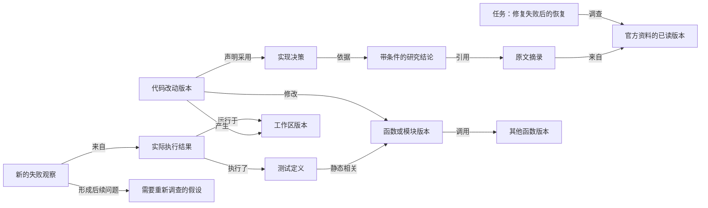
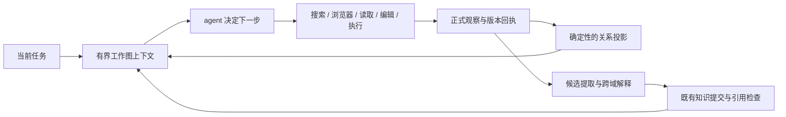

# 用统一工作图连接 codey 的编码与研究（2026-11-19）

目标是让 agent 利用图理解问题、获取上下文、选择行动并积累可复用的结果。借鉴 CodeGraph 和 Graphify 的结构抽取、关系解析、查询和增量更新细节，由 codey 独立实现。**图应把研究与代码连在同一条工作链中，使 agent 能从研究找到实现，也能从实现返回研究依据。** UI 展示这一工作图，模型通过有界查询使用它。

本文是对[参考项目分析](codegraph-graphify-codey-analysis-20261119.zh-CN.md)的目标收敛与设计补充。所有新增对象、关系和接口均为提案，未接入生产。随后已完成[首轮本地模型实机对照](agent-work-graph-live-pilot-20261119.zh-CN.md)：初始图检索减少了定位请求，但尚未显示比普通文本检索更高的正确性；完整工作图仍待验证。此前的 31 项检查只验证参考项目局部机制。本轮继续不修改生产代码。

后续已完成[主动查询“约束 → 实现 → 反例”的生产 kernel 试验](agent-work-graph-query-20261119.zh-CN.md)：离线 41 项通过，显式查询实机 9 单元中三组均未完整成功。图实际被查询、结果实际交付，仍遗漏关键条件；真实 Codey 仓库的规模检查也暴露扫描失败。因此当前候选继续留在测试层，尚无生产合入依据。

**融合应发生在任务、理由和结果上。**

例如用户要求“根据官方资料修复浏览器读取失败后的恢复逻辑”，agent 应能沿下面的关系工作：



这里的“声明采用”记录这次实现声称采用了哪个决策，不等于证明实现正确；“静态相关”帮助挑测试，实际运行结果另有自己的版本和作用范围。这样的表达既能连接工作，又能让 agent 知道各条关系可以用来做什么。

三种直接有用的跨域查询：

| 用户任务 | agent 沿图取得的上下文 | 对后续行动的帮助 |
|---|---|---|
| “按刚查到的协议修改解析器” | 协议条款与条件 → 决策 → 现有解析器 → 调用方 → 测试候选 | 看见应修改的位置，以及不能破坏的约束 |
| “这个重试机制为什么这样实现？” | 函数 → 采用的决策 → 研究结论 → 原文 → 当时的验证结果 | 找回原因，区分历史取舍和当前仍成立的条件 |
| “新文档改变了一个限制，会影响哪里？” | 新旧来源差异 → 可能受影响的主张 → 依赖决策 → 实现版本 → 当前调用方 | 把资料更新转成需要核查的代码与测试范围 |

第三种查询中的“影响”是待核查集合：来源更新不自动推翻旧结论，也不直接触发改代码；它使既有依据需要重新检查。

**先在现有事实之上建立统一查询视图，再补缺少的跨域连接。**

codey 已经具备知识对象、版本引用和图扩展召回：[知识模型](../../codey/knowledge/model.py)、[repository](../../codey/knowledge/repository.py)、[recall](../../codey/knowledge/recall.py)。工具侧已有[读取与执行回执](../../codey/operations/kernel_receipts.py)，模型上下文已有[epoch 和来源记录](../../codey/workspace/context_epoch.py)。这些是工作图的数据基础。

目前主要缺少两部分：跨文件代码关系，以及“此实现采用了哪个研究结论/决策、此观察来自哪个实现版本”的桥接关系。现有知识前提引用有类型、版本和循环校验；代码调用存在递归与循环。因此统一的是节点引用、可查询的关系和上下文交付，不要求所有对象都变成同一种知识对象。

| 工作图中的对象 | 既有或建议的事实来源 | 关键身份 |
|---|---|---|
| 任务、运行、问题 | 现有 task/run 与 research question 状态 | 项目/会话、run、问题身份 |
| 来源、摘录、主张、推理、答案 | 现有知识 repository 与研究账本 | 精确 knowledge revision、来源内容版本、摘录位置 |
| 实现决策 | 首轮可由现有知识对象表达，桥接关系记录其角色 | 决策知识版本及条件 |
| 文件、符号、调用、导入 | 建议增加可重建代码索引 | 项目与 worktree、相对路径、限定符号身份、内容/索引版本 |
| 改动、工作区快照、执行结果 | 现有改动、workspace identity、工具回执 | 工作区 revision/fingerprint、call/run、结果引用 |

首轮无需新增图数据库，也不需要重写现有知识系统。逻辑查询可以组合现有 SQLite 知识引用、代码索引和回执投影。只保存当前系统没有的桥接关系，避免把已有来源正文、执行输出和知识 payload 再复制一遍。

代码符号身份不能只用名称或行号：同名函数、方法、重载和不同项目都需要区分；代码版本绑定内容或工作区指纹。改名或移动后，先建立新定位，经过实际变更信息确认后再连接历史身份，避免把相似名称合并成同一个符号。

**关系既要跨域，也要有明确的方向和用途。**

首轮只需补齐能支撑上述任务的关系，以下名称是候选语义，不代表需要一次实现全部 schema：

| 关系 | 产生方式 | 用途 |
|---|---|---|
| 文件定义符号、符号调用/导入/引用另一符号 | AST 与受限的跨文件解析 | 理解代码、查调用链和影响范围 |
| 主张引用证据、证据来自来源；反证和适用条件 | 复用现有知识引用 | 核对研究依据和限制 |
| 决策依据某个知识版本 | agent 提议，走既有知识提交与引用检查 | 记录为什么采用某个设计 |
| 某改动声明实现某决策、改动修改某符号版本 | agent 的实施声明 + 实际变更定位分别记录 | 从理由定位实现，从代码回查理由 |
| 某执行运行于某工作区、产生某观察 | 正式执行回执投影 | 把结果和被验证版本联系起来 |
| 某测试静态关联某符号 | AST、测试声明或经标注的推断 | 推荐测试，说明推荐依据 |
| 新旧知识/代码版本使既有连接需要复核 | 版本变化与依赖查询 | 形成后续调查集合 |

每条新增桥接关系至少包含：两端精确引用、关系类型、关系依据、生成方式、作用域、状态和产生它的事件身份。模型声明、结构解析和实际执行分别标记，不用一个浮点“置信度”代替这些信息。

**agent 通过一个主要查询入口取得任务所需的小范围图。**

建议先试验一个只读的 `graph_context` 接口。它将自然问题、可选种子和查询目的变成有解释的上下文；模型不需要直接编写数据库查询。参数可从下面的最小形状开始：

```json
{
  "question": "改变恢复入口后，哪些调用方和测试需要检查？",
  "purpose": "impact",
  "seeds": ["<当前上下文中真实返回的节点引用>"],
  "budget": 2000
}
```

`purpose` 首轮可覆盖理解、影响、依据追溯三类；下一步研究候选可以先作为结果中的可选内容，避免一开始就增加独立规划器。`budget` 的单位和计数方式必须在正式合同中明确，服务端上限优先；不能把字符估算伪装成目标模型的准确 token 数。

接口应返回：

- **定位项与少量原始上下文。** 哪些代码、资料和版本与任务直接相关；实际交付了什么原文。
- **选择理由与路径。** 例如“直接调用被修改函数”“这个实现声明采用了该条款”，而非只有相似度分数。
- **条件、反证与变化。** 当前结论适用于什么情况，哪些依赖已经改变，哪些来源还未读。
- **覆盖情况。** 本次用了哪个项目/工作区版本；未解析调用、预算截断和未覆盖语言分别说明。
- **少量行动候选。** 读取哪个具体位置、补查哪个问题、考虑哪个测试及其依据；由 agent 按任务决定是否执行。

示意结果可以是：“恢复入口有两个直接调用方；已有决策依赖来源第 4 节，但该版本标注了特定超时条件；一个测试静态关联入口，尚无覆盖当前改动的执行结果。”这比一串节点更接近 agent 作出正确下一步选择所需的信息。

默认返回模型友好的简洁结果；UI 获取同一查询的子图数据。模型不应同时接收完整图 JSON、文字副本和重复原文。初次进入任务时可在现有安全请求边界自动提供少量图上下文；agent 需要转向、追问或扩大范围时，再显式调用查询。

首轮可保持“图负责定位，现有 read/knowledge_read/open 工具负责正式原文读取”。后续如果把原文一并交付，必须使该交付产生符合现有规则的读取回执，才可用于引用或精确编辑。这样也能分别测量“图是否找对了位置”和“合并读取是否减少总轮次”。

**查询算法要围绕任务和关系语义展开。**

1. 从当前任务、问题、最近读取、已采用知识和修改符号中选择少量种子。名称/全文/显式别名检索负责发现入口；不是只靠用户精确说出函数名。
2. 在评分和扩展之前应用项目、会话、personal 权限过滤。可见的公共概念也不能把不可见项目的邻居或计数泄漏出来。
3. 按目的选择关系与方向：影响查询优先逆向调用和决策依赖，依据查询从实现沿决策回到证据，理解查询关注局部代码及其约束。
4. 控制邻域与预算，并预留少量位置给限制和反证。首轮试验可从少量种子、一至两层扩展开始；具体阈值由数据决定。
5. 将相关代码、资料条件和关系路径一起组织成上下文。出处不同的两条边不会因为连成路径就自动合成新事实；高连接度节点也不应淹没更直接的任务证据。

借鉴 CodeGraph 的是结构解析、调用位置、动态连接依据、增量失效和任务上下文组织；借鉴 Graphify 的是混合资料抽取、跨资料连接、种子加邻域查询和探索问题发现。社群划分可以在图变大后帮助选入口，不是实现首轮跨域查询的前置条件。

**图随着实际工作更新，更新本身也分层。**



获取失败可以增加“尝试过、为何失败”的任务状态，成功读取后才存在对应正文观察。资料中的实体、结论及跨资料联系可以由 agent 按需提取为候选；不需要每次点击都再启动一个模型重新抽取整张图。编辑后，更新相关文件的结构和引用；执行后，将正式结果与当时工作区身份关联。

桥接关系应记录产生事件，支持幂等更新；崩溃后可从正式回执补投影。知识提交和代码索引不一定在同一事务中完成，查询应暴露尚未对齐的版本，而不是生成看似一致的最新状态。

变化处理应区分历史事实与当前适用性：代码改变后，旧执行仍是旧版本的真实记录；它不再证明新版本。来源更新后保留旧快照，并把依赖它的决策列为需要复核。循环调用使用有界遍历和 visited 集合；知识前提继续遵守已有引用规则。

**这样也能改善浏览器研究中的行动选择。**

工作图可以让 agent 看见：哪些问题已有正文支持、哪些只有搜索链接、哪些访问失败、是否有同源转载、还有哪些不同来源可读。下一步候选由这些状态生成，帮助避免把同一问题反复搜索。

对代码研究，查询还可以带上实现中的具体未知点，例如“当前恢复逻辑依赖哪个浏览器生命周期假设”，再沿这个问题查文档和实验。研究结果随后回到同一符号和决策，而不只保存为一篇孤立报告。

实际浏览器动作继续使用当前可执行对象和权限，历史来源节点不复用另一次运行中已经过期的页面元素或临时引用。网页能否打开、正文是否进入模型、模型是否采用观察，要分别计分。[现有网页行动诊断](model-web-action-capability-result-20261118.zh-CN.md)中的失败案例可直接成为实验任务。

**UI 是 agent 使用同一张图的可检查窗口。**

用户和 agent 应能定位到相同节点、关系及版本。代码、证据和主题视图是同一工作图的不同查询方式，可以跨视图沿连接继续走，而不各自维护一套关系。

例如用户点击“这段代码的研究依据”，打开当前实现声明采用的决策与来源；点击“这条结论影响哪些实现”，查询与它连接的实现版本和当前定位；点击“交给 agent 检查”，将精确节点引用与用户意图放入下一轮任务。UI 通过现有操作流程交付这些请求。

任务视图显示当前问题、相关代码、关键依据和未解决项；链路视图按方向稳定排布；主题探索视图用于展开邻域。关系详情应直接展示依据和版本。agent 每次查询或写入产生的连接可被检查，方便发现误连、删除或纠正候选。

**实施顺序应首先验证跨域价值。**

| 阶段 | 可审阅产物 | 验收重点 |
|---|---|---|
| 1. 冻结跨域任务与基线 | 来自 codey 的“资料到代码”“代码到依据”“依据变化到实现复核”任务与标准答案 | 基线实际会错过哪些约束、影响和后续问题 |
| 2. 试验最小工作图 | 隔离代码索引、现有知识/回执只读投影、少量明确桥接关系 | 跨域查询能否找回应有路径，并排除同名、过期、越权和仅猜测的连接 |
| 3. agent 对照实验 | 现有工具组与增加工作图上下文组的真实请求、动作和回执 | 是否改善约束采用、实现正确性、来源归属、恢复行动和总成本 |
| 4. 增量更新与自动投影 | 编辑、读取、知识提交、执行后的更新记录 | 修改后能否识别旧依据/旧测试，恢复重放是否重复或漏连 |
| 5. UI 接入与规模优化 | 同一查询结果的可视检查、按需扩展与后续社群 | 用户能否理解并纠正 agent 使用的关系；规模扩大后预算和延迟是否可接受 |

首轮不需要复制两个参考项目的所有语言支持、接口或可视化。以 codey 的 Python/TypeScript 及已有研究来源为范围，先做最小闭环，确认收益再扩展。

真实对照应至少包含这几类失败风险：

- 资料中有一个摘要未出现的关键条件，agent 是否在改代码时正确采用。
- 同名符号、跨项目节点或动态调用候选存在时，是否选错实现。
- 来源失败后能否转向另一份相关材料；全部不可读时是否仍编造归属。
- 代码、来源或条件发生变化后，是否继续错误使用旧依据或旧执行通过状态。
- “正文已交付”“约束已采用”“实现测试通过”分别验证，防止只看最终答案措辞。

固定模型、任务、预算和权限，分别记录构图成本、查询延迟、工具轮次、累计输入、当前上下文驻留和任务质量。保留未运行、超时和环境失败；不能把图中出现某节点当成模型已经理解或采用它。

可能的生产落点仅用于后续评估：在 `workspace` 增加代码关系索引，在 `knowledge` 附近提供跨域图投影与桥接关系读取，在 `operations` 接入现有请求边界和结果投影。具体模块划分随试验结果决定。现阶段只完成设计，尚未新增这些模块。
