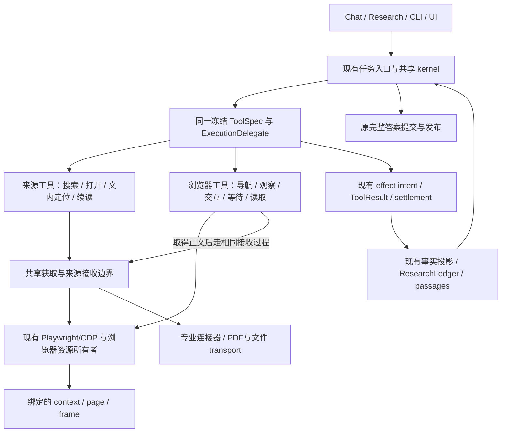

# 借鉴 agent-browser / agent-desktop：浏览器与 Research 的收敛设计

日期：2026-11-09（Asia/Taipei）。性质：源码审阅与设计建议，尚未实施。

本次核对 Codey `6648524e020a9cf0f88c522b0f752a5cca97be9b` 的工作树源码，以及两个本地参考仓库：agent-browser `4b0e9f01fa8d214d39bbfe5391257640634fb9a0`、agent-desktop `b43ac4f6e892ef608f8851428613c4009f0e84c7`。工作树原已有 `codey/runtime.json` 修改和两份上游审阅报告，本次没有改动它们。

## 1. 建议结论

下一步应把浏览器从一次性抓取器扩展为现有 kernel 可持续操作的资源，让 Chat 与 Research 共用网页获取实现，同时把每次实际读取固定为现有来源回执与不可变 passage。

最值得借鉴的组合是：

- agent-browser：持续页面、显式标签页绑定、观察与交互、条件等待、文档与元素身份。
- agent-desktop：命令定义与入口复用、严格目标解析、部分观察、动作投递与结果验证分离。
- Codey：已有的单一执行 kernel、冻结 ToolSpec、durable intent/settlement、来源回执、不可变阅读片段、完整答案提交与发布。

这两个参考项目提供的是操作环境的机制，不能证明某个研究结论正确。Research 质量仍取决于原问题理解、找到合适材料、读到关键章节、比较条件与冲突，以及最终解释。浏览器升级应让同一个 writer 能完成这些动作；不增加浏览器 agent、研究 supervisor 或另一个自动研究循环。

“单一事实来源”应落实为每类事实只有一个所有者、其他地方通过引用或可重建投影使用。它不要求所有事实挤进一张表，也不要求所有任务共用一个浏览器、context、标签页或线程。

## 2. 当前已有的收敛基础，需要保留

### 2.1 Research 已不是需要重新统一的第二套模型循环

[headless_runner.py](../../codey/app/headless_runner.py) 适配生产任务入口；[task_loop.py](../../codey/operations/task_loop.py) 暴露共享 kernel；[research_iteration.py](../../codey/operations/research_iteration.py) 组装 Research 的任务资源与合同。

[pipeline.py](../../codey/research/pipeline.py) 的 `ResearchPipeline.run()` 调用一次 `run_iteration`，随后审阅、投影并收尾；现有 outer-followup 计数对新研究归零。不能因为文件叫 pipeline、还有历史字段，就断言现在存在另一套自动补搜循环。

[test_architecture_no_legacy_loops.py](../../tests/test_architecture_no_legacy_loops.py) 已约束被删除的 follow-up、plan executor 等模块不得恢复。浏览器能力应进入这条已有主干。

### 2.2 来源与证据已经有可靠的原始记录

- [source_gateway.py](../../codey/research/source_gateway.py)：来源政策、获取、文档构建与打开记录。
- [task_execution.py](../../codey/operations/task_execution.py)：工具执行、临时观察、canonical 结果。
- [kernel_receipts.py](../../codey/operations/kernel_receipts.py)：完整工具回执及恢复。
- [kernel_facts.py](../../codey/operations/kernel_facts.py)：live/recovery 共用的事实投影。
- [ledger_receipts.py](../../codey/research/ledger_receipts.py)：从同一来源回执恢复正文、hash、时间和页码。
- [passages.py](../../codey/research/passages.py)：实际展示文字的不可变区间；引用绑定正文版本，不靠重新访问 URL 恢复。
- [answer_contract.py](../../codey/research/answer_contract.py)、[research_publication.py](../../codey/operations/research_publication.py)：完整答案与原发布事务。

尤其应保留 `_observation_tools()` 的原则：获取先修改临时 ledger，正式事实只在原结果提交后进入投影。浏览器中的页面已经变化，是外部现实；“本任务已经读过正文”，则必须有正式读取回执。这两个事实不能混为一谈。

### 2.3 多渠道检索已经有一部分改善

当前 [connector_search.py](../../codey/research/connector_search.py) 的 `search()` 在连接器结果之后仍调用 `_base_search()`，再合并去重；不是“连接器找到两个结果便完全跳过网页搜索”。浏览器失败时还能保留真实连接器结果。

应继续使用这条渠道组合逻辑。Chat 不必强制承担学术连接器策略，但其普通网页访问应与 Research 复用同一个底层实现。

## 3. 真正值得收敛的五个缺口

### 3.1 获取策略分散，而且方向相反

当前代码是：

```text
普通 Chat
  ChatWebProvider
    搜索：真实浏览器
    正文：HTTP → 仅 application shell 升级浏览器

Research
  ConnectorAwareSearchProvider
    专业连接器 / BrowserSearchProvider
    普通网页：浏览器 → 某些不可读页面再试 HTTP
```

依据：[chat_web.py](../../codey/research/chat_web.py)、[search_factory.py](../../codey/research/search_factory.py)、[browser_search.py](../../codey/research/browser_search.py)。[task_execution.py](../../codey/operations/task_execution.py) 的 `build_research_tools()` 根据 `browser_sources` 选择默认工厂。

这些路径已经复用了部分下载和浏览器实现，不应笼统说整个获取栈重复了两遍。但“何时用浏览器、何时回到 HTTP、怎样解释失败与保留会话”仍分别由不同 wrapper 决定，导致同一个 URL 因入口不同而有不同语义。

建议普通网页统一采用明确绑定的浏览器环境。公开 API、学术连接器、PDF/文件下载继续保留各自适用的 transport，由同一获取边界选择并记录实际 backend，不强行全部改成 DOM 操作。

### 3.2 浏览器资源仍主要服务抓取，缺少明确目标与接续语义

`BrowserSearchProvider` 保存 `_session`、`_search_page` 和 `_fetch_page`，但 `_fetch_page` 是供后续 URL 覆用的一张页，不是模型可按身份继续操作的一组来源页面。403、登录和不可读分支会丢弃页面；下一篇文章又会导航复用该读取页。

[automation/browser.py](../../codey/automation/browser.py) 的 `open_chat_page()` 会寻找匹配 host 的页面，必要时使用第一个 context。它适合原有 provider 寻址，尚不是“本任务明确绑定用户已打开的那张文章页”的证明。

此外，`ResearchPipeline.run()` 的 `finally` 会关闭 search provider；只删除 403 分支里的 close，无法自动获得跨任务或用户处理后的稳定接续能力。需要明确资源所有权与释放时机。

建议将连接、context、页面绑定与生命周期交给复用的浏览器资源所有者，通过现有依赖装配注入。provider 和工具取得该资源的使用权，不分别启动自己的页面管理器。跨轮需要保留的绑定进入原有 checkpoint/资源引用；活的 Playwright 对象仍归浏览器工作线程，不序列化进账本。

这不要求建立一个全局浏览器单例。不同任务可以有独立页面和执行 lane；同一个目标页只能由明确的操作序列管理。浏览器会话与模型网页 provider 也应有各自角色和标签页，不能为了“收敛”让网页检索导航掉模型会话。

### 3.3 文内定位后再次联网，缺少正文版本绑定

这是本轮相较先前 HTTP 失败排查新增的发现。

现有调用链为：

1. `ResearchSourceGateway.search_inside()` 在 ledger 中已保存的正文里定位。
2. `ExecutionDelegate._build_hit_mapping()` 生成的目标只有 `{url, offset, pages}`。
3. `open_hit` 解析这个目标后调用 `tools.open_url()`。
4. `open_url()` 再经 gateway 调用 `search_provider.fetch(url)`，将旧 offset 用于本次新获取。

依据：[source_gateway.py](../../codey/research/source_gateway.py)、[task_execution.py](../../codey/operations/task_execution.py)、[receipt_types.py](../../codey/research/receipt_types.py)。`reopen_source` 也会重新获取 URL。

因此若第一次定位发生在正文 V1，之后页面更新、展开或懒加载形成 V2，旧 hit 仍可能被用于 V2。当前不可变 passage 会固定最终真正读到的内容，所以不能说既有引用回溯整体失效；缺口在于“这次续读是不是刚才定位的同一段”没有被 hit 身份保证。

建议：

- 对已获取正文，定位与续读默认引用同一份原回执/正文 hash 与区间，不重新联网。
- 打开新网页、主动刷新或继续加载属于新获取；保留新的观察和正文版本。
- 同一 URL 的不同正文版本分别绑定，旧命中不能静默迁移到新版本。
- PDF 已捕获页内可直接阅读；缺失页需要新获取，记录新页与既有文档的身份关系，无法确认时保留差异。
- `source_id` 可以继续表示来源，但续读目标还应有版本身份。不要把 URL 本身升级成版本号。

这是将上游的“旧元素引用不能误用于新页面”延伸到研究材料，不能简单把 DOM ref 直接用作 passage ref。

### 3.4 工具合同对 Web 的重放假设需要细分

当前 [tool_spec.py](../../codey/toolchain/tool_spec.py) 将 `web.read` 对应的研究工具归为 safe，`web_search/open_url/source_search` 的合同还声明 `parallel_safe=True`。这与当前“取得材料”的抽象有关。

不能直接让新浏览器交互继承这些属性：导航、点击、填写、滚动都会改变页面状态；重新执行有可能作用于另一页面状态。即使业务上仍是“阅读资料”，也不等于执行上无状态。

目前 `_search_browser_worker()` 会串行执行浏览器作业，不能据此声称生产代码已经出现同页并发误读。真正的风险在扩展工具和并发后：若按每个底层步骤分别排队，导航 A、导航 B、读取 A 可能交错；完整的目标页操作必须保持其顺序边界。

建议先使用现有 ToolDispatch 的保守串行准入，浏览器状态动作默认非并行、不可盲目重放。不同冻结材料的文内搜索和区间读取仍可并行。有证据需要时再在同一资源所有者内部细化不同页面的并发，不新建研究调度器。

[task_effects.py](../../codey/operations/task_effects.py) 已优先从冻结 ToolSpec 记录 replay class；[replay_policy.py](../../codey/runtime/effects/replay_policy.py) 与 [safe_tool_replay.py](../../codey/runtime/effects/safe_tool_replay.py) 还有恢复准入约束。新增工具要对齐这些边界，而不是增加独立的 browser-retry 表。

### 3.5 新工具还要进入 Research 的证据与合同主干

只往全局 registry 注册 click/read 不够。[answer_contract.py](../../codey/research/answer_contract.py) 有 Research 可用工具集合；[kernel_facts.py](../../codey/operations/kernel_facts.py) 还决定哪些工具成为调查记录，哪些结果能形成来源读取事实。

浏览器观察、交互失败、继续等待都应能在同一调查历史中被看到；成功取得正文应经原来源转换与 passage 生成过程进入原引用通道。否则会出现“模型在浏览器里读到了，但正式答案不能引用”，或者“工具成功，所以错误地认定已读正文”两种分裂。

## 4. 两个参考项目分别借什么

| 机制 | 核验的上游实现 | Codey 的落点 |
|---|---|---|
| 长期连接与页面资源 | agent-browser `BrowserManager`、`DaemonState` | 复用 Playwright/CDP 与 BrowserWorker，扩展资源所有权，不复制 daemon |
| 目标页绑定 | agent-browser `tab_binding.rs`、`pin_tab`、`bound_target_gone` | 绑定实际 browser/context/target；页面丢失明确报错，不自动换另一页 |
| 文档与元素身份 | agent-browser `RefMap.observe_document()`、backend node；agent-desktop qualified ref | 目标页、frame、文档与观察身份进入同一原回执；旧 ref/歧义目标拒绝执行 |
| 观察、动作与等待 | agent-browser snapshot、click/fill、条件 wait | 由同一 writer 决定下一动作；工具只执行有界操作 |
| 不完整观察可表达 | agent-desktop `SnapshotResult.complete`、`nodes_observed`、`identity_unproven` | 裁剪、未展开、未加载保留范围；没看到不等于不存在 |
| 投递与验证分离 | agent-desktop `DeliverySemantics`、`OperationReport` | 在原 ToolResult canonical 中表达；点击已投递不等于文章已打开或事实已核验 |
| 响应丢失时不重发状态动作 | agent-browser `send_with_retry()`、`outcome_unknown` | 沿原 intent/settlement 恢复；先观察和核对，不自动再点击 |
| 多入口共用命令实现 | agent-desktop MCP 由 clap tree 派生、batch 使用原 dispatch | 继续从同一 ToolSpec/定义派生文本、native、CodeMode；入口只适配 |
| 浏览器与桌面分工 | agent-desktop `launch_suggestion()` 把 web content 交给 CDP 客户端 | 网页用现有浏览器栈；原生窗口、菜单和文件对话框才评估桌面 adapter |

上游源码入口：

- [agent-browser browser.rs](../../reference-projects/agent-browser/cli/src/native/browser.rs)
- [agent-browser actions.rs](../../reference-projects/agent-browser/cli/src/native/actions.rs)
- [agent-browser element.rs](../../reference-projects/agent-browser/cli/src/native/element.rs)
- [agent-browser snapshot.rs](../../reference-projects/agent-browser/cli/src/native/snapshot.rs)
- [agent-browser tab_binding.rs](../../reference-projects/agent-browser/cli/src/native/tab_binding.rs)
- [agent-browser connection.rs](../../reference-projects/agent-browser/cli/src/connection.rs)
- [agent-desktop delivery_semantics.rs](../../reference-projects/agent-desktop/crates/core/src/actions/delivery_semantics.rs)
- [agent-desktop ref_token.rs](../../reference-projects/agent-desktop/crates/core/src/refs/ref_token.rs)
- [agent-desktop snapshot/mod.rs](../../reference-projects/agent-desktop/crates/core/src/snapshot/mod.rs)
- [agent-desktop mcp/catalog.rs](../../reference-projects/agent-desktop/src/mcp/catalog.rs)
- [agent-desktop batch/mod.rs](../../reference-projects/agent-desktop/src/batch/mod.rs)
- [agent-desktop launch.rs](../../reference-projects/agent-desktop/crates/core/src/commands/launch.rs)

两个 ref 设计不同：agent-browser 展示 `@eN`，内部依赖 page/frame/session/loader/backend node；agent-desktop 显式使用 `@<snapshot_id>:eN` 并检查目标身份。应借鉴身份约束，不同时引入两套 ref 语法和解析器。

loader 身份也不覆盖全部变化：SPA 同文档更新、DOM 节点替换、展开和滚动加载都可能不产生新 loader。元素动作仍要验证当前节点与唯一性；研究正文版本仍以实际捕获内容为依据。

## 5. 目标结构：一个执行主干，明确的资源与证据边界



图中的获取与来源接收是职责边界，不意味着新增一个与 gateway 并列的总管。可以从现有 `ResearchSourceGateway.open()` 和 `_source_document_from_fetch()` 提取共同的已获取材料接收过程，让 URL 获取与当前浏览器正文捕获共用。

低层浏览器函数只操作和观察，不写 ResearchLedger；gateway 构建临时来源观察；ExecutionDelegate 生成原 canonical 结果；原 kernel 提交后统一投影。不能让 browser_read 和 open_url 各自实现一套证据写入。

`open_url` 仍可作为便利操作，在同一实现中完成导航和正文捕获，一次原效果回执记下内部步骤。普通页面不必增加数轮模型调用。遇到加载、登录、验证、展开或分页时，结果交回原 writer，由它决定是否继续操作。

## 6. “单一事实来源”的具体所有权

| 事实 | 唯一所有者 | 其他部分怎样使用 |
|---|---|---|
| 工具身份、参数、执行与重放合同 | 原定义 → 冻结 ToolSpec | 文本/native/CodeMode 从同一份派生；UI不另猜 |
| 网站登录与存储状态 | 实际 browser profile/context | 保留或连接正确实例；不维护第二套“已登录”真假表 |
| 当前任务的目标页与资源使用权 | 注入的浏览器资源绑定 | 工具传目标引用；持久绑定走原 checkpoint/资源记录 |
| 本次是否发起动作、拿到何种结果 | 原 durable intent + settlement 与完整 ToolResult | UI、恢复、调查历史均投影同一结果 |
| 某时刻观察到的页面与范围 | 原观察回执及其受管产物 | AX树、截图、DOM是有范围的不同表示，共用观察身份 |
| 捕获到的正文版本 | 原来源回执/受管正文 | 版本身份与内容 hash 派生，不用 live URL 替代旧正文 |
| 实际展示给模型的可引用文字 | 原 passage descriptor 与完整回执 | 延用现有引用通道；取得全文不等于模型已读全文 |
| 已发布答案与知识版本 | 原提交和发布事务 | 不另写浏览器报告库或第二套答案持久化 |

这里允许内存缓存和 UI 投影，条件是它们可以从原记录恢复，且没有独立推进事实的权力。不要增加 `browser_ledger.json`、浏览器专用恢复日志、另一套 eN 注册表或自行决定任务完成的 browser session 状态机。

绑定可以包括 browser instance/连接代次、context、targetId、frame 和 ownership。endpoint 只是地址，端口可能被另一实例复用；不能仅凭端口相同认定恢复了原浏览器。进程重启后先核对存活目标，再决定是否接续；DOM ref 不因旧回执存在而自动仍可操作。

同一 context 的标签页可共享部分网站状态，却不保证共享 sessionStorage 等页内状态。要复用用户已能打开的文章，最直接的办法是显式选择并绑定那张页，不能只连到同品牌浏览器或相同域名。

## 7. 浏览器结果需要区分三类事实

建议在原结构化结果中分别表达：

1. **执行事实**：动作未投递、已投递但未验证、投递不确定、已有后置条件验证。
2. **页面观察**：实际 URL/title、HTTP 状态（若取得）、页面文本/控件、加载或验证线索、观察裁剪范围。
3. **来源读取**：是否取得目标正文、正文版本、实际展示区间、可引用 passage。

这些不是三个独立数据库，也不一定需要照搬上游字段名。可以将浏览器观察与投递信息放入原 `ToolResult.canonical`，继续使用既有 `research_observation/read_passages/source_acquisition` 表达来源事实。

例如：

| 现场 | 可以确认的事实 | 还不能确认的事实 |
|---|---|---|
| 页面导航完成，显示 403 验证提示 | 导航/观察成功，正文受限，页仍可继续观察 | 文章已读、验证一定能解除 |
| 点击“展开全文”动作投递 | 动作已发送 | 全文已出现、正文已完整读到 |
| 用户在同页完成处理后重新读取 | 新的观察和已捕获正文 | 原先失败的读取已追溯成功 |
| 动作发出后响应超时 | 结果不确定 | 动作未执行、可以原样自动重发 |
| 取得全文，但只展示一个窗口 | 捕获范围与实际阅读区间 | 模型已读到所有章节 |

导航工具成功可以只表示导航操作成功；`open_url` 的成功仍应表示其来源读取合同得到满足。不能为了减少红色失败标签把验证码页记作文章。失败标签的细化应该来自原结构化结果，而不是前端分析报错字符串。

页面状态描述也要保留观测依据。没有通用、完美的验证码或正文识别器；应允许 unknown，并展示实际提示与范围，不能新增一个凭域名/关键词就替模型宣布事实已核验的分类器。

有界 `wait` 可以轮询具体条件；需要用户处理时应返回并使用原任务的询问、接续与取消机制。若接续能力有缺口，扩展原生命周期，不能把工具变成长期阻塞、私自调用模型的内层 agent。

## 8. 如何让 Research 真正变好

### 8.1 发现、导航和证据读取各司其职

`web_search` 继续产生线索；模型可以打开结果或沿页面链接寻找原始材料。浏览器快照用于理解当前页面和选择操作；当前页的正文读取进入既有证据流程。

保留 `source_search` 这类离线定位工具。已经取得正文后，查找和续读默认针对冻结材料；不必回到页面滚动，也不必重复下载。只有未加载内容、动态控件或所需页面不在捕获范围内时，才继续操作浏览器。

研究中的导航页不一定能直接充当证据页。现有 `source_candidate_skip_reason()` 会筛除部分宽泛首页；这个证据筛选规则不应直接成为浏览器禁止导航首页、登录页或目录页的规则。网络准入仍沿用原政策，导航与来源入账分别满足各自合同。

### 8.2 让关键章节真正进入模型可见范围

上游的 compact/interactive snapshot、局部观察、delta 有助于压缩导航输入；它们不会自动给模型正文。特别是只保留交互控件的快照，可能省略整篇文章文字。

正文窗口继续复用 [answer_context.py](../../codey/research/answer_context.py) 的预算和已读片段展示。目录、摘要、正文、已加载部分分别保留身份；处理长文时可以定位方法、限制、版本或反例段落，而不是每次只重读开头。

若使用增量快照，必须有基线观察引用，基线丢失时回到完整观察，不能让模型把缺上下文的 delta 当完整页面。图片、AX树和 DOM 不是彼此完全等价的表示；跨 frame、Shadow DOM、画布、隐藏文字和懒加载范围应如实记录。未来图像/OCR 作为证据也应接回同一来源主干，本轮设计不把它假定为已有完整能力。

### 8.3 补搜仍由同一个 writer 对照原问题决定

同一个 writer 根据原任务、已读段落和真实失败记录选择：

- 材料已有但未读到关键内容：文内定位与续读。
- 页面内容未加载：在绑定页展开、等待、滚动或翻页，再捕获新版本。
- 对象、时间或版本不符：调整检索。
- 只有转载或概述：沿引用查原始材料。
- 来源冲突：比较条件并继续查证。
- 获取仍不可行：交付有依据的 partial/unresolved，并保留缺口。

缺口列表可以是当前任务与回执的投影，不需要另一套持久计划或自动 corpus critic。已有 ANSWER_GUIDANCE 与工作视图应保持单一来源，避免系统提示、工具描述和补救提示各复制一段研究流程。

这能改善可采取的研究动作与证据定位，但是否提高最终答案质量，必须单独比较。更多页面、更多点击或更少 Tool failed 都不是研究质量的充分指标。

## 9. 不建议照搬的部分

- **整套 agent-browser CLI/daemon 作为永久并行实现。** 它不是第二套模型循环，但会给已有 Playwright/CDP 再增加 session、配置、页面绑定、重试和资源生命周期。本目标下优先借鉴机制；若未来选择替换 backend，应让它接管同一边界并退役旧实现。
- **agent-browser 的可选 chat/flow/MCP 生态整体引入。** 当前普通浏览器核心是 Rust + CDP；可选 chat 另有模型能力，Codey无需采用。MCP只是入口协议，并不会天然消除重复状态。
- **`read URL` 当成浏览器读取。** 上游 `handle_read()` 对显式 URL 调 `read::run_read()`，仍走 HTTP；当前页普通 read 才取得 active tab HTML。接错入口会重现环境差异。
- **将整个网页操作改成 UIA 或截图坐标。** agent-desktop 自己把 Chromium 内容工作交给 CDP。Codey 已有相应驱动；桌面 adapter 应有明确补充用途，不另造网页读取栈。
- **把 Cookie 状态文件当原浏览器完整副本。** 上游保存 Cookie/localStorage/sessionStorage，并不是所有网站状态的完整镜像。
- **默认页面绑定、默认重试、默认工具集全部照抄。** 上游 pin-tab 并非无条件默认启用，普通 snapshot 与 MCP 默认选项也有差异；Codey 应定义自己的统一产品合同。
- **为了收敛强制所有线程和所有会话共用一页。** 这会引入相互干扰。应统一实现与所有权，保留必要的资源隔离。
- **给每个网站堆特殊规则。** 优先使用通用的目标身份、条件等待、交互和捕获范围；站点 adapter 只有在明确能力缺口与实测收益下才值得维护。

受会话保护的 PDF/下载还需注意：现有 browser fetch 遇 PDF 会进入独立下载路径。保留下载 transport 是合理的，但需要认证的文件应明确使用合适的浏览器关联请求或下载事件，记录实际取得的字节来源，不能假定独立 HTTP 自动继承会话。

## 10. 建议实施顺序与同步退役项

| 批次 | 实际交付 | 同批应合并或退役的重复责任 | 主要验收 |
|---|---|---|---|
| 1. 来源版本与续读 | hit/续读绑定原正文回执与版本；已捕获内容不重新联网 | 用旧 offset 读取新下载正文的隐式行为 | 动态正文 V1/V2、同 URL 不同版本、PDF 缺页、恢复不 refetch |
| 2. 浏览器资源与身份 | 通过已有依赖装配绑定 browser/context/page；明确所有权与使用期 | provider 各自决定重连后任取页面和独立管理同一绑定 | 两任务、用户切换页、页面关闭、端口复用、attach/owned 释放 |
| 3. 网页获取统一 | Chat/Research 普通网页使用同一浏览器获取；渠道策略可不同 | `ChatWebProvider` 与 BrowserSearchProvider 两处方向相反的升级/回退决策 | 静态页、SPA、头条、403、连接器、PDF，真实 backend 与回执一致 |
| 4. 观察与交互 | 精简工具进入原 ToolSpec、权限、dispatch、取消、重放、Research scope | 交互专用 schema/重试/事实写入分支 | stale/ambiguous ref、超时后不重发、校验页保留与用户接续 |
| 5. 阅读与研究质量 | 当前页捕获接原 gateway；关键章节、动态内容、多来源比较 | 浏览器专用证据缓存/第二份研究状态，若实现中出现须同步删除 | 关键原文读到、版本不漂移、答案有支持、诚实缺口与真实交付 |

这是逻辑依赖顺序，不要求用户逐批批准。完整浏览器能力不会由前一两批单独完成；每批都应有可审阅结果，并明确剩余能力。

迁移期间可以短期保留明确的旧/新候选做对照，但应定义删除条件。生产目标是一个普通网页获取策略所有者、一个浏览器资源实现边界和原有一套事实提交链，不长期维护 browser-v2 与旧路径的双轨。

## 11. 验证：分别证明架构正确与研究质量改善

架构/契约验收应至少覆盖：

- 新工具的文本/native/CodeMode 使用同一冻结定义；未授权动作按原政策拒绝，不让网页读取能力隐式获得任意交互权限。
- 同一目标页的动作有序；不同目标不会因“当前活动页”改变而串页；原 browser worker 的取消和迟到结果丢弃约束保留。
- 动作已投递但响应丢失时，恢复不自动重发；已有读取回执恢复不访问 live URL；新观察与旧已读事实分开。
- 观察成功且正文受限时不记 sources_read；取得正文后只走原来源/passage 投影；失败与部分观察仍可进入原调查历史。
- 任务结束只释放拥有的资源；用户绑定页与长期会话按明确生命周期处理；owned 浏览器的终止行为有覆盖。
- V1 正文定位后即使线上变成 V2，旧 hit 仍读 V1 或明确拒绝，不以旧偏移静默读取 V2。
- 普通网页与 PDF 的已有可用能力保留；断连、取消、超时、页面丢失的失败都保留原始结果。

真实访问与研究效果另外验收：

| 类别 | 代表场景 | 要证明什么 |
|---|---|---|
| 会话一致性 | 用户能看的知乎页 | 实际连接与读取的是预期实例和页面；仍受限也保留真实观察 |
| 动态内容 | 头条、展开、懒加载、分页 | 原 HTTP 无正文的情况能取得实际目标内容，并记录范围 |
| 阅读质量 | 长文方法/限制/版本题 | 对应段落实际进入模型可见范围，不只增加页面总数 |
| 研究决策 | 多来源、转载溯源、冲突 | 同一 writer 采取有效补搜与比较，而非重复相同操作 |
| 最终答案 | 全题交付和未解决部分 | 关键断言有支持、条件正确、来源可追溯、缺口诚实 |

先用本地可控页面确定身份、版本、交互和恢复合同，再用真实网站验证会话与动态能力，最后在固定模型与任务条件下比较研究结果。旧失败题可以用于开发和回归，最终质量判断还需要新题；调用数、tokens 和耗时记录为成本与诊断，不能把更多工具动作本身当作收益。

本轮只阅读源码并新增本文；没有修改生产代码、配置或测试，没有安装/运行两个上游程序，没有连接用户浏览器，也没有执行模型质量对照或测试。因此本文给出的是有源码依据的设计与风险定位，不宣称改造已完成或 Research 质量已提升。
