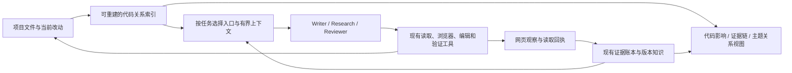

# CodeGraph、Graphify 对 codey 的借鉴分析（2026-11-19）

结论：**借鉴两个项目的思路和实现细节，在 codey 内独立实现 agent 可用的统一工作图，让研究依据、实现决策、代码关系和执行结果能够双向查询。** CodeGraph 提供代码结构与任务上下文组织的参考，Graphify 提供混合资料关联与图查询的参考；UI 展示同一张工作图。

用户已明确不需要复用源码或接入两个外部产品。具体的跨域关系、agent 查询入口、增量更新和验证方案见[统一工作图设计](agent-work-graph-design-20261119.zh-CN.md)。下文保留参考项目源码分析和已完成检查，实施方向以该设计为准。

本轮按用户要求只拉取项目、阅读源码、编写并运行局部测试、生成分析材料。**未修改 codey 或两个参考项目的生产代码，未安装它们的 CLI/MCP、未修改模型配置，也未对 codey 建立全仓库图索引。** 分析依据当前工作区，保留用户正在进行的修改；效果建议是待验证方案，不是已经实现的收益。

两个项目已完整克隆到指定参考目录，均保留自己的 Git 历史：

| 项目 | 本地路径 | 拉取分支 / 版本 | 本轮审阅提交 |
|---|---|---|---|
| CodeGraph | `D:\codey\reference-projects\codegraph` | `main` / `1.6.3` | `e879216bba01cdc3b860405b750276549a1217ea` |
| Graphify | `D:\codey\reference-projects\graphify` | `v8` / `0.9.112` | `340268a70a83588d6b3c6de1fffb05326350ef1d` |

`reference-projects/` 已由现有 `.gitignore` 排除，本次不需要修改忽略配置。以下源码链接指向这些本地检出；上游固定快照分别是 [CodeGraph](https://github.com/colbymchenry/codegraph/tree/e879216bba01cdc3b860405b750276549a1217ea) 和 [Graphify](https://github.com/Graphify-Labs/graphify/tree/340268a70a83588d6b3c6de1fffb05326350ef1d)。

**先区分 codey 已经有什么，才能确定实际增量。**

| 领域 | codey 当前实现 | 值得补强的部分 |
|---|---|---|
| 编码导航 | 有界 Project Map、符号概览、文件元数据索引、diff 中的明显符号提取 | 持久或可复用的跨文件调用/引用图；按任务返回可解释的相关代码；修改影响与测试候选 |
| 上网研究 | 搜索、来源读取、问题覆盖、证据账本、HTTP/浏览器获取状态 | 让已读资料之间的关系帮助选择下一条查询或下一份来源；降低重复探索 |
| 浏览器 | 已有页面观察、动作回执、失败分类和继续执行逻辑 | 把观察结果更清楚地交给后续研究和知识系统；两个项目不能直接补齐 DOM 操作能力 |
| 知识沉淀 | SQLite 正式存储、稳定身份与 revision、条件、来源、反证/限制关系、作用域召回 | 更好的任务种子选择、领域导航、别名候选和新旧知识对照；保留现有证据边界 |
| 图谱界面 | Canvas 拖拽、缩放、悬停邻接高亮、节点详情、部分边详情、来源跳转、深度选择 | 图内搜索与筛选、稳定的链路视图、关系来源的直接解释、历史导航、键盘可操作替代视图 |

对应代码：[Project Map](../../codey/workspace/map.py)、[文件索引](../../codey/workspace/file_index.py)、[变更符号](../../codey/workspace/changed_symbols.py)、[知识对象](../../codey/knowledge/model.py)、[作用域召回](../../codey/knowledge/recall.py)、[来源快照](../../codey/research/source_snapshots.py)、[获取状态](../../codey/research/source_acquisition.py)、[现有图谱界面](../../frontend/src/research_graph.ts)。

其中一个重要细节是：[统一图谱入口](../../codey/knowledge/concepts.py)会优先返回版本图；没有适用的版本图时，才走概念图与旧笔记证据图组合。不能假设所有会话都能直接获得同一套概念社群数据。现有概念图也已经有“缺失连接”建议，并明确不把它们保存或绘制成事实边；这部分不需要重新发明。

**CodeGraph 的主要价值是把一次代码探索变成一个有来源的任务上下文。**

它的流程是结构提取、跨文件解析、SQLite 节点/边与 FTS、增量更新，再提供任务查询。默认 MCP 工具表只列出 `codegraph_explore`，其他专门查询仍可启用。返回内容包含相关符号原文、位置、调用路径和影响摘要。对 codey 的网页模型和较小本地模型，这种“少量入口、明确结果”值得做对照实验。

最值得借鉴的四处实现：

1. **相关代码与关系一起返回。** 不只回答“看这个文件”，而是给出相关代码范围、为什么相关、调用者/被调用者，以及路径中的不确定环节。codey 可将这种能力接到现有项目工具和上下文预算中，避免每轮重新寻找代码结构。
2. **文件变化会使旧答案失效。** 它跟踪待同步文件，并在 watcher 降级时对回答依赖的文件做有界内容哈希检查；超时或缺少哈希保留 `unchecked`，不假装已经验证。codey 已有 context epoch、文件索引与读取回执，新增代码图应复用这些身份和失效语义。
3. **动态调用的来源与终点可见。** 合成边记录 callback、事件、HTTP 路由等连接来自哪里；静态分析走不通时，显示边界和候选，不把候选直接当成调用。codey 的 Python 动态分发、工具注册和前后端连接也需要这种表达。
4. **按当前上下文去重。** 同一文件内容未变时，已提供的代码范围可以用精确指针代替；内容变了就重新返回。借鉴到 codey 时还必须检查原内容是否仍在当前模型上下文中：已经压缩、淘汰或没有交付给模型的内容，不能仅凭“曾经发送过”而省略。

实现依据：[工具层](../../reference-projects/codegraph/src/mcp/tools.ts)、[回答新鲜度](../../reference-projects/codegraph/src/mcp/answer-freshness.ts)、[去重](../../reference-projects/codegraph/src/mcp/explore-dedup.ts)、[会话状态](../../reference-projects/codegraph/src/mcp/explore-session-state.ts)、[合成边解释](../../reference-projects/codegraph/src/graph/synthesized-hop.ts)、[静态边界报告](../../reference-projects/codegraph/src/graph/dynamic-boundary-report.ts)、[SQLite schema](../../reference-projects/codegraph/src/db/schema.sql)。

不宜直接照搬它“相信结果、不要再读取”的提示策略。codey 的精确编辑和验证仍需要现有正式读取/执行回执。**只有当图工具交付的原文符合 codey 原有读取合同，并记录实际交付范围、内容版本和调用身份时，才能讨论复用该读取资格。** 仅有符号摘要或调用路径不能赋予编辑资格。

另外，少调用工具不等于上下文占用更小。CodeGraph 自己的[残留上下文报告](../../reference-projects/codegraph/docs/benchmarks/residual-context-occupancy.md)报告了检索内容在多轮会话中驻留更多的现象。codey 应测试“小范围原文 + 按需展开”，同时记录累计输入与当前窗口占用，不能直接采用 README 的节省比例。

**Graphify 的主要价值是把代码与资料变成可查询、可追溯的关联网络。**

它用确定性的结构抽取处理代码，文档/PDF/图像等语义抽取另走模型路径，再建立 NetworkX 图、聚类、生成报告并提供查询。代码抽取无需模型不代表文档和图像理解也没有模型成本。查询能按关键词/名称选种子，再返回有预算的邻域；也支持外部检索器提供种子。这一点适合让 codey 既有检索选出入口，再沿关系补充少量相关背景。

值得借鉴的能力及限制如下：

| 能力 | 对 codey 的用途 | 必须保留的边界 |
|---|---|---|
| `EXTRACTED / INFERRED / AMBIGUOUS` 来源分类 | 解释连接从原文抽取、解析推导还是仍有歧义 | 抽取到一条关系不代表该主张真实；类别或分数也不是经校准的事实正确概率 |
| 带方向的路径与最弱环节说明 | 回答“这个结论如何连到来源”“这个模块如何影响另一个模块” | 最短路径不能当证明；各类关系不能自动传递；无路径也可能是索引遗漏 |
| 社群、关键节点、跨社群连接 | 形成领域导航、发现资料空白、推荐下一步研究问题 | 高频和高连接度只影响导航，不能提高证据强度；综述、转载和同源论文不能算独立支持 |
| 混合资料与来源位置 | 代码、ADR、论文、网页摘录可以互相定位 | 保留来源快照/页码/内容哈希；不能用后来的网页正文替换旧证据 |
| 查询结果与 outcome/correction 回流 | 保存“问题—所用资料—结论—执行结果—纠正” | 旧答案继续作为答案或经验保存，不再抽取为新的独立证据；结果修正应有版本 |
| 内容缓存与增量更新 | 降低重复抽取成本 | 提取器版本、grammar、内容和作用域都影响有效性；删除、改名和切分支需要同步清理 |

实现依据：[查询与路径](../../reference-projects/graphify/graphify/serve.py)、[社群划分](../../reference-projects/graphify/graphify/cluster.py)、[缓存](../../reference-projects/graphify/graphify/cache.py)、[输入校验](../../reference-projects/graphify/graphify/validate.py)、[网页导入与查询回流](../../reference-projects/graphify/graphify/ingest.py)。社群实现优先使用 Leiden，相关依赖不可用时可回退到 NetworkX Louvain，不能把所有安装都描述成必然运行 Leiden。

Graphify 的网页导入主要是获取 HTML、转换 Markdown、保存 URL 和时间等字段，不是可替代 codey 的浏览器执行器。它没有因此解决登录、动态表单、标签页状态、点击后读回或实际动作采用问题。更适合借鉴的是：**codey 获取成功的观察进入证据/知识后，怎样更容易被后续任务发现和使用。**

这也与 codey 现有的[网页行动能力诊断](model-web-action-capability-result-20261118.zh-CN.md)相符：拿到相关链接仍重复搜索、来源失败后编造正文归属，都不是增加关系边就能解决的问题。图谱最多帮助选择“下一份应读来源”；实际读取、正文交付和回答采用仍要分别验收。

**UI/UX 值得借鉴，但应按用户正在做的事选择图的形式。**

CodeGraph 当前 UI 有一个很明确的设计决定：代码阅读不以整张力导向节点图为中心，而是围绕单个符号、调用流和模块地图。Graphify 则适合以社群着色的关系探索。两者可以在 codey 中分别服务于不同任务。

| 建议视图 | 借鉴对象 | 用户实际要完成的事 | 适合的交互 |
|---|---|---|---|
| 代码影响视图 | CodeGraph Symbol / Flow / Map | 看懂调用链，判断改动涉及哪些文件与测试候选 | 中间源码、两侧调用者/被调用者；连线关联调用行；稳定分层；展开回调来源和分析边界 |
| 证据链视图 | CodeGraph 的稳定流式阅读方式 + codey 版本知识 | 从回答或主张追到证据，并检查条件、反证与版本 | 主张、证据、来源卡片；每条边可解释；反证/限制并列显示；打开已保存摘录与当前网页是两个明确动作 |
| 主题关系视图 | Graphify 社群探索 | 熟悉一个领域，发现值得继续查的问题 | 搜索定位、类型/状态/来源筛选、邻域聚焦、社群折叠、按需扩展；候选关系默认不混入已确认关系 |

CodeGraph 的[设计规格](../../reference-projects/codegraph/docs/design/codegraph-ui-design-spec.md)、[地图布局](../../reference-projects/codegraph/ui/src/lib/map-model.ts)、[调用流布局](../../reference-projects/codegraph/ui/src/lib/flow-model.ts)尤其值得读。其布局按依赖层或源代码行计算；相同输入可稳定重现，载荷顺序变化时节点坐标仍稳定。它还把合成边与不确定边画成不同线型，并显示静态路径结束处。

Graphify 的[HTML 导出器](../../reference-projects/graphify/graphify/exporters/html.py)已经实现搜索、社群复选框、邻居导航、节点详情及按来源类别区分的边样式。大图有明确限制：默认上限为 5,000 节点，给定 `node_limit` 时可以生成社群聚合视图；不能把聚合后的线误读成一条具体事实关系。

对现有 codey 图谱，优先可做的改进：

- **图上搜索和筛选。** 搜索命中先定位节点，再显示可展开邻接项；类型、状态和关系筛选应显示隐藏数量。
- **让“为何相连”直接可见。** 当前已经能点击部分边看详情，应增强为结构化展示关系、原文位置、版本、抽取方式和适用条件，不重复实现另一套详情存储。
- **让状态有独立视觉含义。** 当前节点基本共用同一个填色；反证和候选/virtual 边也可能共用虚线。应分别表达节点类型、关系语义和不确定性，配合文字/图例，不能只靠颜色。
- **链路阅读使用稳定布局。** 证据追溯和代码调用适合有方向的固定层级；主题发现可以保留可拖拽关系图。进入详情、返回、展开邻域应保留选择和视口。
- **给关系配可执行入口。** 来源节点可打开保存快照；候选问题可追加到研究计划；代码符号可进入源码；影响项可加入验证候选。每个按钮调用 codey 既有能力，不能绕过项目权限和执行授权。
- **增加列表/键盘入口。** Canvas 之外提供可聚焦的节点与关系列表、可读名称和筛选结果，兼顾小屏、键盘和辅助技术。

当前图规模默认约 96 个节点，后端限制为 200；前端布局有成对节点排斥计算。先改善语义和操作，再讨论放大到几千节点。不要简单提高限制并照搬整仓库动画。

框架成本也不同：codey 前端是原生 TypeScript，CodeGraph UI 是 Svelte 5 + `@xyflow/svelte`。纯 TypeScript 布局算法和交互原则适合选择性移植，直接接入其整套组件会引入额外框架。Graphify HTML 则在本轮浏览器检查中确认依赖 unpkg 上的 vis-network；断网时图无法绘制。codey 若采用图形库，应走现有本地构建与资源交付。

**建议保留两种事实来源，以统一的查询和展示连接它们。**



代码索引从当前文件重建；正式知识继续由 SQLite repository 和 revision 管理。跨域连接使用明确的引用：例如“某个知识版本被这次实现采用”“某次执行验证了这份代码版本”。测试文件引用一个符号只能说明可能相关；只有真实执行回执才能说明某次检查通过。图的展示和查询共享同一事实模型，不能各自推导不同版本的结果。

实现方向是在 codey 现有扫描、tree-sitter、知识与回执基础上独立实现小范围代码关系索引和跨域查询。先覆盖 Python/TypeScript 及现有资料流程，以工作区版本、知识 revision 和实际回执连接研究与实现。Graphify 的查询、分类与社群设计作为参考，CodeGraph 的解析、任务上下文与失效处理作为参考，不引入两个外部产品作为生产依赖。

此前的许可证讨论针对复制和分发参考源码。用户已明确只借鉴思路并独立实现，因此它不作为本方案的技术路线选择因素。后续分析重点转向图怎样帮助 agent 获取上下文、行动和积累结果。

**推荐先实验，再按结果决定生产实现。**

1. **冻结基线和对照数据。** 编码准备跨文件理解、修改影响、同名符号、动态分发和改动后旧索引五类任务；研究复用已有网页行动探针，再补同源转载、反证、条件变化和过期来源；知识补跨项目隔离、版本撤回和压缩后重新取回。验收看真实动作、正确性与来源，不只看生成答案是否流畅。
2. **先做跨域工作图试验。** 基线是现有代码和研究工具，实验组增加连接研究依据、决策、代码和执行结果的有界关系上下文；保持模型、任务、生成参数、权限、回合预算和评分标准一致。覆盖“资料指导实现”“代码回查依据”“依据变化后定位待复核实现”三个方向，先比较离线召回，再比较真实模型多轮行为。记录构建成本、工具调用、延迟、累计输入、驻留上下文、答案质量和漏掉的依赖。对代码改动另验收实际测试结果。
3. **做现有图谱的交互试验。** 先用现有真实图 payload 验证搜索定位、关系解释、状态可辨、回到原位置和键盘导航，不依赖先接入新的索引后端。让用户完成“找来源”“看反证”“追影响”任务，比较耗时、误读和操作次数。
4. **研究阶段只增加候选导航。** 基于缺证、矛盾、未覆盖问题和来源独立性生成少量下一步候选；保留现有模型选择和执行链路。验收重复搜索是否减少、相关正文是否成功进入模型、失败后是否恢复、引用归属是否准确；若没有改善，就不把候选导航升级成生产编排器。
5. **有收益后再扩大知识组织。** 增加社群和跨会话关联之前，先证明作用域、别名、版本失效和反证不会被聚合破坏。高连接度主张不应挤掉低频但直接相关的反证。

可以将“零跨项目泄漏、零伪造读取回执、修改后旧代码不被误当新版本”设为必过项；收益门槛在实验开始前按任务成本确定。本轮没有数据支持“编码一定提升多少”或“研究成功率提高多少”，上游 benchmark 只能作为实验线索。

**本轮已经执行的验证为 31 项局部检查，全部通过。**

| 范围 | 结果 | 实际覆盖 | 未覆盖 |
|---|---|---|---|
| CodeGraph 原始模块 | 15/15 | 不变内容去重、编辑后失效、新范围保留、会话无历史时不省略、固定输入布局一致、重排后坐标稳定、循环与弱布局依据提示、关系线型、当前/变化/缺失/无哈希文件状态 | 完整引擎构建、Rust kernel、全仓库抽取、watcher 长时稳定性、完整 UI 浏览器验收 |
| Graphify 核心模块 | 12/12 | 有向路径、反向无路径提示、最弱环节、未知来源类别、查询邻域、同名歧义、反向依赖、有效/无效 schema、HTML 控件、5,001 节点限制和显式聚合 | AST 提取完整性、真实模型语义抽取、学术研究质量与代码任务收益 |
| Graphify HTML 浏览器 | 4/4 | 合成三节点图绘制、搜索打开详情、社群隐藏、离线缺少 CDN 时不绘图 | codey 接入、真实大图交互性能、浏览器代操作能力 |

CodeGraph 检查使用工作区已安装的 TypeScript 编译器转译所需原模块后执行；不是完整构建或类型检查。Graphify 检查直接导入所审阅版本的 Python 模块；浏览器检查运行它真实生成的 HTML，但数据是合成 fixture。5,001 节点检查只证明默认拒绝和两社群聚合路径，不是 5,001 节点浏览器性能测试。

可复跑材料保存在现有忽略目录 `artifacts/reference-graph-review-20261119/`，未加入生产测试发现路径：

- [CodeGraph 检查脚本](../../artifacts/reference-graph-review-20261119/codegraph_smoke.cjs) / [结果](../../artifacts/reference-graph-review-20261119/codegraph-smoke.json)
- [Graphify 核心检查脚本](../../artifacts/reference-graph-review-20261119/graphify_smoke.py) / [结果](../../artifacts/reference-graph-review-20261119/graphify-smoke.json)
- [Graphify 浏览器检查脚本](../../artifacts/reference-graph-review-20261119/graphify_browser_probe.py) / [结果](../../artifacts/reference-graph-review-20261119/graphify-browser.json) / [合成图界面截图](../../artifacts/reference-graph-review-20261119/graphify-fixture-ui.png)

在 `D:\codey` 运行：

```powershell
node artifacts/reference-graph-review-20261119/codegraph_smoke.cjs
python artifacts/reference-graph-review-20261119/graphify_smoke.py
python artifacts/reference-graph-review-20261119/graphify_browser_probe.py
```

以上脚本依赖本地参考检出及当前环境已有的 TypeScript、NetworkX、Playwright 等模块；浏览器在线绘图检查还需要访问上游 HTML 引用的 CDN。脚本和结果是本机研究材料，报告可以进入版本管理，克隆及 artifacts 不会随之提交。
