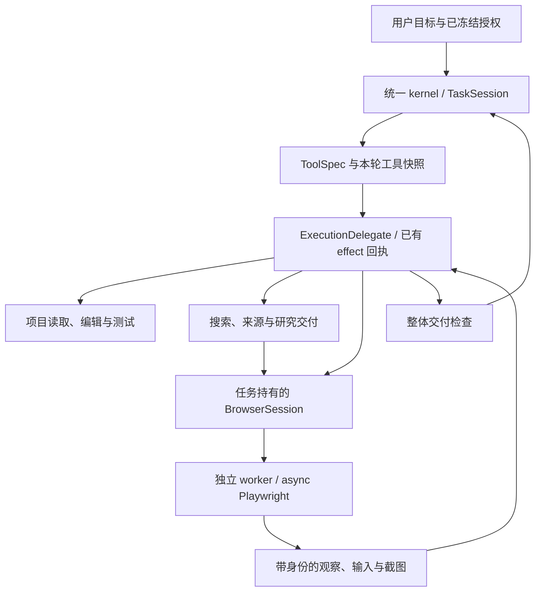

# Codey 统一任务与浏览器能力：函数级重构方案

日期：2026-11-21，Asia/Taipei。状态：实施前函数级设计基线；当前实现及未通过验收项见[实施与验证](codey-unified-agent-browser-worker-and-validation-20261121.zh-CN.md)。

本文整合此前的能力融合、开放网页、登录接管与静态对照结论，作为后续实施主文档。代码中的现有函数与拟新增函数明确区分；新名字是本方案的接口约定，不声称当前已经存在。

## 导航

- [0. 范围、基线与决定](#s00)
- [1. Codex / agent-browser 的函数级借鉴](#s01)
- [2. 目标架构与数据合同](#s02)
- [3. 入口、授权与工具目录](#s03)
- [4. 共同交接与组合完成](#s04)
- [5. 浏览器资源与生命周期](#s05)
- [6. 执行通道、取消与 durable 恢复](#s06)
- [7. 文档、frame、元素与定位](#s07)
- [8. 观察、增量与截图](#s08)
- [9. 输入、等待与查询恢复](#s09)
- [10. 网页获取、搜索与来源](#s10)
- [11. 工具协议、CodeMode 与图像回传](#s11)
- [12. 人工协助和 UI](#s12)
- [13. 测试矩阵](#s13)
- [14. 分批实施、迁移与删除清单](#s14)
- [15. 静态验收与完整交付条件](#s15)

<a id="s00"></a>
## 0. 范围、基线与决定

### 0.1 唯一产品目标

一个用户任务可以自然执行：读项目 → 搜索资料 → 浏览器操作 → 阅读证据 → 修改代码 → 跑测试 → 回到浏览器 → 再研究 → 最终交付。所有活动共用任务身份、授权、来源与工具回执，以及可恢复的浏览器资源；用户不需要切换模式或选择 Hybrid。

研究是过程活动和交付质量要求，浏览器是共享能力，编码是项目能力。内部仍分模块，但不能用活动名称隔断已授权能力。

### 0.2 基线与证据

- Codex 参考提交：`970111f6cb`；本机安装曾核对为 CLI `0.171.0-alpha.13`、扩展 `26.1117.41037`。参考 checkout 未证明与本机二进制完全一致。
- agent-browser 参考提交：`4b0e9f0`。本轮借鉴其 Chromium 核心，不把移动端、远程 provider、flow 等全部功能列为首轮范围。
- [函数和源码摘要基线](data/codey-unified-function-baseline-20261121.json)：94 个文件、1249 个 Python 符号的定位与 SHA256。它用于审阅和变更核对，不是全树正确性证明。
- 已有[两个无模型机械复现](../../.e2e-artifacts/browser-open-world-audit-20261121/results.json)：普通 div 结果可读但查询确认失败；遮罩阻挡查询后常规关闭操作被 pending 锁住。
- 已有[小红书七节点观察](../../.e2e-artifacts/xhs-login-observation-20261121/summary.json)：可关闭提示、搜索登录阻挡、正文/部分评论可读同时存在。

工作区正在进行其他改动，包含 kernel_context、kernel_protocol、task_entry 等共同文件。实施前核对当前 diff 与本基线，保留其他会话的修改，避免整文件覆盖。

### 0.3 本方案作出的实现选择

1. 延用现有 kernel、TaskPolicy、TaskSession、ExecutionDelegate、ToolSpec、CodeMode、来源账本、ManagedOutputStore 和 durable effect。不开第二套 agent、权限表或执行账本。
2. 浏览器继续使用 Playwright。任务浏览器最终采用独立 worker 进程内的 async Playwright；父 kernel 仍可通过同步 facade 调用。这样可以处理取消、原生弹窗和卡死隔离，不重写完整 CDP 引擎。
3. 模型供应商自身使用的网页浏览器连接不在此轮改造范围；不得为任务浏览器迁移而破坏已有 provider 的 sync Playwright 路径。
4. `task_kind` 可保留作历史/UI/默认交付偏好，不能成为已授权工具的互斥选择器。只读、显式禁网、项目路径、命令审批等约束继续生效。
5. 正式任务只保留一条工具执行与回执权威路径；进程 IPC 状态不是第二份完成证据。报告提交与整体任务完成分离。

<a id="s01"></a>
## 1. Codex / agent-browser 的函数级借鉴

| 参考符号 | 借鉴的机制 | Codey 落点及适配要求 |
| --- | --- | --- |
| Codex `CoreToolRuntime.environments_for_input/live_environment_resolver/finishes_on_cancellation/wait_until_ready`，`tools/registry.rs` | 工具声明、运行时、环境选择和取消职责在同一合同下组合 | 延用 ToolSpec 与 ExecutionDelegate；增加可检查的前提/输出闭合，不复制整套 Rust registry |
| Codex `terminal_session_for_input` | 从真实活资源身份解析执行环境 | `ToolResources.task_browser`、`BrowserSession.from_binding`；不按域名猜另一个页面 |
| Codex `UnifiedExecProcessManager.resolve_terminal` | ID 指向仍存活且属于原环境的资源 | 父任务浏览器租约与 worker 解析；对象失效明确失败 |
| Codex `exec_command` / `write_stdin_inner` | 常驻进程、调用与进程寿命分开 | 浏览器 worker 进程可跨多次命令存在，每个 browser command 有独立计时、deadline 和结果 |
| Codex `submit_nested_tool`，`tools/code_mode/mod.rs` | 编程组合仍派发真实嵌套工具调用 | CodeMode 子调用继续使用原 effect 身份与执行器，不用脚本返回值伪造动作证据 |
| Codex `ViewImageHandler.handle_call` / `ViewImageOutput.to_response_item` | 图像是内容块，日志文字是另一个投影 | ToolImageRef → managed artifact → provider 图像输入；不只返回截图路径 |
| Codex `RequestUserInputAsyncHandler.handle_call` | 用户问题可以是结构化事件，回答与工具结果有独立身份 | 借鉴结构化投影；登录首版仍复用 Codey 会暂停的 ask_user，不照搬其异步继续语义 |
| agent-browser `take_snapshot` | AX 树、范围与 DOM 补充结合 | `browser_snapshot.collect_snapshot`；明确完整性范围 |
| agent-browser `find_cursor_interactive_elements` | 补充标准标签/AX 未表达的可交互 DOM | `collect_dom_candidates`；额外覆盖无字图标，不能完全照搬其文本筛选条件 |
| agent-browser `RefMap.observe_document` / `durable_ref` | 按 frame/document 延续引用 | `ElementRegistry.observe_document` / `resolve`；身份未知就不延续 |
| agent-browser `resolve_element_center` / `check_node_interception` | 实际命中和 frame 坐标约束 | `resolve_target` / `check_actionability`；不能只用 is_visible 判断 |
| agent-browser `click_element` / `dispatch_click` / `dispatch_pending_release` | 原生输入可能部分完成，dialog 会打断派发 | `browser_input.perform_click` / `settle_input_state`；只记录实际可知的派发事实 |
| agent-browser `press_key` / `select_option` / `scroll` | 真正按键、选择和指定范围输入 | BrowserSession.press/select/scroll；不把 JS dispatchEvent 当作原生按键 |
| agent-browser `handle_snapshot` / `observe_screenshot` | revision/delta 和真实像素变化 | `diff_snapshot` / `capture_screenshot`；变化不等于业务成功 |
| agent-browser `take_screenshot` | 图片、编号、ref 和 box 一起生成 | 同一 ObservationRef 下保存截图与映射 |
| agent-browser `tab_binding.load/save` | 原子持久化 pinned target 与丢失反馈 | 复用 Codey durable 绑定，继续严格校验 browser/context/target；不额外建 .target 状态文件 |
| agent-browser `CdpClient` 的 method taps | 需要回复的关键事件与可丢帧视觉流分开 | worker 的关键状态事件不可静默丢失；压力溢出要明确失效或流控，不能无限缓存 |

参考源码：[Codex registry](../../reference-projects/codex/codex-rs/core/src/tools/registry.rs)、[unified exec](../../reference-projects/codex/codex-rs/core/src/unified_exec/process_manager.rs)、[view_image](../../reference-projects/codex/codex-rs/core/src/tools/handlers/view_image.rs)、[CodeMode](../../reference-projects/codex/codex-rs/core/src/tools/code_mode/mod.rs)、[agent-browser snapshot](../../reference-projects/agent-browser/cli/src/native/snapshot.rs)、[element](../../reference-projects/agent-browser/cli/src/native/element.rs)、[interaction](../../reference-projects/agent-browser/cli/src/native/interaction.rs)、[screenshot](../../reference-projects/agent-browser/cli/src/native/screenshot.rs)、[actions](../../reference-projects/agent-browser/cli/src/native/actions.rs)。

<a id="s02"></a>
## 2. 目标架构与数据合同



浏览器核心不得导入 `research` 或 `operations`。来源接收和任务执行层可以依赖浏览器合同。共享 JSON、网络准入、artifact 引用等基础类型可保持在现有基础模块。

### 2.1 必要的新合同：`automation/browser_contracts.py`（拟新增）

| 类型/函数 | 必须表达的内容 |
| --- | --- |
| `BrowserIdentity` / `PageIdentity` | browser UUID、context ID、target ID，区分所有权与身份 |
| `DocumentIdentity` | PageIdentity、frame ID、loader/document 身份；未知身份显式表示 |
| `ObservationScope` / `ObservationRef` | frame、实际区域根、revision、完整性与 artifact；scope 不能暗示整页完整 |
| `ElementTarget` / `TargetSemantics` | 实际节点/已观察 locator、所属文档、角色名称与记录区域约束 |
| `BrowserCommand` / `BrowserInvocation` | 已有 effect_ref、owner_task_id、resource_id、目标、参数、绝对 deadline；不以参数 hash 重新发明 effect 身份 |
| `BrowserOutcome` | 确认未派发、确认派发、派发未知三个有约束分支；原因、已知阶段和后续观察可用性 |
| `BrowserCapture` | 原始可观察内容、URL、当前响应事实、区域与文档身份；不负责判来源是否已读 |
| `WaitCondition` / `WaitTicket` | 目标范围、谓词、新文档/同文档规则、deadline、取消状态 |
| `ScreenshotCapture` | 像素/附件、视口与裁剪变换、ObservationRef、ref/box 映射 |
| `validate_browser_command` / `validate_browser_outcome` | 在 IPC 边界严格校验，未知字段和非法状态组合拒绝 |

类型定义统一导出所需 schema，或通过既有 ToolSpec 生成/校验对应结构；不手写两份互相独立的权威合同。字段最终名字可随现有类型规范调整，但含义和约束不可省略。

### 2.2 动作结果与业务结论分离

```text
BrowserOutcome
  dispatch = not_sent | confirmed | unknown
  phase = 最后实际可确认的阶段
  reason = 机器可读原因或空
  before/after = 可选的观察引用
  input_state = 实际可知的原生输入状态

任务/查询验证
  根据用户目标、真实输出区域和已读证据另行检查
```

driver 方法返回并不证明业务正确；超时不证明动作未发生。Playwright locator 的内部鼠标微阶段若不可观察，记录 unknown，不从英文报错猜它已经/尚未按下。需要原生分段输入时才使用受控的 down/up 调度并记录 InputState。

原因码至少覆盖现有 stale/unknown/disabled 与新增的 ambiguous、occluded、resource_lost、unsupported、deadline、dialog_blocked、input_release_pending、dispatch_unknown、observation_unavailable；最终统一为受校验的枚举。来源模块的 access_restricted/login_required 等 acquisition code 保留其独立含义，不与输入派发码混用。

### 2.3 最少新增模块及职责

- `automation/browser_contracts.py`：边界类型与校验。
- `automation/browser_runtime.py`：worker 内 async Playwright、页面/frame/事件所有权与命令派发。
- `automation/browser_worker_main.py`：子进程 IPC 入口，只有结构化命令，不接收 Python callback。
- `automation/browser_refs.py`：节点引用、定位与失效。
- `automation/browser_snapshot.py`：AX/DOM 观察、范围和 delta。
- `automation/browser_input.py`：原生动作、可操作性和部分输入状态。
- `operations/browser_resources.py`：父任务资源创建/恢复与注入。
- `operations/task_handoff.py`：共同任务交接，组合现有专业检查。
- `toolchain/tool_preconditions.py`：ToolSpec 前提与已有检查的明确映射。

复用现有 browser_binding、browser_document、browser_query、ToolResources、研究来源接收与 provider codec。截图首先放在观察模块的独立函数；只有实现规模确实增长时再拆文件。不是为每条表格新建一个框架。

<a id="s03"></a>
## 3. 入口、授权与工具目录

文件：[task_policy.py](../../codey/policies/task_policy.py)、[task_entry.py](../../codey/operations/task_entry.py)、[dispatch.py](../../codey/operations/task_phases/dispatch.py)、[kernel_protocol.py](../../codey/operations/kernel_protocol.py)。

| 现有函数/类型 | 修改决定 | 函数级行为与边界 |
| --- | --- | --- |
| `TaskPolicy.allows/to_payload/from_payload` | 保留并同步协议变化 | 继续是已授权能力的权威；不得由模型计划临时扩权；恢复不重新猜授权 |
| `build_task_policy` | 修改 | 使用整体用户请求及既有 requested/denied/project_changes_required；strict_research 不再撤销明确授权的项目能力；纯研究不自动写项目 |
| `_default_web_grants` | 保留共享方向 | 不重新引入 coding/research/browser 开关；只读观察与交互权限仍区分 |
| `_entry_tool_checks/_entry_output_check/_entry_browser_checks` | 解耦 | 检查与交付要求从请求形成，不能因 kind 字符串直接禁止合法组合；真实矛盾继续报错 |
| `build_task_policy_for_entry/start_task_session` | 修改 | 同一任务只构造一次授权与来源要求；中间研究/编码活动不新建 TaskSession |
| `_entry_policy_with_recovery` | 保留 | 使用原冻结授权；只迁移可证明兼容的展示结构，不用新默认覆盖旧授权 |
| `dispatch_run_mode` | 修改 | 一次构造策略、资源与公共运行请求；项目/研究的准备和后处理作为策略挂接，不各自拥有另一套浏览器 |
| `run_task_mode` | 收敛 | 不要求 hybrid 才能组合；保持 review 等真实受限工作语义；阶段适配器不得重置主任务资源/来源/授权 |
| `run_project_mode` / `run_research_mode` / `run_planning_readonly_mode` | 适配 | 保留项目配置、审查、研究交付和只读要求；调用公共任务循环或继承同一资源租约，不直接删除这些既有流程 |
| `project_adapter._request_session/_require_write_permission/run` | 修改 | 复用已有主任务会话；验证权限按实际写入要求，不限定 project/hybrid 名字；适配器不能重新缩减浏览器能力 |
| `project_writer_phase._run_one_writer_attempt/_writer_research_tools` | 修改 | 注入相同任务资源；重试/获准的 provider failover 不创建另一个网站会话或丢掉来源账本 |
| `controller_allowed_for_session` | 重写收窄规则 | 以授权为基底，保留真实 alias/资源前提；删除研究阶段的全局白名单，不因没有 research_plan 就隐藏无关项目动作 |
| `offer_browser_tools/offer_browser_call` | 合并规则 | 所有授权任务按同一规则展示核心浏览器能力；scope 只补参数与交付约束，不把 research/project 排除 |
| `_task_tool_specs` | 修改 | done、报告、引用和输入绑定分别附着对应工具；报告 scope 不支配整个工具集合 |
| `build_turn_snapshot` | 修改 | 冻结“授权＋资源＋各工具合同”；保留 CodeMode 与简单动作，避免某个复制表单把其他已授权工具全局清空 |
| `browser_task_handoff.initial_navigation` | 修改 | 明确 URL 导航可服务所有有对应授权的任务；导航后先观察页面，不要求正式正文读取成功后才允许 snapshot |
| `browser_detail.initial_query_access` | 修改 | 查询接管使用共同资源与观察；来源读取失败不能通过 unwrap 中断而使后续页面观察根本不执行 |
| `_lower_bound_inputs/normalize_turn` | 保留并修改绑定 | 直接工具与 CodeMode 进入同一执行路径；继续校验参数/独占控制回合；固定流程只约束用户声明的那项工作 |
| `browser_followups.allows_surface/model_spec` | 修改 | 移除活动类型门槛；不隐藏必要的观察/恢复入口；可提供 follow-up 便利语义但不冒充底层原子动作 |

拟新增小函数：`authorized_task_tools(policy, specs, resources)` 放在现有 kernel_protocol；`completion_requirements(session)` 放在现有完成检查附近，读取既有 required_checks 与明确项目/报告要求。首轮不另建 GoalGraph 数据库。

具有对应授权且任务资源工厂可用时，基础导航入口应可发现并惰性启动，不要求模型先通过另一条隐藏路径取得 retained page 才看见浏览器能力。具体 click 仍需真实 ref；资源尚未创建与操作未获授权是不同状态。

验收 T01–T03：同授权同资源的工具一致；未授权及只读负例；项目/研究适配入口保留共同 session/resource。前提不足表现为明确的对应动作前提，不回退为切模式提示。

### 3.1 关键签名变化约定

以下为拟定接口形状，类型来自 s02；实现时沿项目现有类型规范补全，不是可直接执行的补丁：

```python
KernelExecutionDeps(..., browser_session: BrowserSession | None = None)
ExecutionDelegate(..., browser_session: BrowserSession | None = None)  # 已有参数，改为明确独立注入
ToolDelegate.execute(call, *, turn=0, tool_index=0, effect_ref=None)
ExecutionDelegate.execute(call, *, turn=0, tool_index=0, effect_ref=None)

BrowserSession(client: BrowserResourceClient)  # 删除具体 research provider 入参
BrowserSession.snapshot(*, scope=None, base_revision=None, max_elements=80, max_text=12000, file_inputs_only=False, invocation)
BrowserSession.click(ref, *, invocation)
BrowserSession.capture(*, scope=None, invocation) -> BrowserCapture
BrowserSession.press(ref, key, *, invocation)
BrowserSession.locate(query, *, scope=None, invocation)
BrowserSession.inspect(ref, fields, *, invocation)
```

`effect_ref` 和 invocation 由运行时注入，不是模型可提交的工具参数。生产浏览器调用必须具有已 admission 的实际 effect；非浏览器路径的默认值只服务平滑调整内部接口，不能让缺身份的浏览器调用执行。调用链的其他适配函数用 keyword-only 参数传递资源，禁止靠增加一串同型位置参数来维持接口。

<a id="s04"></a>
## 4. 共同交接与组合完成

文件：[kernel_context.py](../../codey/operations/kernel_context.py)、[kernel_control.py](../../codey/operations/kernel_control.py)、[browser_task_handoff.py](../../codey/operations/browser_task_handoff.py)、[research_submission_handoff.py](../../codey/operations/research_submission_handoff.py)、[answer_contract.py](../../codey/research/answer_contract.py)。

| 现有函数 | 处理 | 新职责 |
| --- | --- | --- |
| `KernelContext.request_snapshot` | 提取共同组装 | 调用拟新增 `compose_task_handoff`，所有任务先处理共同资源/观察/恢复，再补报告或项目指导 |
| `browser_task_handoff` | 修改 | 不限定 chat/hybrid；只处理有真实浏览器事实的部分，不决定整个任务只能浏览 |
| `_project_edit_handoff` | 修改 | 依据尚未满足的项目交付要求和授权，而非 hybrid；不强制所有任务先读完整网页才允许编辑 |
| `_compile_handoff/_partial_handoff/_navigation_handoff` | 保留事实恢复 | 复用已执行组件与当前观察；新观察合同替代“必须整页完整”的判断 |
| `_current_snapshot/bind_browser_references` | 修改 | 接受当前声明区域的完整控件，而不是整页控件必须未截断；绑定文档与 scope/revision |
| `research_browser_handoff/offer_query_controls/offer_page_details` | 组合 | 作为共同交接的专业补充，不与普通浏览器恢复互斥 |
| `research_submission_handoff/_offer_submission` | 修改 | 报告就绪只建议提交；用户仍有其他工作时不能把 tool_names 缩到只剩 submit |
| `whole_research` | 迁移后删除 kind 判据 | 报告合同按明确交付要求判断；旧名字可短期作适配，不能继续控制浏览器和项目工具 |
| `answer_scope/answer_spec/submit_answer` | 保留引用验证，改语义 | scope 仍冻结证据；报告成为已验证产物，不再宣称无需任何最终任务完成步骤 |
| `ExecutionDelegate._submit_research_answer` | 修改 | 返回报告提交事实及引用；不返回“整个任务已发布完成”的暗示；知识更新按原授权与原子提交合同处理 |
| `submitted_answer` | 扩展明确引用 | 可返回当前有效提交；最终检查引用实际已验证的提交，不把历史任意报告当当前目标已完成 |
| `KernelContext.deliver_results` | 修改 | 删除 submit 成功就无条件进入完成阶段的分支；检查整体交付要求，未齐则正常继续循环 |
| `evaluate_completion` | 组合 | 同时检查用户要求的报告、代码、测试、页面结果；复用原验证器，不在此猜网站业务事实 |
| `prepare_research_completion/strict_research_checks` | 修改 | 只在需要正式研究交付时运行；报告编译不覆盖或丢弃代码与测试交付 |
| `prepare_completion_output/tool_facts` | 修改 | 无论入口 kind，都从相同 task effects 与来源事实组装；专业产物作为结果组成部分 |
| `_enrich_hybrid_outcome` | 提取为共同投影后删除特例 | 有研究事实就投影，不能只 hybrid 输出；源记录仍只有一份 |
| `prepare_control_delivery/close_protocol` | 同步调整 | 报告中间结果正常 ack；只有整体结束关闭协议，不合成虚假的 done 工具调用 |

拟新增 `task_handoff.compose_task_handoff(session, snapshot, facts, resources)`：先列必须处理的执行不确定性和人工等待，再提供可用观察与未完成交付事实；不替模型选业务按钮，也不另建固定计划语言。

最终任务终止由统一完成检查决定。可以保留纯报告任务的一次提交便利：提交后若整体要求已满足，运行同一完成检查；存在编辑/测试要求时继续。这比机械要求每份纯报告多一次 done 更合适，也不再把研究提交当无条件终止信号。

验收 T04：报告已齐但代码未改；代码已改但测试失败；中途重新研究；纯报告一次正常交付；取消时不误发布最终完整报告。

<a id="s05"></a>
## 5. 浏览器资源与生命周期

文件：[tool_resources.py](../../codey/runtime/core/tool_resources.py)、[research_resources.py](../../codey/operations/research_resources.py)、[kernel_contracts.py](../../codey/operations/kernel_contracts.py)、[browser_binding.py](../../codey/automation/browser_binding.py)。

### 5.1 拟新增资源接口

```python
# operations/browser_resources.py
def build_task_browser(owner_task_id, tool_resources, config, receipts) -> BrowserSession: ...
def restore_task_browser(owner_task_id, tool_resources, binding) -> BrowserSession: ...
def bind_source_browser(research_tools, browser) -> None: ...

# ToolResources 新方法，名称与现有 child wait 绑定区分
def acquire_task_browser(owner_task_id, factory) -> BrowserSession: ...
def task_browser(owner_task_id) -> BrowserSession: ...
def release_task_browser(owner_task_id) -> None: ...

# BrowserSession 拟新增；client 持有真实 resource，不接收研究 provider
def from_binding(client, binding) -> BrowserSession: ...
```

资源 registry 保管所有权和活对象；最新页面绑定来自普通回执；等待协助的目标来自 question continuation。三者不是同一张可任意覆盖的状态表。

| 现有函数/类型 | 修改 |
| --- | --- |
| `ToolResources.bind_browser/browser/release_browser` | 保留其工具子任务固定绑定语义；复用 underlying lease，但不能把 binding 不变假设直接用于整个父任务 |
| `ToolResources.observe_commit/close` | 终态释放父任务租约和子任务租约；等待不释放；关闭时区分断开连接与销毁拥有的资源 |
| `KernelExecutionDeps` | 增加独立 browser_session/资源访问依赖；不能只从 research_tools.browser_session 找任务浏览器 |
| `_entry_executors/_build_delegate/ExecutionDelegate.__init__` | 公共资源 builder 按授权惰性构建并注入同一 BrowserSession |
| `build_research_tools/bind_browser_session` | 改为接受任务浏览器；来源工具借用它，禁止从 search provider 反向发明浏览器资源 |
| `close_research_tools` | 只释放来源/连接器自身资源或借用引用，不销毁仍被父任务持有的浏览器 |
| `run_entry_kernel` 的 finally | 结束本次调用的局部引用，不以函数返回当父任务终态；question/approval 时保留父任务资源 |
| `project_completion_flow.run_project_mode` 的 finally | 同上；阶段策略不能关闭共享任务资源 |
| `BrowserSession.__init__/from_provider/_base_provider` | 改为明确接收 resource client；迁移调用者后删除 `_base_provider/from_provider` 对具体研究类的依赖 |
| `BrowserSession.prepare_from_receipts/resource_binding/capture_wait_binding` | 根据实际浏览器和目标恢复；包括失败但仍有页面的回执；等待绑定单独固定 |
| `BrowserBinding.read/connect_binding` | 扩展 frame/版本信息时严格校验；仍核对 browser UUID、context、target；不因找不到原页而任选同域页 |
| `BrowserSearchProvider.retain/release/close` | 浏览器租约移交 registry；搜索 provider 只持借用；删除重复的独立 browser 终止权 |
| `Session.close/open_chat_page/open_headless_page` | 保留原 provider 使用路径；任务 runtime 复用纯启动/端点解析帮助函数，不关闭借来的用户浏览器 |
| `finish_run_operation/_commit_durable_terminal` | 父任务终态提交后触发资源释放；取消、异常和正常完成统一核对，等待不是终态 |

资源保证只针对原浏览器仍存活的恢复；若用户关闭实例，返回失效事实。恢复不可伪造浏览器登录状态，不复制用户密码或 Cookie 到另一套任务状态库。

验收 T05：研究→编辑→测试→原页；人工等待；原页关闭；浏览器 UUID 改变；双重释放；借用页不被销毁；普通只读 HTTP 任务不启动浏览器。

<a id="s06"></a>
## 6. 执行通道、取消与 durable 恢复

文件：[browser_worker.py](../../codey/automation/browser_worker.py)、[kernel_execution.py](../../codey/operations/kernel_execution.py)、[task_effects.py](../../codey/operations/task_effects.py)、[tool_dispatch.py](../../codey/runtime/core/tool_dispatch.py)。

### 6.1 worker 目标接口（拟新增/修改）

```python
# parent facade；不是向子进程发送任意 Python callable
BrowserWorker.dispatch(command: BrowserCommand, *, cancel_event) -> BrowserOutcome
BrowserWorker.cancel(operation_id) -> CancelAcknowledgement
BrowserWorker.health_snapshot() -> BrowserWorkerHealth
BrowserWorker.close(timeout) -> bool

# child：async Playwright runtime
BrowserRuntime.dispatch(command) -> BrowserOutcome
BrowserRuntime.cancel(operation_id) -> CancelAcknowledgement
BrowserRuntime.observe_events(page_identity) -> BrowserEventBatch
BrowserRuntime.close_owned_resources() -> None
```

子进程使用结构化、长度受限的协议与独立 operation ID；图片数据走有界二进制附件，不将 base64 当日志或永久任务正文。生产使用单一任务浏览器 driver，不长期维护 callback 与 IPC 两套权威路径。

| 现有函数/类型 | 处理与实现要求 |
| --- | --- |
| `_search_browser_call/_search_browser_worker` | 任务采集/交互迁移到持有的 resource client 后删除全局依赖；不能让所有任务排队等一个卡页 |
| `BrowserWorker.call/submit/_loop` | 任务路径改为结构化命令派发；原 provider 线程路径可保留原职责；不跨进程传 Playwright 对象或 lambda |
| `_JobState/_abandon_browser_job/_call_deadlines` | 对齐 queued/started/cancel_requested/unknown/settled；父进程维护总 deadline，传送剩余预算，不重新给每一步完整超时 |
| `session_worker/default_worker/close_session_workers` | 明确原 provider 用途；任务 browser 的 worker 由资源拥有者解析，不因相同会话名就错误复用另一个 page |
| `ToolDispatch.for_resource/admit` | 继续协调父子调用；浏览器 action 资源键包含真实 target 身份；等待事件不长期持有互斥锁，取消通道不被业务锁挡住 |
| `BrowserWorker.health_snapshot` | 区分进程存活、命令阶段与最后进展；stuck 不仅是 UI 文字，要有隔离受影响 worker 的受控路径 |
| `KernelExecutionDeps/ToolExecutionContext` | 注入任务浏览器及已 admission 的调用身份；不从当前工具参数重新推导身份 |
| `KernelRunRequestBuilder.build/_run_entry_kernel` | 在构建执行依赖时携带独立浏览器资源；保留现有记忆/context admission，不绕过其他会话正在修改的候选输入机制 |
| `kernel_actions._call_execute_turn/execute_turn/_build_delegate` | 新增资源参数使用 keyword-only 方式贯穿到 delegate，避免移动现有大量位置参数；调用者、Protocol 和测试替身同批调整 |
| `_execute_slots/_run_via_delegate_or_fn/execute_tool_operation` | 将现有 slot 的 `identity` 传给浏览器 invocation；CodeMode child 使用现有 child effect，避免误用 outer call_id |
| `ToolDelegate.execute` / `ExecutionDelegate.execute` | 增加显式调用上下文或 keyword-only effect_ref；非浏览器工具不因此获得新权限；不得在 handler 内另猜 outer/child effect |
| `ExecutionDelegate.execute/_execute_browser` | 消费该 invocation；先校验前提，再派发；返回含真实阶段的 ToolResult；直接/嵌套均不绕过 policy |
| `KernelEffectSink.begin_turn/settle/for_child` | 延用意图先提交与父子效果关系；浏览器最终结果进入同一 settlement，IPC ack 不冒充网站效果证明 |
| `safe_tool_replay` 与 `replay_policy` | 区分已提交结果可重交付、观察可重新读取、未知写动作不可盲目重放；不能按“同参数”自动去重网站动作 |

### 6.2 恢复与取消的具体状态规则

| 中断点 | 恢复决定 |
| --- | --- |
| 已入队，确认尚未执行 | 可撤销；新尝试仍按原 admission 校验 |
| worker 已开始，派发阶段不清楚 | 标为 unknown；重新观察，不自动重放 |
| 动作已派发，后续观察失败 | 保留派发事实，允许补观察；不把动作退回 not_sent |
| 已完成并已提交回执，模型尚未收到 | 交付原回执，不再次执行 |
| 原页面仍存在，worker 失效 | 受控重启 worker 并按 exact binding 重接，先观察与核对输入状态 |
| 原 browser/context/target 已消失 | 明确失效；不自动创建一个空白页冒充恢复 |

关键约束：同一 target 写操作有序，独立 task browser 不受另一个卡死同步 job 牵连；控制通道可以取消/检查 worker。硬停止 worker 不意味着网站动作撤销；父进程必须保留 unknown。不得宣称跨网站 exactly-once。

新 worker 的启动/管道管理可复用既有 ProcessIO 中合适的进程基础，但它面向 terminal 的部分不能原封不动当作二进制 RPC。使用系统 Python 启动固定模块，Windows 不弹辅助终端窗口。所有权、协议版本、消息大小、operation ID 与退出处理有明确验证。

### 6.3 拟新增 driver 与进程入口函数

| 新函数 | 责任 |
| --- | --- |
| `browser_worker_main.main/read_command/write_response` | 固定入口和有界 framing；拒绝未知版本/类型/operation ID；控制消息可被及时读取 |
| `BrowserRuntime.connect/restore_binding/get_page/get_frame` | async Playwright/CDP 连接与 exact 资源解析；活 Page/Frame 不离开 worker |
| `BrowserRuntime.subscribe_page_events` | 接收导航、frame detach、popup、dialog、download 和主文档响应；按文档身份更新事实，修复 Page 对象不变却仍用旧 403 的问题 |
| `BrowserRuntime.dispatch/_dispatch_action` | 从已验证 command 选择唯一 handler；同目标关键输入有序，关键事件不静默丢失 |
| `BrowserRuntime.start_wait/check_wait/cancel_wait` | 事件和短时谓词驱动等待，独立控制通道取消；不用一个阻塞 sleep 占住 page |
| `BrowserWorker._start_process/_read_messages/_handle_exit` | 进程与回包管理；死亡时标记 inflight unknown，保留已提交结果 |
| `BrowserWorker._expire_operation/_restart_connection` | deadline 到期与故障隔离；原浏览器仍存活时精确重接，不假定输入已撤销 |

### 6.4 一次动作的完整调用链

```text
KernelContext._execute_calls
 → kernel_actions._call_execute_turn
 → kernel_execution.execute_turn / _begin_pending_intents
 → _execute_slots：取得已有 slot identity
 → _run_via_delegate_or_fn
 → ExecutionDelegate.execute / _execute_browser
 → check_preconditions
 → BrowserSession 的同步 facade
 → BrowserWorker.dispatch(BrowserCommand)
 → BrowserRuntime.dispatch → 具体输入/观察函数
 → 结构化 BrowserOutcome
 → 原 KernelEffectSink.settle(identity, result=...)
 → 原工具结果交付与下一轮模型请求
```

worker 内部状态只帮助执行，不代替 kernel effect settlement。任何转换层都不能重新生成一份看似成功的动作回执。

拟新增 `KernelEffectSink.record_browser_progress(identity, progress)`：把有界的已确认阶段绑定为原 effect 的证据 artifact/进展记录，继续通过现有 durable mutation 与 artifact 机制提交；不分配第二个工具 effect，不提前调用最终 settle。恢复函数读取最后有效阶段和最终回执；进展记录缺失或停在可能派发窗口时默认 unknown。该记录不承诺与网站效果原子提交，不能消除最后一条记录与实际输入之间的崩溃窗口。

验收 T06–T08：排队取消、执行中取消、迟到结果、派发后崩溃、回执后重交付、双页面隔离；先做纯状态/IPC 测试，再做真实 Chromium。

<a id="s07"></a>
## 7. 文档、frame、元素与定位

文件：[browser_document.py](../../codey/automation/browser_document.py)、[browser_binding.py](../../codey/automation/browser_binding.py)、[browser_session.py](../../codey/automation/browser_session.py)、[browser_references.py](../../codey/operations/browser_references.py)。

### 7.1 worker 内引用注册表（拟新增 `browser_refs.py`）

```python
ElementRegistry.observe_document(identity) -> None
ElementRegistry.observe_node(document, backend_node_id, semantics, observation_ref) -> ElementRef
ElementRegistry.resolve(ref, *, expected_scope, action) -> ResolvedTarget
ElementRegistry.invalidate_document(document) -> None
ElementRegistry.invalidate_frame(page, frame_id) -> None
ElementRegistry.prune_observations(retained_refs) -> None
```

`resolve` 不按同名重新寻找另一节点。需要 locator fallback 时，locator 必须来自已观察范围，匹配必须唯一，并验证同一目标语义；模糊时返回候选供重新观察。

| 现有函数/类型 | 修改 |
| --- | --- |
| `browser_document._identity/same_document/document_changed` | 支持 frame/document identity；同 URL 不等于同文档；身份未知不能证明连续性。旧回执是否可读由版本处理，不把缺字段当新身份已知 |
| `BrowserSession._document_identity_on_browser_thread/document_identity` | 移入 runtime 的 `get_document_identity(frame)`；父 facade 不直接碰 Page；main-frame 与 selected-frame 明确 |
| `_ElementRef` | 移为 registry 记录；不把 Python id(page) 当跨进程或重启身份；保留角色、名称与原区域的语义约束 |
| `_resolve_ref` | 移为 registry.resolve；验证实际节点、所属 frame/document、enabled、可见性和目标语义；不只验证 ref 字符串存在 |
| `_invalidate_refs` | 替换为精确失效操作；不因每次填入/滚动就清空所有仍有效节点；未知文档与替换节点严格失效 |
| `_page_id/_page_on_browser_thread` | 返回/解析真实 task target；worker 内保存活对象；父进程拿到稳定不透明身份 |
| `BrowserReferences.observe/resolve/choices` | 按已冻结 ObservationScope 生成可读选择；只要求该范围候选完整，名称相同但区域不同不得合并 |
| `reference_spec/reference_failure` | 原始 ref 与可读选择都解析到同一 registry 身份；过期、歧义、未知、禁用分开报告 |
| `bind_browser_references/_current_snapshot` | 按 scope/revision 查当前观察；页面其他区域截断不阻止局部完整绑定 |
| `_tab_list_on_browser_thread/_tab_switch_on_browser_thread` | facade 可兼容 index 输入，但内部定位使用返回的 target 身份；列表改变后重新确认，不能依赖永恒的 tab index |
| `connect_binding` | 重接后重新观察；存活节点引用仅在身份可证明时恢复，否则旧 ref 失效，不假装恢复了 ElementHandle |

新增 `BrowserSession.frame_list/frame_select` 与 runtime 对应方法。首版覆盖 same-origin 和 Chromium OOPIF 的明确定位、观察与必要输入；跨域内容通过 Playwright Frame/CDP 会话处理，不用 top-document JS 越过浏览器同源边界。

另拟新增 `BrowserSession.locate/inspect`，对应 driver 的 `locate_candidates/inspect_node`：支持在已声明 scope 中按 role/name/text/placeholder 或实际 DOM 属性找候选，返回注册过的 ref 和诊断；inspect 返回属性、祖先、子节点、几何与命中等固定只读查询。这样模型能发现缺失控件，而不必先获得任意 Python 执行能力。候选不唯一时不得隐式 first；需要进一步观察或明确选择。

虚拟列表必须检查记录语义：相同 backend node 仍可能代表另一条商品/笔记。单纯保持 node ID 不是充分依据。引用清理有界，但保留上一次已交付观察所需的解析信息。

验收 T09：同文档存活节点、节点替换、frame 替换、未知 loader、虚拟记录复用、重启、同名不同区域、人工改页面。

<a id="s08"></a>
## 8. 观察、增量与截图

文件：[browser_observation.py](../../codey/automation/browser_observation.py)、[result_schema.py](../../codey/toolchain/result_schema.py)、拟新增 `browser_snapshot.py`。

### 8.1 观察函数（拟新增，worker 内）

| 函数 | 输入/输出与核心算法 |
| --- | --- |
| `collect_ax_tree(frame, scope)` | 当前文档的 AX 信息及 backend 节点身份；不把 AX 未包含节点当作不存在 |
| `collect_dom_candidates(frame, scope)` | 补充可点击/focusable/contenteditable/无字图标、placeholder 等 DOM 事实；不扫描并无限返回整页所有 div |
| `find_active_layers(frame)` | 先用 dialog/aria-modal/focus/inert，再补布局、遮罩与命中证据；非标准 presentation 弹层需可观察，不靠网站名 |
| `collect_snapshot(frame, scope, budget)` | 合并 AX 与 DOM，优先当前层；按明确范围返回 controls、regions、文字、截断与下一步观察入口 |
| `diff_snapshot(base, current)` | 对相同 identity/scope/options 比较；输出新增/修改/移除 refs、revision；基准不匹配返回 full |
| `capture_screenshot(frame, scope, observation_ref)` | 实际图像及 viewport/crop/scale/frame 变换；编号映射沿用同一观察中的 ref |
| `validate_visual_target(observation_ref, point)` | 坐标处于该次观察的已知空间；页面/视口变化时重新观察，不把旧坐标当永久身份 |

### 8.2 现有函数迁移

| 现有函数 | 处理 |
| --- | --- |
| `BrowserSession.snapshot/_snapshot_on_browser_thread` | facade 增加 scope、base_revision 与预算选项；实际采集移入 collect_snapshot；保留旧参数的受控迁移，不把 max_elements 从 80 改成无限 |
| `_file_snapshot_on_browser_thread` | 复用通用观察身份，文件控件作为专门投影；用户选择和文件权限仍独立检查 |
| `observe_elements/observe_element` | 拆出名称原属性与可操作事实；不把“+86”作为手机号输入框的全部语义 |
| `observe_records/record_regions` | 复用实际区域身份，来源入账时绑定选中的范围；不要重复构造一份页面树 |
| `render_controls` | 只渲染结构化观察；显示 scope、截断、遮挡和区域，避免模型把背景控件当当前可点击控件 |
| `same_node` | 保留节点等同性用途；跨进程转换为实际 driver 身份判断，不传 ElementHandle |
| `_action_observation` | 返回动作关联的当前区域/变化，不再无差别把 body 前 2000 字当作已完成后验观察 |
| `browser_output_schema` | 为 full/delta/partial 范围、图像引用和动作失败定义结构；不得仅在文字说明中添加新字段 |

默认使用结构观察；出现 canvas、图片文字、无名图标用途不明或用户要求视觉核对时使用截图。即使截图成功，模型未支持图像输入也不能声称已经看图。坐标操作是额外可选动作，只在确实需要且已观察时提供，不用它替代正常 ref 输入。

编号优先绘制在捕获后的图片上，不向网站 DOM 注入永久标记或覆盖层来实现一个声称只读的截图。DOM 标注若确实需要，只能是显式、可撤回且不参与正式来源正文的操作。

局部 `complete=True` 表示声明的局部完整。full-page 图片与当前视口图片使用不同变换；大图裁剪有可追溯的区域，不用图片字符截断冒充完整图像。

验收 T10–T11：长列表、非标准弹层、关闭图标、inner scroll、AX/DOM 不一致、delta 基准丢失、缩放/裁剪/frame 位置、图片不支持降级。

<a id="s09"></a>
## 9. 输入、等待与查询恢复

### 9.1 原有动作的迁移

| BrowserSession 现有函数 | runtime / browser_input 的目标职责 |
| --- | --- |
| `navigate/_navigate_on_browser_thread` | 受网络准入约束的真实导航；保留 HTTP 与 document 事实，显示页面不等于取得正文 |
| `click/_click_on_browser_thread` | `perform_click`：解析实际目标→检查可操作性→输入→记录可知派发阶段→后观察；不是通用 query 成功判定器 |
| `fill/_fill_on_browser_thread` | `perform_fill`：目标语义、输入和 readback；成功不意味着表单已提交 |
| `scroll/_scroll_on_browser_thread` | `perform_scroll`：可选 container_ref；整窗与内部滚动分别明确；不假设 window.scrollBy 能滚所有内容 |
| `evaluate/_evaluate_on_browser_thread` | 仍是页面 JS，不伪装完整 Playwright API；默认保守记可能修改页面，不依靠 regex 证明任意 JS 只读 |
| `tab_list/tab_new/tab_switch` 及对应内部方法 | 维护明确 target 身份和拥有权；新页结果不能隐式切到任意 popup |
| `upload/_upload_on_browser_thread/_file_control_ref` | 使用实际文件 input、attachment 授权与真实 readback；不因统一能力而放开任意本机文件 |
| `download/_download_on_browser_thread` | 等待实际下载事件，导入 managed artifact；文件身份与 effect 绑定，不能仅返回临时路径 |
| `wait/_check_wait_on_browser_thread` | 注册 WaitTicket 并短时检查；等待不占住关闭弹窗/取消所需的执行锁；文档转换规则由 predicate 类型指定 |

拟新增 facade/runtime 对：`press(ref, key)`、`hover(ref)`、`select(ref, values)`、`dialog_state/dialog_respond`；它们进入同一 ToolSpec/执行器。补齐 `check/uncheck` 可采用原生选择动作的受控变体，无需每个微动作都新建一层运行时。

`check_actionability` 返回结构化命中结果：目标不可用、disabled、需滚动、被遮挡及遮挡对象。先做检查不代表彻底消除 TOCTOU；真正动作时仍需应对页面变化。不能把 preflight 成功当作输入已经派发。

### 9.2 等待接口与语义

worker 拟新增 `start_wait`、`check_wait`、`cancel_wait`。条件支持文本出现/消失、元素状态、区域改变、URL/新文档，以及必要 popup/download/dialog；统一 deadline。

等待可跨预期导航，也可要求同文档区域变化；它们不能都套用同一个 loader 不变条件。持续网络连接页面不要求 network idle。允许用户声明的函数谓词时经现有 eval 权限和时间预算处理，不让它变成无限执行入口。

### 9.3 查询确认与恢复的函数级变化

| 现有函数 | 修改 |
| --- | --- |
| `bind_query_target/observe_query_target` | 保留 aria-controls/details 的高置信结构；增加“当前观察选中的输出区域”身份，不要求网站本身具有 ARIA 关联 |
| `_query_observation/_RESULT_REGIONS` | 通用候选用于发现，不作为唯一合法输出集合；候选为空不代表不能继续观察页面 |
| `_capture_query_result/_changed_query_region` | 使用实际绑定范围与 before/after；结果没有变化可能是同一答案或动作未生效，不强制“字符串变了才可读” |
| `capture_query_result/read_browser_source` | 将正文读取与查询是否满足分开；允许继续正式读取真实可读区域，但不得把它自动标为指定查询结果 |
| `unconfirmed_clicks/pending_click/interrupted_query` | pending 关联原动作和目标；允许观察、等待、用户接管及有依据的恢复，不全局锁住其他点击 |
| `ExecutionDelegate._browser_action` | 删除“任何 pending 就拒绝所有 click”；根据具体前提和未知效果约束原动作，保留恢复动作的准确记录 |
| `next_browser_step/_control_recovery` | 处理遮挡、目标失效、未知派发与页面变化；观察后要有可执行出口，不能反复只说 inspect |
| `click_followup_plan/click_plans/model_spec` | 便利的 click→wait→read 可保留；各 child 有独立事实；read 失败不能改写 click 已派发事实 |
| `CodeModeHost._click_args/_invoke_one` | 统一原子结果与组合结果含义；部分成功通过 child receipts 继续，不重放已成功前缀 |
| `KernelProgress.observe` / `progress_comparison` | 仅将真实动作/有意义观察变化算进展；忽略纯时间戳、ID 或格式变化，避免修复后无限“看页面” |

对登录的判定基于当前动作证据：推荐提示可关闭；“登录后查看搜索结果”可确认阻挡搜索；部分评论不代表全部评论。只有 403 时保留访问拒绝事实，不断言登录一定解决。

验收 T12–T14：两个既有机械失败、同结果重复查询、结果节点替换、无 ARIA、延时加载、query 后登录弹层、原生 dialog 中断、未知点击不重放。

<a id="s10"></a>
## 10. 网页获取、搜索与来源

文件：[web_sources.py](../../codey/research/web_sources.py)、[browser_search.py](../../codey/research/browser_search.py)、[browser_page.py](../../codey/research/browser_page.py)、[source_gateway.py](../../codey/research/source_gateway.py)。

| 现有函数 | 修改 |
| --- | --- |
| `_background_browser/WebSourceProvider._browser_source/browser_source` | 注入任务资源的借用 client；不再是浏览器所有权工厂。独立 CLI 来源调用可由同一公共 builder 临时拥有并释放资源 |
| `WebSourceProvider.fetch/_should_try_browser` | 保留 HTTP 快路径和 transport-based fallback；需要接续现有页时读原资源，不重开独立 HTTP 会话冒充登录状态 |
| `BrowserSearchProvider._ensure_session_on_browser_thread/_ensure_fetch_page_on_browser_thread/_binding_on_browser_thread/_reattach_on_browser_thread` | 资源与页面操作迁入 runtime；搜索 provider 使用其公开能力，删除私有对象反向依赖 |
| `_fetch_on_browser_thread/_prepare_fetch_page_on_browser_thread` | 变成浏览器采集适配：导航/观察由 runtime 做，来源接受由 source gateway 做；失败仍返回可接管 binding |
| `_discard_fetch_page_on_browser_thread/_abandon_fetch_on_browser_thread` | 不在 login/403/无正文时自动销毁可观察页；取消与资源终止由 owner 处理；网络准入拒绝仍不能继续越界导航 |
| `_validate_page_status/_validate_page_content_type` | 作为来源接受规则保留；不得在 DOM 观察前全局禁止查看错误说明页 |
| `_requires_login/_validate_page_observation` | 将 UI 阻挡观察移入通用观察层；来源是否可读另行判断；删除整页短文本＋密码框的必要条件 |
| `rendered_browser_text/_fetch_page_content_after_settle` | 返回实际选定范围及稳定性事实；不把 HTML 内 CSS 隐藏/背景文本等同当前前景正文；settle 是有预算的采集尝试，不是人工登录等待 |
| `ResearchSourceGateway.open/capture/_receive_capture` | 保留唯一来源接收、失败与版本入账；新增 BrowserCapture 到 SourceDocument 的转换；选择正式正文范围后记录来源 |
| `_admit_source_url` | 区分来源筛选与浏览器导航：首页/登录页可以导航观察，但不自动成为正式证据文章 |
| `read_browser_source/render_source_read` | 当前页读取走真实 selected region；snapshot 操作不会凭空生成已读 passage；图像观察不自动变成文字来源 |
| `audit_browser_open/ExecutionDelegate._execute_source_open` | 即使来源失败，只要实际保留页面也附资源身份；分别记录正文是否取得与页面是否可操作 |
| `ResearchTools.gateway/create_staged/commit_staged` | 共享同一来源账本和任务浏览器借用；stage 知识修改不复制活 browser 资源所有权 |
| `default_research_search_provider/ConnectorAwareSearchProvider.__init__/close` | 传递公共任务资源；连接器与 HTTP/PDF 路径继续复用；close 不终止父任务持有浏览器 |

### 10.1 搜索跑题需单独修复与验证

修改 `BrowserSearchProvider._search_page_results_on_browser_thread/_anchor_scan_results`：

1. 保存 requested query、实际最终搜索页、引擎、提取范围与可观察查询一致性；缺少可验证信息明确标记，不声称已匹配。
2. 结果优先来自搜索结果区域；anchor fallback 不把导航、广告或整页任意链接混成等价命中。
3. 对明确 `site:` 限制检查正规化 hostname 边界，不能用字符串包含判断。超范围结果形成诊断，不能作为满足用户站点要求的依据。
4. 页面发生并发导航或查询状态不符时，不返回上一轮 DOM 的结果。
5. 研究来源 gateway 的 `search` 继续记录实际命中和失败，不按“有几条链接”认证搜索质量。

连接器获取 PubMed 等资料可保留，但必须记录真实 backend 与来源，不把连接器或外部搜索摘要冒充已阅读指定网站记录页。PDF 下载继续走既有字节路径，`pages` 仍是文档页码，不当成网页翻页。

验收 T15–T16：site 限制跑题、旧查询 DOM、HTTP 403→可观察限制页、HTTP 200 应用壳、登录 200、PDF、正文/部分评论范围和失败不产正文引用。

<a id="s11"></a>
## 11. 工具协议、CodeMode 与图像回传

文件：[tool_spec.py](../../codey/toolchain/tool_spec.py)、[result_schema.py](../../codey/toolchain/result_schema.py)、[codemode/host.py](../../codey/codemode/host.py)、[providers/base.py](../../codey/providers/base.py)、[api_chat.py](../../codey/providers/api_chat.py)、[api_responses.py](../../codey/providers/api_responses.py)。

### 11.1 工具与前提闭合

| 现有函数/类型 | 修改 |
| --- | --- |
| `ToolSpec/_browser_specs/freeze_spec_parameters` | 仍为工具主注册源；扩展 scope、按键、frame、截图等定义；replay/effect/preconditions 与实际 handler 一致 |
| `browser_output_schema` | 统一 BrowserOutcome 的成功/失败、观察与图像引用；delivery/phase/reason 用受约束分支，不任意字符串 |
| `validate_args_with_spec/validate_output` | 保留边界校验；所有 browser 输出出口均验证，不仅 CodeMode 成功值 |
| `visible_tool_names_for_snapshot` | 只做授权与明确展示规则，不靠“研究工具”分类撤销其他授权能力 |
| `build_codemode_catalog/render_declarations` | 从同一冻结 specs 导出；浏览器存在不应错误移除外层项目验证能力；真实执行仍共享 |
| `successful_tool_value` | 校验具体结果；发生动作但后观察失败时保留结构，不能只暴露一个失去派发信息的异常字符串 |
| `CodeModeHost.invoke/_invoke_one/_allocate_children` | 沿用真实 child effect 与原始顺序；所有原语从同一入口执行；组合失败不擦除已完成 child |
| `CodeModeHost._reference_args/_click_args` | 解析同一 ObservationRef/registry；跟进组合必须说明 action 与 follow-up 各自状态 |
| `ExecutionDelegate._policy_check/_execute_browser_operation/_browser_action` | 调用前提映射并派发具体 handler；统一输出 envelope；运行时在调用前拒绝的 guard 仍是明确的拒绝分支，不能伪装成 browser 已执行；不得在来源、CodeMode 或 injected executor 绕过权限 |
| `snapshot_description/_restore_spec/_snapshot_payload/restore_snapshot` | 更新 schema、冻结数据和新类型解析；未知合同拒绝；保留已知旧文本回执可读，不清空 implementation_id 绕过保护 |

拟新增 `tool_preconditions.check_preconditions(spec, invocation, resources, facts)`。其职责是把每个声明前提映射到现有真正执行检查，不再加第二套允许/禁止名单。注册表中没有执行检查的前提在开发/合同测试时报错。涉及实时节点的检查仍由 driver 在动作时再次执行。

`fresh_snapshot` 应细化为“该动作所需目标语义已观察且当前可验证”，不是“必须每次动作前读整页”。`browser_bound` 只证明资源可用，不证明正文已读或用户已登录。

新增工具定义至少包括 `browser_locate`、`browser_inspect`、`browser_press`、`browser_hover`、`browser_select`、`browser_frame_list`、`browser_frame_select`、`browser_screenshot`、`browser_dialog_state`、`browser_dialog_respond`。它们分别接入前述 facade；无需再建浏览器专用模式。locate/inspect/screenshot 属观察能力；输入及会改变活动上下文的动作按现有交互权限和 replay 规则声明，未授权时不执行。截图只读编号在图片上生成，避免声明与副作用不符。

### 11.2 图像从 artifact 到真实模型输入

当前 `ApiProvider` 已有 `supports_images`，用户附件已有编码路径。复用这些能力，不再建立第二个模型视觉开关。

| 现有函数/类型 | 修改 |
| --- | --- |
| `ManagedOutputStore.write_file_artifact/file_artifact_record/path_for` | 复用不可变文件存储、hash 和所属 effect；为 worker 图像增加有界字节写入 helper `write_bytes_artifact`，避免先任意写路径再回读 |
| `ToolResult` canonical / `BrowserOutcome` | 记录图片 artifact 身份、mime、尺寸、hash 与 observation_ref；图片不直接嵌进长期日志字符串 |
| `kernel_receipts.result_receipt_fields/restore_result_receipt/tool_history_messages` | 保存并恢复图像所属 effect 和结果字段；历史文本投影不能成为唯一图片身份；artifact 不存在或 hash 错误要报真实缺失 |
| `ProviderToolResult` | 增加有类型的图像引用集合，保留 content 文本；图像归属于实际 tool call，不变成新的用户授权 |
| `_native_tool_results` | 从真实工具结果提取图像与文字；重建最后一条结果补 user_content 时不得丢图像字段，使用保全字段的 replace |
| `request_codec._results/encode_provider_request/decode_provider_request` | 同步新字段与版本；不让严格字段校验在恢复时把图像静默抹掉 |
| `api_chat.encode_results/encode_context` | 编码该协议实际支持的图像形态；通常先交付原 tool 文字，再附与该结果明确关联的图像上下文；保持 call/result 配对 |
| `api_responses.encode_results/encode_context` | 支持时采用类似 Codex 的结构化图像输出；兼容端点不支持 rich tool output 时使用其支持的关联图像消息，不假设 supports_images 意味着所有工具输出格式都支持 |
| `ApiProvider._prepare_exchange/load_durable_context/_attachment_message` | 使用相同的图像物化规则；已支持的用户附件逻辑保留，不能混淆用户上传与网站观察的来源 |
| `input_attachments.with_attachment_content` | 提取可复用的图像内容编码部分；新增明确的 tool-image helper，不把截图登记成用户亲自上传 |
| `context_checkpoint.restore_result_bodies/reduce_old_outputs/summary_source` | 原始图片身份可以恢复；文本摘要可说有图像，但不能伪造图像内容；压缩后需重新看图时按 artifact 重新物化 |
| `write_provider_artifact/read_provider_artifact` 与请求上下文 | 持久化内容引用及变换身份；发送前校验 hash，重试须发送同一实际图片，不重新截屏替换原请求 |
| `ApiProvider.acknowledge_tool_results` | ack 不额外触发生成，也不重复上传一张新截图；使用原结果内容与调用 ID |

拟新增 `ToolImageRef` 和 `materialize_tool_images(results, store, model_capability, codec)`。图片裁剪/缩放若改变像素，生成新的不可变 artifact 和 hash。provider wire 可携带 data URL，durable 长期身份仍是 artifact；不要让同一摘要代表两张不同像素图。

传输格式由 codec 能力决定，是否能看图由既有模型能力决定，两者分开。无视觉模型继续获得可用 DOM 观察和明确缺失事实，截图成功也不能宣称模型已经读取图片文字。正式来源引用若需要图片内容，必须另有真实图像观察或提取证据，不能凭截图存在制造 passage。

验收 T17–T18：Chat/Responses/native/文本工具链路的同一语义；结果配对、图像 hash、请求重试、冷恢复、压缩重读与不支持图像的准确行为。

<a id="s12"></a>
## 12. 人工协助和 UI

文件：[kernel_control.py](../../codey/operations/kernel_control.py)、[questions.py](../../codey/durable/questions.py)、[question_routes.py](../../codey/app/question_routes.py)、[user_questions.ts](../../frontend/src/user_questions.ts)、[run_event_coordinator.ts](../../frontend/src/run_event_coordinator.ts)。

### 12.1 具体调用链

```text
模型观察到当前操作被登录/验证挡住
  → browser 结果含真实阻挡与原页面身份
  → 模型调用既有 ask_user（独占控制回合）
  → prepare_control_delivery 保存 question 与 continuation
  → 同一任务进入等待，保留浏览器租约并展示原页
  → 用户直接在网站处理，在 Codey 回答继续
  → DurableUserQuestionStore.answer 原子接收并唤醒原任务
  → 恢复时 snapshot 当前页，再核实或重试原查询意图
```

不另外造登录数据库、问答工具或“已登录=true”事实。首版仍暂停整个依赖该回答的任务；不额外实现一套并行等待任务图。将来可做异步独立工作，但不能因此跳过登录前提。

| 现有函数 | 修改 |
| --- | --- |
| `KernelContext.interpret` 的 ask_user 分支 | 继续只接受实际控制调用，不能由网页文字直接触发任务授权变更 |
| `prepare_control_delivery` 的 question 分支 | 在已有 continuation 中加入结构化 browser assistance：绑定、最后观察、受阻意图；先持久化再发 UI 事件 |
| `DurableUserQuestionStore.request` | 保存额外 continuation，不改变问题身份与幂等/CAS 语义；不在此隐式关闭或创建 browser |
| `DurableUserQuestionStore.answer/cancel` | 保留原子回答与唤醒/取消；回答表示“用户要求继续”，不是访问已恢复的证明 |
| `KernelContext.restore_facts/prepare_turn` | 恢复 question 关联 browser 资源；在需要继续受阻动作前强制新的真实观察，不复用登录前的元素引用 |
| `BrowserSession.capture_wait_binding` | 返回当前目标与观察绑定；用户导航后允许重新核对同一 target 的新文档 |
| `question_answer_response` | 延用现有接口；不要前端回答后另提交一份重复任务 |
| `UserQuestions.apply/render/submit` | 展示具体卡点与继续/取消选项；可显示已观察页面图像或展示窗口动作，但不要求用户输入账号密码到聊天 |
| `RunEvent.tool_started/tool_finished/run_event_ui_payload` | 每个操作关联独立 operation/effect ID、phase 与耗时；浏览器进程存活时长不能冒充每次 click 耗时 |
| `RunEventCoordinator.handleServerEvent` / `process.ts` 的过程展示 | 保持 waiting、操作中、未知结果与终态不同；提交回答不立即标记整体任务完成 |

拟新增两个小 helper 放在 `operations/browser_resources.py`：`capture_assistance_binding` 和 `resume_assistance_observation`；共同资源层执行，不藏在小红书专用逻辑里。

用户可见文字描述任务卡点，如“网站要求登录后查看搜索结果”；端口、loader ID 和内部协议只留诊断中。页面没有明确登录证据时如实说明访问限制。关闭可选提示后能继续，就不应无谓暂停用户任务。

验收 T19：已回答但仍受限、任务等待时页面存活、同 target 新文档、原页关闭、重复回答、回答/取消竞态、前端恢复后仍显示正确问题与任务状态。

<a id="s13"></a>
## 13. 测试矩阵

每项区分静态/纯逻辑、真实 Chromium 执行、模型自然任务。不能用纯逻辑测试通过宣称网站访问和本地模型决策已通过。

| ID | 覆盖目标 | 优先复用/修改现有测试 | 必须补的关键断言 |
| --- | --- | --- | --- |
| T01 | 能力一致性 | `test_browser_direct_hybrid.py`、任务策略/工具快照测试 | 同授权不因 kind 丢能力；只读/denied 仍拒绝 |
| T02 | 入口共享 | `test_hybrid_completion_research_projection.py`、project adapter/入口测试 | 进入项目或研究策略后同 TaskSession、同 browser owner、同 ledger |
| T03 | 绑定与授权闭合 | `test_browser_tool_contract.py`、`test_toolspec_single_source.py`、冻结恢复测试 | 每个前提有执行检查；直接/CodeMode 一致；不得由结果文本扩权 |
| T04 | 组合完成 | `test_hybrid_completion_tool_receipts.py`、research completion/提交测试 | 报告成功仍继续实现；测试失败不整体通过；纯报告正常结束 |
| T05 | 所有权 | `test_research_browser_cdp_lifecycle.py`、`test_research_user_browser_session.py` | 等待不关闭；终态只释放一次；借用页面不被销毁 |
| T06 | worker 状态 | `test_browser_worker.py`、`stress/test_browser_worker_generations.py` | 排队取消与执行未知区分；late result 不变成成功回执 |
| T07 | 调度隔离 | 现有 ToolDispatch / 子任务测试 | 同 target 有序；独立目标继续；等待不锁住恢复；队列有界 |
| T08 | crash/replay | durable intent/delivery、browser cold recovery 测试 | 派发后未 settlement 不重放；已 settlement 只重交付 |
| T09 | ref/frame | `test_browser_action_cold_recovery.py`、`test_browser_snapshot_recovery.py` | frame 文档替换、unknown 身份、虚拟节点复用、同名区域 |
| T10 | 观察 | `test_browser_observation_regressions.py`、`test_browser_observation_candidates.py` | 局部完整、截断入口、无名图标、遮挡、AX/DOM 互补 |
| T11 | delta/视觉 | 拟新增 `test_browser_observation_revisions.py`、`test_browser_visual_binding.py` | 基准缺失回 full；图像/坐标/ref 对应；滚动/缩放后旧点拒绝 |
| T12 | 输入边界 | 既有 click/fill 测试及拟新增 native input 测试 | Enter、select、hover、内部滚动、dialog 中断与 modifier/release |
| T13 | 两个机械失败 | 把已有 probe 移成正式测试 | div 结果有确认出口；遮罩后可关闭；原未知效果仍不重放 |
| T14 | 查询语义 | `test_browser_query_handoff.py`、query binding/region 测试 | 同结果、替换节点、无 ARIA、登录阻挡不能算业务成功 |
| T15 | 搜索质量 | `test_browser_search_recovery.py`、search diversity 等相关测试 | query/final page 一致性；site hostname 边界；anchor 不收导航链接 |
| T16 | 来源与 PDF | `test_web_sources.py`、`test_research_open_url_structured.py` | 失败页可观察但无正文 passage；PDF 路径与原引用真实性不退化 |
| T17 | 图像 wire | `test_provider_request_codec.py`、`test_input_attachments.py`、Responses 协议测试 | 原 call/result 配对；图片进入实际请求；能力不支持准确反馈 |
| T18 | 图片持久化 | 上述协议/压缩恢复测试 | artifact hash 不变；裁剪有新身份；冷恢复不静默丢图 |
| T19 | 人工协助 | `test_conversation_questions.py`、`durable/test_question_authority.py`、`user_questions.test.ts` | 原子回答、同页恢复、仍未登录、取消/回答竞态 |
| T20 | 进展与结果展示 | repeated feedback / progress 测试、frontend process 测试 | 时间戳不算进展；动作计时不等于资源 uptime；等待不等于完成 |
| T21 | 自然任务闭环 | 现有 production live gates，增加组合任务 | 不提示工具名；真实文件/测试/页面/来源均支持最终结论 |

测试文件名以实施时实际目录为准；拟新增测试须明确新建，不能把本文列出的示例当作已经存在。测试断言用户可见行为、身份、授权和恢复，不只断言某个 helper 被调用。

### 13.1 三个必须冻结的自然任务

1. **研究后实现**：读项目，查指定官方资料，操作示例页面确认细节，修改实现，运行测试，在原浏览器验证。报告与代码都要求时必须全部满足。
2. **实现中回头研究**：先实现，测试暴露版本/行为问题，模型自行查资料与页面，再修复并验证。不得提前固定唯一动作顺序。
3. **人工协助后接续**：搜索被登录挡住，保留页面并 ask_user，人工处理后重新观察和搜索，打开正文再交付。取消或仍受限要有真实部分结果。

同一本地模型、同样参数、同样任务分别测能力融合、恢复修复和观察增强；保留全部失败与实际请求，不把更换模型后的成功归因于代码重构。

### 13.2 静态门禁

- 浏览器核心禁止导入 research/operations，Python AST 检查模块依赖。
- ToolSpec 的注册、schema、handler、前提检查和 replay 策略逐项对照；未知前提/缺 handler 失败。
- 成功/失败类型及非法状态组合用纯逻辑验证；不得以 Any/忽略类型检查消除边界问题。
- 关键状态迁移覆盖 unknown/crash/cancel；不需要浏览器即可检验引用、owner 和完成逻辑。
- 运行仓库既有 lint/type/前端检查；只扩大到改动真正影响的检查集合，再进行完整集成回归。

<a id="s14"></a>
## 14. 分批实施、迁移与删除清单

### 14.1 可独立审阅的提交顺序

| 批次 | 交付内容 | 依赖与完成条件 |
| --- | --- | --- |
| P0 基线与合同 | 固定当前行为；新增身份、结果与测试约束；机械失败回归 | 不改模型参数；保存原失败；明确现有源代码差异 |
| P1 能力与交付 | s03/s04：统一工具目录、共同交接、报告与整体完成分离 | T01–T04；保留只读/审批/引用检查；不删除项目审查策略 |
| P2 资源依赖反转 | s05：父任务 owner、显式注入、来源借用 | T05；BrowserSession 不再依赖具体 research provider |
| P3 引用/观察合同 | s07/s08 的身份、局部观察和 refs；先可用结构观察 | T09–T10；每次变更身份明确；不以放宽校验解决截断 |
| P4 worker 与 durable | s06：结构化 IPC、async driver、取消隔离和原 effect settlement | T06–T08；生产任务路径切换后删除 callback/global 搜索 worker 依赖 |
| P5 原生输入与恢复 | s09：原子动作、等待、查询状态和两个机械缺陷 | T12–T14；partial/unknown 有可执行出口，防重复仍有效 |
| P6 来源与搜索 | s10：当前页接续、来源范围、query/site trace | T15–T16；错误页面观察与证据接受分别核实 |
| P7 图像与 UI | s08 图像部分＋s11/s12；managed image、wire、问题恢复与计时 | T11、T17–T20；确认实际模型请求包含图片而非路径 |
| P8 全链验收与清理 | T21 三种自然任务，真实站点与正式交付 | 不切模式；同模型对照；删除迁移适配和重复权威 |

P2/P3 可在旧 driver 上先通过合同测试，但不得长期保留两种生产任务浏览器实现。P4 切换以完整调用链为单位，不允许一部分 Page 在旧线程、一部分方法在新 worker 访问同一对象。

### 14.2 版本与运行中任务

- 当前函数定位基线中 provider snapshot 为 schema_version=10；实施时复核最新版本，再为新增合同递增并补解析/测试。
- TaskPolicy payload 若不改结构，可保留结构版本并恢复原值；若新增明确交付字段，统一更新序列化、冻结和恢复验证。不得从旧 kind 自动推导更大的授权。
- 历史文本与完成回执保留可读；旧活快照若实现不兼容，应明确拒绝执行并保留可审阅状态，不能清空 implementation_id 或跳过合同保护。
- 未完成任务是否能继续，按真实资源和已验证兼容性决定。不能在升级时静默重放网站动作或重算原始来源。
- 自定义 executor、CodeMode frozen spec、问答 continuation 与图像引用同批更新；不要只改当前请求 JSON 而遗漏冷恢复。

### 14.3 最终应删除或收敛的旧逻辑

1. `_base_provider/from_provider` 对研究具体类的反向解包。
2. 任务采集/交互对 `_SEARCH_WORKER` 和跨线程 lambda 回调的依赖。
3. 研究阶段全局工具白名单、仅 hybrid 才能编辑/混合交付的指导条件。
4. research_scope 两条互斥的普通/研究浏览器交接组装。
5. submit 成功无条件整体结束，以及只因报告就绪隐藏其他工具。
6. login/403/没有来源正文就销毁可接管页面的分支。
7. 一个 pending 查询锁死所有后续点击，以及“所有异常均 uncertain”的粗分类。
8. 只有特定 ARIA 区域才允许继续确认的唯一通道。
9. 全页控件未截断才允许局部描述式选择、每次动作全部清 ref 的策略。
10. 图像仅有文件路径、结果转换丢字段、UI 用常驻进程寿命当动作耗时等不完整投影。

这些删除须在替代路径和负例测试通过后进行；原 provider 浏览器、独立审查、只读任务、HTTP/PDF 和现有真实 guard 不在无差别清理范围。

<a id="s15"></a>
## 15. 静态验收与完整交付条件

### 15.1 与 agent-browser 对照的静态目标

共同 Chromium 范围内，结构观察、引用延续、frame 身份、原生输入、等待、截图映射和会话恢复不再存在本文列出的基础空白。在此基础上，Codey 的可审查优势应表现为：

- 所有工具共享任务授权与 effect 回执，能够组合研究/编码/浏览器活动。
- 所有 browser 成功/失败出口有一致的派发与恢复合同，而非依赖错误文案。
- 同一观察可追溯到来源、报告、代码采用依据与验证结果；不把观察差异自动认证为业务正确。
- 资源所有权、取消、未知效果与重交付边界清楚，浏览器执行不被研究采集类私有状态支配。
- 单一工具定义、前提检查、模型展示、执行和恢复彼此闭合。

完成这些可以支持“在指定设计维度更完整、更一致”的静态结论；不能凭方案文本宣称已经全面超过对照项目，更不能据此宣称任意网站/模型可靠。

### 15.2 实施完成时应提交的材料

1. 实际代码与本函数计划的对应表，说明偏离与删除项。
2. 静态依赖、schema/handler/前提合同、纯状态迁移检查结果。
3. 真实 Chromium 的输入、frame、观察、资源和崩溃恢复结果。
4. 三个自然组合任务的实际模型请求、动作、失败、回执与最终交付。
5. 小红书/知乎/PubMed 等真实网络验证，区分搜索质量、网站限制、登录协助、模型决策与工程缺陷。
6. 保留未通过项与覆盖限制；不将纯报告完成、浏览器窗口出现或工具返回成功当成用户目标已完成。

本方案的范围是任务融合和通用浏览器能力。参考项目提供机制与边界案例，实际实现仍沿 Codey 的授权、回执、来源和持久化体系推进，不复制整套外部运行时。
