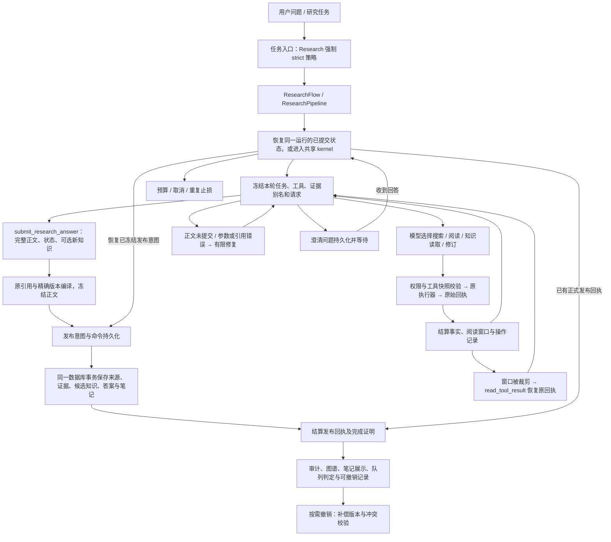

# Research 全流程与分支删减审查（2026-11-03）

## 最新结论与实验结果（2026-11-06）

**超预算原文保留 A/B 已结束，本轮候选不合入生产。** 36 次真实 Research 运行全部保留：v3 保留集 24 次、开发集 4 次，另 8 次前置探索分开统计。保留集两版各交付 4/12；严格整题（含准确引用支持）1/12→2/12，但新增成功发生在未溢出的逻辑题，排序未激活，不能认定收益。双方均触发溢出的有效配对为 0，未达到事前门槛，不再追加默认预算确认。详见[结果、反例和边界](research-window-retention-results-20261106.zh-CN.md)及[逐次机器报告](reports/research-window-retention-ab-20261106.json)。生产代码未因本轮修改。

**确认了 FIFO 风险，也确认了词项候选的边界。** 已读限制确实曾从实际请求全部消息中消失；候选也移走过必须比较的 V2 规则，并在正文中漏答、引用串用。正确正文配错 eN、从未读到、读后不可见、原文可见仍说错分别记录。原始响应还大量输出退化；多数组间失败发生在排序激活前，不能都归因于窗口策略。可见率、保存成功或单次成功均不能替代质量证据。

本轮使用两组共同的 4096-token 压力工作视图，不能外推默认 16384 的线上效果。模型自行搜索、读取和提交，没有预选正确窗口；不使用语义 verifier 评分。评分由本次执行者对照事前金标逐项审读，未做外部人工盲评。123 项扩大定向测试、Ruff、mypy、Pyrefly、ty 通过，未全量 pytest；新增导出后相关 11 项回归再次通过。三批工件及冻结源码已无损归档并逐文件 SHA256/CRC 校验，见[检查点](research-window-retention-experiment-20261106.zh-CN.md)。未确认生产确定性 bug；KoboldCpp 已运行，无需重启。

**语义核查停在离线诊断，不接自动修订。** 已完成 112 次正式模型调用（另保留 2 次中断试跑），包括开发/保留集、引用错配和来源指令鲁棒性、历史模型报告原句回放、逐句绑定证据隔离。详细审查在保留集四类准确率 86.36%、错误检出 100%，但正确断言误报 12.5%，超过预注册 10% 门槛；开发集还出现双 JSON 协议失败。隔离输入也不能稳定解决必要条件误报和来源指令污染。详见[结果与边界](research-semantic-review-results-20261106.zh-CN.md)。不能把 checker 自己的 verdict 当成事实证明，更不能在这批题上反复调提示后宣称通过。

**已独立修复材料身份 bug：** `2f5f3d80` 保留连接器 `abstract`，首次阅读、工作视图、省略索引、恢复和归档都保留“仅摘要”。三项回归先复现生产错误，修复后扩大到 123 项定向测试通过；Ruff、mypy、Pyrefly、ty 通过。没有证明答案正确率因此提高，也没有迁移旧 HTML 档案。语义实验和生产修复分开统计。

本轮测试的两个保留策略只影响展示：A 按最早阅读窗口移出；B 在预算溢出时按完整原任务词项选择完整实际阅读窗口并限制完全重复正文。放得下时渲染完全相同；实际读取记录、准确快照、稳定 eN、版本、引用权限不变。没有增加摘要、导航提示、语义 gate 或 follow-up。后续先独立处理稳定完成真实运行的问题，再验证新的覆盖策略；连接器早停、来源发现和全文获取仍留待独立实验。

## 当前状态：Research 已收敛为一条流程（2026-11-04）

**提交 `63d202a8` 已把严格 Research 统一为「查资料 → 读原文 → 交完整答案 → 保存新发现」。不再建立第二条复杂 Research。**
旧知识修改入口、先注册计划再逐题保存／拼接答案的专用代码已经移除。
新候选知识通过 `submit_research_answer.knowledge_updates` 随答案保存；查旧资料、沿引用读原文和长文续读仍在同一流程内完成。

当前真正还没解决的使用问题是：

1. **一次放不下的长文章**：模型仍可能选错接下来要读的章节，或读得不够就回答。
2. **原文看到了，条件仍说错**：仍可能漏条件、混淆“且／或”、版本或适用对象。
3. **多层旧结论核查**：仍可能没有追到原始材料，或把旧结论当成原始证据。

这些是同一流程中的阅读与回答质量问题，不是需要再开发一条复杂流程。
**修改旧知识已退出 Research 职责，不再列为 Research 待修功能；也没有新建独立维护流程。**
通用指导、自动召回和查旧知识说明的其他精简方案可暂缓；此前未采用的候选不会因此自动上线。
`methods.py` 的领域提醒及共享历史报告功能仍可能服务其他调用者，不能把它们算作当前普通 Research 的第二条路线。

引用与精确版本、原子保存、预算、取消和当前完整答案流程的恢复保护保留。
旧的冻结分题任务需要重新发起；历史已保存报告仍可读取。
2026-11-06 又完成了一批 HyperResearch 启发的 Gemma4 12B 实机 A/B：测试了“结论旁边附原文短引文”“显示旧结论的准确来源入口”和“显示长文已读/未读及下一读取位置”。结果没有达到合入生产的门槛：前者只增加输入而未改善正文，第二项样本太少且原版也已正确，第三项出现输出截断和漏答。生产代码未因这批实验修改。

实施、测试覆盖及后续代码复核结果见[单流程收敛记录](research-single-flow-convergence-20261104.zh-CN.md)。

本批实验脚本和逐次工件见[HyperResearch 启发 A/B 脚本](../tests/manual/research_hyperresearch_inspiration_ab.py)、`.e2e-artifacts/research-hyperresearch-inspiration-ab-v2` 和 `.e2e-artifacts/research-hyperresearch-inspiration-ab-v3`。
**以下待办和阶段记录描述收敛前的历史状态，当前职责与未做列表以本节为准。**

## 收敛前的待办清单（历史记录，2026-11-04）

**收敛前当时的结论：此前“放得下就读完整篇网页”继续保留；当时只接入“旧结论和导航在前，已读原文紧靠问题”的排序。** 不增加工具、审查阶段或新的修订接口。修改旧知识、超预算长文、条件理解和多层核查仍有未解决部分，不能把“看全了”或“保存成功”当成“答对了”。

此前 96 次实机不支持采用当时那些具体提示候选，不能理解成“所有精简都没有用”。更早的重复规则、阅读提示、操作记录及引用路线已有局部改动进入生产；那 96 次也不只测了通用指导，还测了旧知识说明、领域提醒和继续阅读提示。

**下面保留收敛前的八项待办及其当时证据。它们不再作为当前待办；当前状态以本文顶部的单流程收敛说明为准。**

### 一、仍然存在的使用问题

| 未完成项 | 目前做到哪里 | 接下来还需要解决什么 |
|---|---|---|
| 1. 修改旧知识 | **仍未完成。** 完整修改模板和“已经保存”的展示都试过；标题修改题仍有两次没有先读旧对象，反复填错版本，因此不能算完成。此前少抄字段的离线样本虽有实际改对旧条目的收益，但也出现改完继续重复操作、不交答案，未接入生产。 | 研究“程序从本次成功的 `knowledge_read` 回执带入旧版本”的简化方案：模型只提供精确 ID 和要改的字段，程序仍用旧版本做原子校验，成功后内部产生新版本。不能把错误版本号盲目改成当前版本，否则可能覆盖并发修改或改错对象。 |
| 2. 一次放不下的长文章 | **放得下的全文读取已完成；新增超预算压力题，两版都读到关键条款，导航候选没有增益。** | 保留继续阅读；补其他关键章节和阅读判断场景。单个超长题通过不代表所有超长文都可靠。PDF、显式限长和知识库原文仍有各自边界。 |
| 3. 看过原文，仍把条件说错 | **新测“保留原条件句”，出现“仅当”变成“当且仅当”，未采用。** 原文可见仍可能漏条件、混淆适用对象。 | 保住对象、版本、条件和逻辑方向。不能继续一概归因于没读到，也不应靠反复加相近提示宣称修好。 |
| 4. 核查多层旧结论 | **只排序有局部收益，已接入：原文靠近完整问题，旧结论保持背景身份。** 四次探索性沿链对照完整合格 0/4→2/4；新 seed 的生产对照 0/2→1/2，仍有正文混淆旧主张与证据。 | 继续解决正文把旧 claim 说成原始证据的问题，不能把真实读取、形式引用和语义正确混为一谈。最终单组实机确认不能混作 A/B 收益。 |

### 二、还可以研究的精简

这些是可以继续试的方向，**不是已经证明应该删除的内容**。

| 未完成项 | 已经试过什么 | 还没做完什么 |
|---|---|---|
| 5. 通用研究指导的具体句子 | 整体短版、合并任务提醒、少一次条件提醒都测过，候选没有保留。 | 其他句子尚未逐句验证。要分别看哪句有用、哪句重复，不能整段删。 |
| 6. 自动带入的旧知识 | 全部展开成完整条目的方案测过，新增失败，未采用；生产仍压缩显示。 | **“少选几条，但选中的完整显示”这个具体方案还没验证。** 不应再写成完整条目从未做过实验。 |
| 7. 查旧知识时的长篇说明 | 短版、读取时再提醒都测过，没有找到能采用的版本。 | 需要新的精简方案；先前失败的短版不能直接上线。 |
| 8. 特定领域的提醒 | `methods.py` 的一个短版测过，没有稳定收益。 | 其他句子未逐项验证。它用于旧计划／局部报告等条件入口，普通整篇 Research 不走这里，优先级可低一些。 |

### 三、已经处理，不再列为未做

- **放得下就直接读完整篇网页：已完成，提交 `6c272fb0`。** 最终生产复测长文全文可见 4/4，长文整题正确 3/4；改善了漏读，没有保证读后理解全对，也没有证明更省 token。
- **正文、条件、限制、证据不截半句：已完成，提交 `c4ab91cb`。** `_bounded` 已改成完整显示或整条省略，省略时保留准确恢复入口；仍受每条分配预算约束。
- **原文优先于操作历史：已完成。** `display_omitted` 只在预算不足时兜底，当前决定保留；不是还没删除干净。
- **`brief_projection` 的长度限制：用途已查清，当前保留。** 它只写诊断记录，没有给 Research 或 Project 模型截短答案，不列为必须修改的待办。
- **离线遗留迁出、重复审计计算合并、重复提示和部分操作／阅读／错误记录精简、已读原文引用路线简化：均已有实施记录。** 修订工具也已恢复直接完整展示，不再先展开。

此外，旧计划、Ghost、换窗、长 PDF、连接器及不同 provider 等条件分支，仍有实机验证缺口；完成状态、强制工具调用和发布后诊断目前保留。**这些属于删除前还缺证据，不等于已经发现必须修的故障，也不应和上面的八项混在一起算“还没开发”。** 全流程清点已做完，并不代表每种动态情况都做过实机实验。

**最新修订复测补充（不计入上面已归档的 116 次实机）：** 仅展示完整修改模板和“已经保存”的状态，标题修改题仍有两次没有先读旧对象，反复填错版本。这个结果进一步确认：当前最先要解决的是“准确读到目标对象并使用它的旧版本”，不是把错误版本号交给程序盲目改成当前版本。

最新四类失败核查、采用与未采用的具体原因见[本轮通俗报告](research-state-fidelity-20261104.zh-CN.md)。上一轮修订与长文见[此前通俗报告](research-revision-longread-20261104.zh-CN.md)；更早证据见[逐项实验与失败证据](research-guidance-followups-20261104.zh-CN.md)、[全文显示的已实施记录](research-context-view-simplification-20261104.zh-CN.md)。

## 各阶段跟进记录

> **2026-11-04 四类失败继续核查：116 次实机尝试，只接入原文位置调整。** 113 次后端记录完整，3 次后端中断保留并排除对应配对。少抄修订字段、显示保存状态、额外长文导航和条件原句提示均做过独立或拆分复核，未接入生产。仅把已读旧主张和导航放在原文之前，使原文紧靠完整问题；未增加工具或修改保存协议。四次探索性沿链对照完整合格 **0/4→2/4**，新 seed 真实生产沿链对照 **0/2→1/2**；普通旧资料的一个有效配对两版都漏版本，严格 **0/1→0/1**，不能按保存成功算通过；新增积累两版 **2/2**。另三题单组确认 **3/3**，最终准确源码沿链确认 **1/1**，均不混算 A/B 收益。四类问题仍有未解决部分，输入也并非每题都减少。具体失败、采用理由和机器证据见[本轮通俗报告](research-state-fidelity-20261104.zh-CN.md)。

> 本轮最终扩大回归 **3,038 项通过、357 项子测试通过，零失败**；Ruff、Mypy、Pyrefly、ty 通过。首次扩大回归因助手在运行中改了类型注解而发生 8 项源码指纹不一致的恢复失败；固定源码后，相关恢复文件 84 项通过，再完整重跑得上述结果。没有修改恢复校验或放宽失败断言，详情见本轮报告。

> **2026-11-04 修订与长文继续跟进：最终只保留放得下的网页全文读取。** 多轮 A/B 查到程序代填版本的局部修订收益，但试接生产后出现额外替代 claim；显式新建补救又使两次真正新建没有落库，修订接口改动全部撤回。长文改为使用同一工作视图和 tokenizer，确认全部当前原文同时放得下才完整读取，预算不足继续使用原窗口和续读；没有取消原始回执、引用或重启恢复。最终八次新 seed 实机全部交付，严格完整任务 **7/8**，其中长文整题 **3/4**，查旧资料与首次积累各 **2/2**；全文可见不能保证条件理解正确，成本也未必下降。最终扩大回归 **3,015 项、357 项子测试通过，零失败**；Ruff、Mypy、Pyrefly、ty 通过。逐例结果见[通俗报告](research-revision-longread-20261104.zh-CN.md)。

> **2026-11-04 逐句指导等八项跟进：新增 96 次实机，不采用本批提示候选。** 整体短版、短召回说明、读取时提醒、领域短版和额外续读参数均未获得可稳定接入的结果。只合并两句任务提醒首轮略有收益，但新 seed 复测的完整任务合格 **8/10→5/10**，出现“仅当”改成“当且仅当”和跳过旧引用核查，已撤回，生产通用规则保持原版。`_bounded` 的完整条目/整条省略及原文优先已由此前提交完成；本次补回归，没有重复实现。另查明 `brief_projection` 仅为发布后诊断，不是下游模型交接正文。首次扩大回归的 6 项失败逐项修复，其中生产笔记逐条查询改为一次批量查询。修复提交 `b2c32549`；最终扩大回归 **2,999 项通过、0 失败，另有 357 项子测试通过**，Mypy、Pyrefly、ty、Ruff 通过。详细处理与证据见[这次通俗报告](research-guidance-followups-20261104.zh-CN.md)。下文旧实验数字保留历史含义。

> **已读原文与引用路线已简化并接入生产。** 放得下的已读原文持续可见；本任务真正读过且准确快照仍在的材料，可以引用，不再要求模型先抄回执编号找回全文。整篇回答移除手工恢复工具和相关旧指路；生产中的 `read_receipt_index` 已清理，仍在使用的旧局部目录改为 `read_receipts`。最终代码的 24 次生产对照中，复杂题严格合格 **0/4→4/4**、请求 **18→4**；全批严格合格 **7/12→12/12**、输入 **−53.22%**。第一轮另外 24 次生产对照查到的未读状态提示和不可用工具提示问题也已修正，失败记录保留。当前实现、逐例结果及检查见[通俗生产报告](research-visible-evidence-production-20261103.zh-CN.md)。下文“必须先恢复隐藏全文才能引用”是旧协议，原始记录、继续阅读、准确归档和重启恢复仍保留。

> **第五项跟进：完整草稿保留，同一次错误的重复显示已局部合并。** 新增 24 次 A/B、24 次新 seed 生产对照；查旧资料遇错后的正确恢复两版均 2/2，输入分别 **−0.95%、−0.90%**，请求相同。原始诊断、失败目标、较早错误、长错误全文及恢复记录保留。草稿在实际请求里本来只有一份，不再截短。复杂恢复仍失败，且新版有一份已保存答案漏掉第二份材料的规则，不能称正确率提高；连续错误题的消耗也有来回波动。详见[通俗报告与全部证据](research-feedback-dedup-ab-20261103.zh-CN.md)。下文旧错误短版及草稿截断实验保留历史结论，以当前处理表和本次报告为准。

> **第四项跟进：长文章的重复阅读提示已局部合并。** 24 次正式 A/B 后，再用新 seed 完成 24 次生产对照。生产复测的续读、中间漏读、固定旧版本、裁剪恢复两版均 **8/8**，该范围输入 **−3.21%**；全部任务输入 **−2.66%**，请求均为 24 次。整篇回答不再重复发送完整阅读回执目录及两份未读区间摘要；已读区间、首个未读位置、章节、全部裁剪恢复入口保留。完整 SQLite 长文题仍两版各 0/2，错误细节有变化，不称全文无损或总体正确率提高。见[通俗报告](research-navigation-ab-20261103.zh-CN.md)。下文 108 次旧实验与旧压缩方案保留历史结论，当前处理以本段及当前表为准。

> **最新实施状态：** 按用户最终选择，已撤掉 `71f6bf3d` 的按需展开修订步骤，恢复直接提供完整 `knowledge_commit`；保留 `622ce76a` 的操作记录精简，并在读完原文后继续显示已读旧主张。全部改完后另做 16 次单组实机，保存 14 份答案，包含步骤要求的检查通过 13 次；两次真正修订仍失败。没有重做 A/B，不据此声称成本或总体正确率改善。见[通俗实施报告](research-direct-tools-prior-knowledge-20261103.zh-CN.md)。下列旧跟进中的“已接入按需展示”等是历史阶段状态，以本段和当前处理表为准。

> **收益与回退归因跟进：** 原 28 次删修订 A/B 已另做 52 次冻结状态单步诊断。查实旧主张在读取原证据后的请求中会消失，及联网场景受控来源的身份/hash 冲突；普通研究未实际执行修订，不能据结果变化推断修订能力必需。补回本轮比较对象原话后，两个 seed 从再次读取变为直接提交，正文准确核对版本与条件关系；这只是单步信号，未作完整发布复测。语义及参数错误仍有后端复播波动，尚不能指定某句提示为根因。见[详细诊断与证据](research-revision-diagnosis-20261103.zh-CN.md)。

> 审查及 108 次实机实验基线：`231b7921`，实验阶段没有修改生产代码。**实施状态已更新：四处清理已由 `d42ba1d5` 完成；验证中发现的整篇答案 ledger 兼容问题已由 `fedc334b` 修复。** 这两项实施与验证见第 8.3、8.4 节；其后的定向实验和接入另见下面跟进，不把旧实施提交号称作当前仓库 HEAD。此前删除重复研究规则的改动已包含在审查基线内，不再将它计为本轮收益。

> **定向跟进：查旧知识的说明长度已追加 24 次实机 A/B。两组均保存 8/12 份答案，短版总输入 +1.78%、请求 52→53，未达到合入标准，生产未改。** 旧推论链两组都失败；本次短版暂缓采用，不能据原先正常历史题的节省直接上线。见[通俗报告和逐例结果](research-read-guidance-ab-20261103.zh-CN.md)。下文原 108 次实验数字保持原样。

> **第二项定向跟进已进入生产接入验证。** 原 36 次 A/B 查询输入 −32.78%，因两组修订均 0/6 按原门槛暂缓。用户随后明确允许已有修订失败继续失败，另做 24 次生产 v1、2 次失败定点回归、24 次新 seed 生产 v2。最终查询输入 **−30.88%、请求 29→22**，事前核心项目两组 **6/6**，真正修订仍各 **0/4**。**严格全文检查为 5/6→4/6，仍有旧主张转述问题，不能称内容无损。** 已接入生产代码并完成验证；最终检查与提交见[生产跟进报告](research-lazy-revision-production-20261103.zh-CN.md)。原始 [36 次报告](research-lazy-revision-ab-20261103.zh-CN.md)保留历史结论，各阶段分别统计。

> **第三项操作记录跟进：共 96 次实机，最终只保留“读过原文后搜索确认零结果”的局部精简。** 原文、全部阅读回执、准确版本和恢复入口保留；刚读取、搜到新内容、失败、重复、修订及恢复用原历史。相同目标状态的 12 个 seed 累计输入 **−20.14%、请求 17→14、严格检查 11/12→12/12**；**最后单批目标输入 +13.52%，没有通过该批成本下降门槛**，不承诺每次都省。采用依据是用户明确的局部准则与全部累计证据；刚读取及搜到内容的精简均未采用。过程、失败、最终验证见[通俗报告](research-operation-history-ab-20261103.zh-CN.md)。

> **后续“Research 不再修改旧知识”职责收缩实验：28 次实机未通过不退步门槛，未删除生产支线。** 用户已接受明确修订能力退出普通 Research，不要求候选完成旧修订任务。但排除这些任务后的普通研究，正式交付 **10/12→9/12**、正文与保存要求 **9/12→7/12**、请求 **47→52**、输入 **+5.84%**。新知识积累有约 2% 局部节省，普通历史和读取失败恢复仍出现新增退步。因此保留当前生产代码，也没有另建维护流程。全部配对与失败见[此次报告](research-no-revision-ab-20261103.zh-CN.md)。这不是依据旧修订仍失败来否决职责收缩。

## 1. 先回答最关心的问题

**本轮已完成整体清点和五类定向审查：审查基线的 80 个 Research 模块、61 项职责/边界，另做 108 次正式 12B 实机运行。已将确认的三处离线遗留迁出生产，并合并 accepted 分支的重复审计与查询计划计算。** 模型侧最有希望的是只读历史任务按需少展示，尚不支持全局删除恢复、修订、草稿或通用指导。

不能把上一轮的 42 项职责、88 次运行当成“Research 的每个生产分支都已经验证过”。本轮把目录清单、产品入口、共享内核、保存事务、恢复、后续消费者及离线辅助代码分开核对。

本报告中的“保留”指保留能力和边界；不意味着每句话、字段和计算都必须维持原样。“删除”也明确到函数或生产位置，不能扩大成删除整个研究能力。

| 对象 | 明确处理 | 依据与适用边界 |
|---|---|---|
| 旧 done_finalizer.py（基线 624 行） | **已迁出生产** | 迁到 `tests/support/research_done_finalizer.py`，测试和回放导入已更新。现用 AnswerReport、FindingReport 编译器及引用校验保留。 |
| brief_projection 的 constraints_from_claims / build_impact_contract / render_handoff 及专属类型 | **已迁出生产** | 迁到 `tools/research_benchmark/brief_impact.py`，同步更新 scorer、测试和手动 harness。生产 `project_research_brief` 与 `agents.handoff.render_handoff` 保留。 |
| source_trust.evaluate_against_profile | **已迁出生产** | 迁到 `tests/support/research_source_profile.py`，删除原生产导出。来源分类、集合投影和告警逻辑保留。 |
| accepted report 两次相同审计 | **已合并重复计算** | 一次 review 和 plan 传给收尾阶段复用，审计不可用的 None 也不重算；保留原诊断输出。非 accepted 分支仍在 ledger 写入后重新校验。 |
| 历史知识的冗长解释 | **已做短版与展示时机实验，候选暂缓采用** | 原 108 次实验的正常历史题有局部节省。独立 24 次说明短版整体输入 +1.78%，未合入；2026-11-04 又在 24 次三组历史题中分别测试短召回说明和读取时提醒，完整任务检查 6/8→5/8、5/8，也未采用。不是尚未开展实验，亦不能直接照搬旧单场景收益。 |
| 严格 Research 自动召回条目 | **仍用压缩显示；完整条目候选已测，未采用** | 独立 16 次 A/B：完成 8/8→7/8、请求 56→64、输入字符总量约 +15.1%。只选少量完整条目的新方案尚未验证；详见[召回条目报告](research-recall-rows-ab-20261104.zh-CN.md)。 |
| KNOWLEDGE_READ_GUIDANCE 展示时机 | **已测读取时再提醒，保留当前生产展示** | 读取结果保留提醒，只去掉工具说明中的完整副本；本批完整任务检查 6/8→5/8，出现版本起点措辞错误，总输入约 +7.02%。候选未采用，不能记为完全没研究。 |
| methods.py 领域提醒 | **实际旧入口短版已测，保留原版** | 4 次实际领域入口对照，两组各完成 1/2，短版请求 13→24、输入约 +0.96%。没有稳定收益，其他句子仍未逐项验证；普通整篇回答不调用这条领域提示路径。 |
| 操作历史 | **确认零结果的搜索续接时省重复；其余保留原历史** | 后续 96 次定向跟进仅采用零结果续接：已有独立阅读回执的成功读取不重复列出，搜索、旧主张、错误和恢复信息保留。目标 12 个 seed 累计输入 −20.14%，末批 +13.52% 仍有波动。刚读取及搜到内容的精简未采用；不能全局只留最近三条。原 108 次证据保留在下文。 |
| knowledge_commit 常驻展示 | **已恢复直接展示完整工具，按需展开机制已移除** | 旧按需实验的成本收益仍作为历史证据保留。用户为简化程序及操作流程选择撤掉展开步骤，同时补回已读旧主张原话；另做 16 次单组实机，详见最新实施报告。不放松权限、身份、版本、引用及发布检查。 |
| 召回旁追加完整 read_request 模板 | **证据不足暂缓采用** | 本轮仍 3/3，但输入 +46.58%；没有证明加大模板能减少选择失败。应继续改善精确可选目标，不能放宽 ID 匹配。 |
| 旧知识修订流程与完整对象模板 | **保留原接口；职责收缩及新修订候选均未采用，问题未解决** | 此前程序代填版本原型出现替代条目，补救又影响正常新建，已撤回。完整模板和保存状态展示也没有解决“先读旧对象、填对版本”这一最前面的失败；标题题两次仍反复填错版本。本轮没有放宽身份、版本、访问范围、原子保存或并发冲突检查。详见[本轮报告](research-state-fidelity-20261104.zh-CN.md)。 |
| 长材料定位、已读/未读导航 | **重复显示已合并；放得下的网页全文读取已实施** | `6c272fb0` 在全部当前原文同时放得下时完整读取网页；本轮又测真正超预算长材料，原版及导航候选各 2/2 读到关键条款并完成，没有采用额外导航。其他超预算长文和看全后的条件理解仍需改善，不称所有长文已可靠。详见[本轮报告](research-state-fidelity-20261104.zh-CN.md)。 |
| 旧结论、导航、原文和任务的显示顺序 | **已接入最小排序：已读原文紧靠完整问题** | 有已读旧主张时，先显示旧主张和导航，再显示原文、完整任务及原规则；无旧主张时保持原序。探索性沿链完整合格 0/4→2/4，新 seed 生产对照 0/2→1/2，仍有把旧主张当原始证据的失败；没有增加工具或审查阶段。 |
| context_view._bounded 完整条目 | **已完成：完整显示或整条省略** | `c4ab91cb` 已删除正文、条件、限制及证据摘录的前缀截断，超分配额度时保留准确 fN / ID / revision 恢复入口。本次又补显示优先级回归。此前无效探针不是模型 A/B，不据此声称正确率已提高。 |
| context_view.display_omitted 预算优先级 | **已调整优先级；真实超预算兜底保留** | `c4ab91cb` 已让最近结果、操作历史先让位，再尝试完整证据。本次新增 4,000 字符回归保留尾部 AND/OR 条件；仍超预算才省略，原始记录不删除。 |
| omitted_windows 裁剪恢复索引 | **整篇回答已移除手工找回要求，改为已读快照目录** | 放得下的原文持续显示；只有真实 token 额度不足才移出完整阅读窗口，保留稳定标签、范围和准确快照的引用资格。整篇不再展示 read_tool_result。本轮补了一个真正超预算长材料的 4 次实机，但没有覆盖所有多材料裁剪组合，不能宣称所有长文均可靠。 |
| read_receipts 通用阅读索引 | **底层真实阅读记录保留，整篇不再要求手工搬运** | 旧 read_receipt_index 名称从生产删除；仍在使用的局部恢复目录统一称 read_receipts。整篇的引用资格依据真实成功阅读及准确快照，已读尾部与未读尾部不混淆，准确归档和冷重启保障保留。 |
| 完整未提交草稿回传 | **保留；本次未发现需要再删的完整副本** | 旧实验删除完整草稿后退化。新增两轮实机中，首次修复请求均只有一份完整草稿；简单草稿题两版均正确提交并保存，复杂题仍不稳定。本次不截短草稿。 |
| 详细错误及重复错误副本 | **具体错误保留；同一次最新错误的重复显示已合并** | 新增 48 次实机，成功历史读取恢复的全程输入分别 −0.95%、−0.90%，正确完成均 2/2。最新错误全文在原错误栏保留；当前工具结果只有在全文已显示时才改为简短回执。较早错误及超过 1,600 字符的完整工具错误仍保留。复杂恢复和连续错误没有稳定正确率收益，不采用全局截短。 |
| 通用整篇研究语义指导 | **保留原版；本批逐句候选已撤回** | 旧实验整体没有无损证据。2026-11-04 另测整体短版、单独合并任务提醒及少一次条件提醒；任务提醒候选在全新 seed 生产复测出现新增条件错误和步骤遗漏，未保留。没有证明其余每一句都不可删；提交协议、保存协议及领域 methods 仍分开判断。详见本次跟进。 |
| 完成状态 answered / partial / unresolved | **保留** | 它是后续完成判定所需的支持程度声明，不是语义正确认证。去掉后只能保守映射 partial，不能把有引用的正文自动当成已解决。 |
| provider 强制工具选择 | **保留当前行为；全局删除暂缓** | 取消强制仍保留提交合同，部分任务仍可交付；这不证明所有 provider、复杂失败或自由文本提交都可靠。保留明确提交边界，具体适配器可另测。 |
| 发布后审计及诊断输出 | **必要输出保留，重复计算已复用** | 关审计仍可交付同文，却丢 proof review / brief 诊断；仅看最终正文会漏掉后续排错代价。没有额外模型自审调用，不冒称省模型请求。 |
| brief_projection 摘要长度 | **已核对用途，保留诊断摘要限制** | 当前生产消费者只写 trace，不是 Research / Project 的模型输入；原答案保持完整。没有实际下游模型丢条件的失败证据，不列为必须改成全文的待办。 |
| 旧计划/FindingReport、外层 followup 兼容字段、Ghost/换窗/PDF/连接器条件分支 | **证据不足暂缓删除** | 区分仍有触发入口、只供兼容与本轮未实机覆盖。普通整篇不走某路径，不代表整个产品已无消费者；逐项证据和缺口见生命周期表。 |
| 引用、精确版本、访问范围、原子发布、正文冻结、原回执、重启恢复、幂等、撤销冲突、预算和取消止损 | **保留** | 仍在产品调用链解决不同边界问题，已有原入口和故障回归；模型结果差不构成删除这些程序保障的理由。它们也不保证推论正确。 |

**收敛前状态：本报告确认可从生产迁出或合并的四处对象已全部处理。操作历史的零结果局部精简保留；修订工具已恢复直接展示，按需展开机制移除；已读旧主张原话已补回；长文章的重复阅读信息、同一次最新错误的重复显示已局部合并，完整草稿、继续阅读和准确归档能力保留；已读原文在额度内持续可见，整篇手工回执恢复已移除；放得下的网页已直接完整读取；本轮让已读原文紧靠完整问题。历史说明短版未采用。修订、超预算长文的阅读选择，以及看全后仍说错条件的问题仍需改进。** 通用指导等项目的证据和边界见第 6 节。四处清理完成不等于其余代码已被逐行证明不可删除。

历史“按任务展示”实验没有验证自动分类器。原 36 次及后续生产复测采用模型调用轻量入口、结算后展开工具，并在失败读取后恢复原上下文；这套展开机制现已移除，没有按问题关键词放宽权限。实际修订任务仍失败。只读历史题中少展示有效，也不能推出完整失败记录或长文恢复索引都能按同样方法减少；它们需要各自的任务与故障验证。

“已迁出生产”限于本仓库生产路径，离线功能仍在测试/工具目录使用；相关导入和导出已更新，原生产导入路径不保留转发壳，仓库外私有调用方如有使用须自行迁移。它不会节省当前普通 Research 的模型输入，因为这些函数原本就没有进入模型请求；审计去重减少的是确定性程序计算，也没有模型请求或 token 节省证据。

## 2. 覆盖范围与证据等级

在审查基线 `231b7921` 上，逐文件建立了 `codey/research` **80 个 Python 模块**的清单，索引 **1,077 个定义**，包括类、方法及嵌套函数；另列出 **89 个相邻边界模块**，核对 UI 展示/恢复入口、任务授权、共享 kernel、provider、版本知识库及持久化副作用。机器索引记录当时的路径、定义行号、文件摘要、生产/测试/离线导入者和可静态解析的导入调用位置。**清理后生产 Research 目录为 79 个 Python 模块**；旧清单与覆盖数据继续作为实验基线保存，不冒充当前源码索引。

这是一份完整的 Research 目录与生命周期分支审查，**不是整个应用所有动态路径的穷尽证明**。静态导入、直接调用、测试覆盖率与真实产品触发是四种不同证据：有单测覆盖的函数也可能完全不在生产路径；没有静态解析出的调用也可能通过回调或对象方法触发。删除判断还要核对注册表、调用方及实际执行。

| 证据 | 本轮怎么用 | 不能据此推断什么 |
|---|---|---|
| 代码及调用 | 从产品入口沿原调用追踪，核对策略与条件分支 | 不能把模块存在等同于普通 Research 每次都调用 |
| 确定性回归/故障对照 | 原入口、原事务、原恢复投影，脚本 provider 固定行为 | 不能证明模型自己会选对工具或推论正确 |
| 真实 12B 请求 | 记录实际 wire、工具调用、后端 token、输出和数据库版本 | 不能凭“有正文”认定修订、条件保留或长期积累成功 |
| 独立内容审查 | 本次审查逐份读正式正文，另核对数据库事实 | 无正式正文不记成“所有语义都错”；少量 seed 不能证明普遍无损 |

附录逐模块清单覆盖全部 80 个文件；[机器清单](reports/research-branch-inventory-20261103.json)保存完整定义和调用位置。相邻边界清单不是全部共享运行时的文件清单；授权、网络、存储等共有基础设施通过实际调用和专项测试追踪。

## 3. 普通 Research 的实际主线

关键调用位置：`task/entry_auth.py` 与 `operations/task_entry.py` → `operations/task_phases/dispatch.py` → `operations/research_flow.py` → `research/pipeline.py` → `operations/research_iteration.py` → `operations/research_continuation.py` → 共享 kernel → `research/answer_contract.py`、`answer_report.py` → `operations/research_publication.py` → `knowledge/store.py::publish_note`。

普通整篇研究使用 `AnswerScope` 和 `submit_research_answer`。它不再先让同一个模型生成逐题计划、逐题保存所有 finding，再让同一个模型强制自审。**不能把已经退出主线的流程再关闭一次，算成新的删减收益。** 旧的 structured finding/report 合同仍服务混合任务、其他 strict 策略或历史冻结请求，不应整片误删。

## 4. 全生命周期职责与分支核对

表中“现用”按实际入口区分；“按需”表示有明确触发条件，不是每次运行都发生。证据列列出本轮读取的实现和相关现有测试族，实机结果另见第 6 节。

### 4.1 接收问题、策略和上下文

| 编号 | 环节及是否现用 | 解决的问题；重复判断 | 已有证据 | 仍缺验证 | 处理 |
|---|---|---|---|---|---|
| A01 | 任务授权与 Research 强制 strict：在用 | 防止普通入口绕过研究提交/保存约束；上下两入口是不同调用边界 | `entry_auth`、`task_entry`、`task_policy`；policy boundary 回归 | 所有第三方入口组合未逐个实机 | 保留 |
| A02 | 原始完整问题逐请求携带：在用 | native continuation 可能只带最新工具组；最初 user 消息不能替代每轮任务锚点 | `answer_context`、`kernel_preparation`；whole/native 回归；前轮删减跑题证据 | 更长多轮任务 | 保留 |
| A03 | 工具允许集、快照与参数合同：在用 | 防止模型调用当轮未承诺工具；注册表存在不等于全部对模型显示 | `kernel_protocol`、`tool_contract`；工具隔离/快照故障对照 | 更广 provider 编码组合 | 保留；展示可按任务收窄 |
| A04 | 基础提示中的重复完整规则：已删 | `231b7921` 已移除；当前工作视图仍保留一份 | whole-guidance 回归和冻结基线 | 不重复实验 | 维持既有删除 |
| A05 | 通用整篇语义指导：在用 | 保留对象、动作、版本、条件、OR、证据边界；本轮比较原文/缩短/删除 | `ANSWER_GUIDANCE`；复杂条件实机 | 跨题型稳定性及逐句因果 | 暂缓全局删减；保留当前指导 |
| A06 | `methods.py` 领域方法提示：条件路径 | `strict_research` 且没有 research scope 时才加；普通 `AnswerScope` 绕过它 | `kernel_preparation` 分支；新增原入口测试证明未调用 | 混合任务各领域删句实验 | 暂缓；不能拿 A05 的结果替它做结论 |
| A07 | 自动召回背景：在用，有权限和范围筛选 | 提供历史线索；排除 answer 和当前新建对象，防止把本轮草稿召回成独立证据 | `knowledge_context`、`recall`；历史/长期复用回归 | 多项目/多语言大库相关性 | 保留通道；缩短说明另判 |
| A08 | 召回、历史读取旁的解释：在用 | 旧主张不是可引用原文；提示沿精确引用读 source/evidence | `KNOWLEDGE_READ_GUIDANCE`；history 实机 | 复杂矛盾修订、来源缺失 | 按任务展示/缩短，不删除证据边界 |
| A09 | 聊天 handoff / 换窗摘要：按需 | 延续先前上下文；部分不带 API ContextBudget 的 provider 可在换窗前额外调用摘要模型，与 Research 自审或审计 brief 不同 | `conversation_plan`、dispatch activation、agents handoff；共享窗口边界回归 | 新矩阵是 fresh API 窗口，没有触发长聊天摘要；不能将其成本说成已测零成本 | 保留；本轮不宣称实机覆盖 |
| A10 | Ghost 话题延续及研究兴趣：按需 | 将队列提示、历史引用纳入有界上下文，不授予新权限 | `topic_continuity`、`research_interest`；flow/iteration/queue 回归 | 新矩阵没有运行 live Ghost | 暂缓删减 |
| A11 | ask_user 澄清及等待回答：按需 | 不足信息应持久化问题并停止当前执行，不能当作正式研究已交付 | `kernel_control`、DurableUserQuestionStore；新增 whole 入口 native/text 两路验证无答案发布 | 新矩阵没有让 12B 自发提出澄清，问答后续共享流程另有回归 | 保留 |
| A12 | provider 发送/结果结算、native/text 编码及切换：在用 | 区分未发送与可能已发送；收到结果不能盲目重发或偷偷降级合同 | `kernel_driver/transport`、`provider_receipts/session`；shared lifecycle/native/restart 回归 | 本轮实机只用 KoboldCpp native；其他 provider 不外推 | 保留 |

### 4.2 找资料、读原文和长材料

| 编号 | 环节及是否现用 | 解决的问题；重复判断 | 已有证据 | 仍缺验证 | 处理 |
|---|---|---|---|---|---|
| B01 | web_search 与 connector 搜索：模型按需 | 不知道 URL 时发现资料；connector-first、浏览器 fallback，不是无条件搜两遍 | `source_gateway`、`connector_search`、`search_factory`；前轮 discovery 关闭失败；connector 回归 | 实网各服务可用性/限流 | 保留 |
| B02 | 搜索结果、open_result/open_hit/reopen_source：按需 | 把已返回的短标识解析为具体目标；底层仍进入原读取链 | `kernel_facts`、`url_selection`、`tools`；native/observation 回归 | 各 provider 对别名的选择效率 | 保留；不能将别名误当第二套取证 |
| B03 | open_url 真正读取：在用 | 搜索摘要与来源题目都不是正文证据 | `tools`、`source_gateway`；前轮关闭原文读取无法交付 | 不同站点结构 | 保留 |
| B04 | URL 策略、重定向复查、下载上限和关闭资源：在用 | 初始 URL 与最终目标是两个网络边界；限制耗用、保证响应关闭 | `source_download`、`http_redirects`；故障对照及 gateway 回归 | 真实大 PDF、慢服务器压力 | 保留；不靠模型省略 |
| B05 | HTML 清洗、结构化状态与文档模型：在用 | 形成可定位原文；错误/跳过不能被外观字符串抹成成功 | `extract`、`source_document`；structured status/标题清洗回归 | 特殊网页、编码 | 保留 |
| B06 | PDF 页读取/页内搜索/扫描限额：按需 | 页码、提取失败和长 PDF 不能按普通网页处理 | `pdf_extract`、`source_search`、gateway；PDF/read/search 回归 | 本轮新矩阵不是大 PDF 实机 | 暂缓；不因未触发删除 |
| B07 | source_search：按需 | 已打开长文内找目标段落，搜索本身与完整阅读不等价 | `source_search`、`passages`；diversity/navigation 回归 | 自然模型何时正确选择定位 | 保留 |
| B08 | offset/limit 和章节导航：在用 | 默认只读开头，不带 offset 会重读；章节索引仅导航 | `context_view`、`passages`；新增实际续读及固定旧版本对照 | 更可靠的复杂任务定向续读 | 保留能力；整篇回答的重复字段已精简，见新报告 |
| B09 | 首个未读位置/next_offset 与已读区间：在用 | 跳读后不能把“最远读到”误当“前面都读过” | interval/read_projection 回归；新增中间空洞实机、EOF 回归 | 更复杂多洞区间的 12B 选择行为 | 保留已读区间和首个未读位置；整篇回答省去两份未读区间摘要，其他共用视图不变 |
| B10 | 保存原文版本、精确 evidence 及 passages：在用 | 区分完整来源、实际显示窗口和可引用片段 | `ledger`、`passages`、`answer_archive`；substring/版本回归 | 引用附近语义是否真正支持结论 | 保留；版本一致不认证推论 |
| B11 | offset 续读仍经 fetch：现用 | gateway 每次 open 仍调用 provider.fetch，尽管本轮 ledger 已有原文；实网变化时可能读到新快照 | `source_gateway.open` 与长文实际工具调用；HTML source_search 则直接查 ledger 内原文 | 能否显式复用本次精确快照、兼顾 freshness/重定向/版本身份，尚未做缓存对照 | 暂缓；可研究快照内续读，不能直接删 fetch 校验 |

### 4.3 历史复用、修订和窗口恢复

| 编号 | 环节及是否现用 | 解决的问题；重复判断 | 已有证据 | 仍缺验证 | 处理 |
|---|---|---|---|---|---|
| C01 | knowledge_search：按需 | 自动召回不全时显式定位对象；不是与召回等价的重复能力 | `tools`、`store.search`；history/identity/多语言回归 | 大库检索排序 | 保留，允许只读任务收窄无关工具 |
| C02 | knowledge_read 精确版本：在用 | 沿旧引用读 revision1，不能换成当前 head2 | `knowledge_materials`、`evidence_view`；历史冲突版本实机与回归 | 缺失旧源、复杂依赖图 | 保留 |
| C03 | 身份、owner/project/session、revision 校验：在用 | 防止读错对象、越界和丢失更新；ID 抄错应修选择，不能宽松匹配 | `tools.knowledge_read/commit`、`recall.KnowledgeAccess`、repository；故障对照 | 更易复制的呈现 | 保留守卫 |
| C04 | knowledge_commit 旧对象修订：按需 | 同一身份推进版本；与新对象 `knowledge_updates` 不同 | 本轮 revise 实机；原提交/版本回归 | 稳定精确保留字段且不重复修改 | 保留能力；改进呈现后再评 |
| C05 | 修订工具常驻展示：现有默认会展示 | 纯读取任务常不需要其长 schema；修改任务则需要 | history 的 hide_revision 实机；revise 的真实失败 | 自动分配展示范围的路由正确率 | 按任务展示，不全局删除 |
| C06 | 操作历史与重复计数：在用 | 成功读取、失败 ID、相同结果的执行记录；不是正文证据的替代 | `investigation_history`、kernel_progress；正常/错误历史对照及后续 96 次定向实验 | 不同资料与长期分布的节省、复杂恢复 | 确认零结果续接省重复读取行；最新失败行的重复错误从 latest_error 复用，目标/参数/重复计数保留；不能全局只留最近三条 |
| C07 | 18,000 字证据视图裁剪：在用 | 控制每次输入，按完整窗口选取；不等于丢弃原回执 | `answer_scope`；本轮 recovery/draft/error 真正超预算 | 多个大窗口争用、单窗过大 | 保留 |
| C08 | omitted_windows 恢复索引：裁剪时用 | 说明哪些旧窗口被隐藏，并给稳定标签、位置和 recover 调用 | `answer_context`；受控裁剪后实际模型恢复 | 与 receipt 索引的最小组合 | 保留恢复信息；按触发显示 |
| C09 | read_receipts 通用阅读索引：整篇回答的重复显示已移除 | 底层 result_ref 和原工具结果仍保留；被裁剪原文由 omitted_windows 提供准确入口 | 原始回执恢复回归；新增两轮实际裁剪恢复对照 | 更复杂的混合工具结果；不外推为两个索引都可删 | 保留准确恢复信息，合并整篇回答的重复目录；见新报告 |
| C10 | read_tool_result 原回执恢复：按需 | 恢复曾实际读过的文字，保持 eN，不重新联网换源 | managed outputs、`ledger_receipts`、kernel recovery；本轮 recovery 实机 | 超大/损坏/丢失回执的提示优化 | 保留 |
| C11 | 重启续作：按需 | 从冻结请求、已收响应和已结算事实继续；不同于恢复阅读窗口 | `research_continuation`、kernel recovery；durable restart 回归 | 各崩溃时刻与 provider 长期兼容 | 保留；本轮不是 live kill 全矩阵 |

### 4.4 写答案、失败修复和知识积累

| 编号 | 环节及是否现用 | 解决的问题；重复判断 | 已有证据 | 仍缺验证 | 处理 |
|---|---|---|---|---|---|
| D01 | 完整正文通过提交工具交付：在用 | 选定最终正文，避免自由文本被猜测成已保存结果 | `submit_answer`、kernel_control；whole/inline/full-prose 回归 | 自由文本友好入口的另一套合同 | 保留明确提交边界 |
| D02 | tool_choice/强制下一步工具：在用，provider 相关 | 防止只写草稿；与真正的提交校验不同 | 实际 wire；无强制对照；native codec 回归 | 支持方式不同的 provider | 保留当前行为；全局删除暂缓 |
| D03 | 完整未提交草稿回传：失败分支 | 当模型正文正确却没调用工具时，避免修复中丢内容 | `_repair_prompt`、本轮复杂草稿实验 | 更长草稿、分多次传输、截断 | 保留；当前截短方案不采用 |
| D04 | latest_error、工具错误和历史错误：失败分支 | 保留具体字段/ID/引用诊断；同一次最新错误的文字已复用 | 新增 48 次错误显示实机；native/text、长错误及进程重启回归 | 复杂引用恢复仍失败；没有新的长错误截短实机证据 | 最新错误重复显示已局部合并；较早错误和长错误全文保留，不作全局截短 |
| D05 | answered/partial/unresolved：在用 | 模型声明支持程度；影响未决问题后续关闭，不认证正确 | `answer_contract`、`completion_gate`；状态故障对照及实机 | 无字段时可靠外部判定方案 | 保留状态能力 |
| D06 | eN 引用解析及精确绑定：在用 | 未读/隐藏/未知标签不能直接引用；生成确定来源列表 | `answer_report`、`answer_archive`；编译/错引/冻结回归 | 真值、蕴含和完整性仍需内容审查 | 保留 |
| D07 | knowledge_updates：按需新积累 | 同一答案事务保存候选 claim/inference；不是修订现有对象 | first-pass/long-term 回归，前轮实际 4→0 候选知识对照 | 推论是否新增信息、完整保留前提 | 保留通道；质量另查 |
| D08 | 批次引用规范化、依赖无环及仓库校验：在用 | 模型批次局部键与仓库全局对象不同信任边界；不是已证实重复 | `knowledge_updates`、repository；依赖故障对照 | 合并边界必须覆盖所有写入入口 | 保留 |
| D09 | 旧计划、save_finding、本地问题合同与 FindingReport：条件路径 | 仍服务混合/旧冻结任务，普通整篇入口绕过计划但共享部分值与校验 | local_scope、finding_report、plan_contract；mixed/legacy 原入口回归 | 每种历史 schema 的生命周期 | 保留兼容职责，后续单独退役 |
| D10 | 旧自由正文 done_finalizer：已迁出生产 | 整篇和旧 structured 路径使用各自编译器；旧实现仅供测试/离线重放 | 原无生产调用证据；迁移后 AST 比较、回放自检及两路发布回归通过 | 外部私有调用无法由仓库证明不存在 | 已迁到 tests/support/research_done_finalizer.py |

### 4.5 发布、后续处理及运行保障

| 编号 | 环节及是否现用 | 解决的问题；重复判断 | 已有证据 | 仍缺验证 | 处理 |
|---|---|---|---|---|---|
| E01 | AnswerReport/正文摘要冻结：在用 | 接受后不得换正文、引用、版本或范围 | answer_report、publication；snapshot/故障对照 | 更多存储故障组合 | 保留 |
| E02 | 冻结发布意图、原命令与发布回执：在用 | 提交成功但回复丢失时，重放原事务而非重新推导 | `research_publication`、effect store；publication/restart 回归 | live 进程终止组合 | 保留 |
| E03 | 单事务保存原文、证据、候选、新答案及展示笔记：在用 | 写展示失败不能留下半份积累；DB authority 与 UI 笔记不能分叉 | `store.publish_note`、repository；rollback/authority 回归与故障对照 | 大库写入/并发压力 | 保留 |
| E04 | 稳定 synthesis ID、commit 回执与版本守卫：在用 | 相同发布重试不重复；与模型用新 commit_id 再次修订不同 | `_stable_synthesis_id`、committed；幂等/restart 回归 | 重复模型动作的业务去重 | 保留 |
| E05 | 已发布内容投影一致性：在用 | authoritative answer、note、完成证明都必须指向同一交付 | report_projection、store；committed projection/authority 回归 | 各前端消费者组合 | 保留 |
| E06 | 发布后 proof review、brief/source trust/findings：在用，审计用途 | 不调用模型自审；全部删除会丢诊断 | 关审计原始对照；实施后诊断内容及 trace 顺序回归通过 | 哪些诊断长期有消费者、保留多久 | 必要输出已保留；accepted 重复计算已合并 |
| E07 | 同一 accepted report 两次相同审计：重复已消除 | run 计算 review/plan 后传给收尾复用，包括 None review | whole/legacy × native/text 均只算一次；ledger 成功/失败、审计不可用均有回归 | 非 accepted 结果 ledger 前后语义不同 | accepted 已复用；非 accepted 仍在写入后重新校验 |
| E08 | 外层 query plan、followup 计数：在用为审计/兼容输出 | 没有额外 live 研究循环；followup counters 新运行固定为零 | pipeline 与 trace 调用 | 旧 UI/存档格式迁移 | 暂缓删字段；不可冒称节省模型请求 |
| E09 | ResearchCompletionGate、Ghost 未决问题关闭：按需 | 交付不等于未决问题已解决；校验任务/运行/版本归属 | completion_gate、ghost_post_turn；accepted queue 回归 | live Ghost 与 partial 的交接 | 保留 |
| E10 | 图谱、批量笔记、运行展示与撤销入口：按需 | 保存后的用户读取和回退；不是模型提示 | app/api、documents、frontend research；graph/session restore 回归 | 更广 UI 交互自动化 | 保留 |
| E11 | KnowledgeChanges 撤销：按需 | 新库用补偿版本/撤回恢复，遇并发变更报冲突；不是删除版本历史 | changes、task_state；restore/conflict/session 回归 | 重启后的持久撤销登记（现有登记有界驻内存） | 保留；明确恢复范围 |
| E12 | ResearchBrief 的 impact/handoff 构造：已迁出生产 | project_research_brief 在用；离线部分及专属类型、辅助和导出已迁移 | brief、benchmark scorer、longitudinal harness 回归及 AST 比较通过 | 仓库外旧导入路径需迁移 | 已迁到 tools/research_benchmark/brief_impact.py；主投影保留 |
| E13 | source_trust.evaluate_against_profile：已迁出生产 | 主来源分类、集合投影和告警仍在生产 | source_trust 回归与函数 AST 比较通过 | 仓库外旧导入路径需迁移 | 已迁到 tests/support/research_source_profile.py；生产导出已删除 |
| E14 | 本地 AnalysisRun、artifact lineage、reproducibility：共享工程路径 | project completion 与 trace 使用；普通 ANSWER_TOOLS 没有 run/shell | project_completion_context 与专项回归 | 不是普通 Research 自动本地实验的实机证明 | 保留共享能力；不算每次研究成本 |
| E15 | 知识 import/export/rebuild/purge：库 API、按需 | 迁移、索引重建、维护；不是默认模型工具或研究阶段 | knowledge/store、documents、version graph 回归 | 各维护 API 的产品触发/外部调用 | 暂缓；不以默认未调用视作死代码 |
| E16 | 轮数/时间/请求预算、重复止损、取消：在用 | 限制失败重试；取消与发布结算必须区分 commit 前后 | kernel_progress、cancellation、publication；故障对照及本轮 no_progress | 不同 provider 中断状态 | 保留 |
| E17 | 工具 staging、结算后事实投影：在用 | 避免失败执行污染内存/存储；live 与 replay 使用同一事实规则 | staging、kernel_facts、ledger_receipts；effect/recovery 回归 | 并发与超大结果压力 | 保留 |

本表共 **61 项**职责/边界，其中按条件触发、兼容或离线的路径明确分开。它比“只看模型提示”的审查范围更大，但不会把共享编码工具也误说成普通研究每次必走。

两个容易误判的反例：`research_flow` 的 proof/plan trace 包装仍由 `ghost_post_turn` 使用；`analysis_run.environment_summary_digest()` 仍在内部生成 AnalysisRun 时调用。原工具回执、运行内 ledger 和有界持久 EvidenceLedger 分别服务原结果恢复、当前证据事实与运行后审计，也不能只因都有“证据”二字就视为三份重复保存。

## 5. 实机设计与实验有效性

正式主矩阵预先冻结 **99 次运行**：9 类任务 × 每个相关方案 × 3 个 seed（74、75、76），包括 27 次基线、72 次候选。共 16 种临时变体，产生 24 个同场景对比。每次从相同初始库独立复制，通过原 headless 入口、原 kernel、原编译器和原发布事务执行；候选只在隔离子进程里临时 patch。

- 模型：`koboldcpp/Gemma4-12B-QAT-Uncensored-HauhauCS-Balanced-Q4_K_M`，用户本地 KoboldCpp，顺序运行，不并发推理。
- 温度 0.3、top_p 0.9、输出上限 4,096、关闭 thinking、上下文 32,768；固定模型可见时间。
- 每例最多 12 个真实模型请求、18 个逻辑轮次、900 秒子进程上限；代理限制每例累计输入 180,000 token。受控前置动作同样消耗逻辑轮次，但不冒充真实模型推理。
- 冻结生产及实验源码、原材料、初始库、模型标识与采样；实际 wire 逐请求记录 tools、tool_choice、消息和后端 token。
- 基线按同任务、同 seed 配对；不同任务不拼成一个“正确率”。一份基线在多个比较表行重复展示，不重复计入实际运行总数。

| 场景 | 对照方案 | 要补的证据 |
|---|---|---|
| history | 历史说明短版、最近三次简明历史、隐藏修订工具、追加精确 read_request | 正常历史复用是否可以少展示；明确 ID 模板是否真能减少重试 |
| history_error | 简明历史、短错误 | 注入一次下划线错误 ID 后能否恢复；不能只测试顺利路径 |
| revise | 读取旧对象时附精确修订模板 | 先把“能改旧对象”与“能正常写报告”分开 |
| long | 压缩导航、隐藏 source_locators | 模型是否真正继续读；不能把未读内容写成原文缺口 |
| recovery | 隐藏 omitted_windows、隐藏 read_receipts、压缩导航 | 确实超出视图预算后，能否恢复未知原文与稳定 e1 |
| draft_complex | 不回传完整草稿、短错误、取消强制工具选择 | 复杂正文未提交且旧证据被裁剪时，修复是否仍保留全部条件 |
| error_complex | 删除工具错误反馈、短错误、简明历史 | 错误 e99 加裁剪后，是否能恢复有效引用及内容 |
| asyncio | 删除语义指导、指导短版 | 12 项异常/取消/顺序/性能边界是否完整 |
| synthetic_conditions | 删除/缩短指导、取消强制工具选择、删除状态字段 | 陌生数字、版本和 AND/OR 组合，避免凭预训练常识补答案 |

history 初始库来自前次真实 12B 成功积累；额外制造明显冲突的 source head2（9.99.0），要求沿旧依赖读 revision1（3.22.0）。修订要求同一个 claim 仅改标题、准确推进一次且不新建替代对象。

recovery 前置五次真实工具打开约 4,850 字的独立材料，强制使第一份原文被 18,000 字视图预算隐藏。`ZEPHYR-6842-Q` 在首次真实模型请求中不可见；必须恢复原回执，回答只适用 L7、禁止 L8，且不能新抓 URL。draft/error 前置三个真实读取后触发未提交完整草稿/错误 e99；原材料同样发生裁剪。**这些前置 provider 选择是受控注入，不是模型自发行为。** 它们单独记录，真实请求/token 不包括受控回应。

draft/error 题没有禁止重开允许的来源，所以逐例另外记录“恢复原回执”和“重新读允许来源”。后者可以用新可见标签完成用户任务，但不能被宣传成成功恢复旧回执。recovery 题明确禁止重抓，重抓后即使 token 答对，任务也失败。

“不回传完整草稿”只保留 120 字预览；实际 wire 检查完整受控草稿没有从其他消息重新混入。短错误保留最新错误前 500 字、直接失败上下文前 900 字，移除历史中的重复 error 字段；删除错误方案针对工具错误，不意味着删除协议解析诊断。语义指导的删除/短版均保留提交、状态和积累协议；`methods.py` 没有混入这个实验。

删除状态的方案不能凭空替模型认证正确，因此有引用的答案保守投影为 partial；这正是要检查的后续代价。取消强制工具仅移除 provider 的 `require_tool_call`，保留实际提交边界与提示，不能被描述为“自由文本已可以直接保存”。

**短错误候选有触发不足的限制。** 首次真实请求中，错误 ID 的 latest_error 为 156 字，复杂错引为 113 字，都没有达到 500 字截断阈值；草稿分支首次 latest_error 为空。复杂错引/提交错误又不进入调查工具历史，所以移除历史 error 字段在这些初始视图也没有减负。该候选不能被解读为“已经测试过把很长的错误截短”；其配对差异还会受隔离身份和后续路径影响。删除错误反馈是另一项确实生效的对照。

另外安排一组**单列的长文诊断**：自然长文多数没有继续读后，用两个受控工具打开确保已经进入 2.2 节，再让真实模型继续。它在观察自然长文结果后才声明，不能混进原 99 次预注册矩阵，也不能说模型自发选择了那两次读取。结果见第 6 节。

实验工具的旧 JSON 分块匹配在新材料尾部多一个换行时可能漏改字段，本轮只在新工具中增加 `lstrip` 并补测试，同时检查实际请求是否真的生效。复核旧实验 wire：no_navigation 4 个块、no_receipt_index 9 个块、no_attempt_history 10 个块、no_omitted_index 4 个块均已正确删空对应字段；**没有据此宣布上一轮实验无效**。

先导恢复运行保留在不带 `-final` 的工件目录，因随后冻结了正式设计，单列排除；不当成正式矩阵的额外 seed 或成功样本。

## 6. 五类具体删减的结果

### 6.1 先区分三个结果

1. **正式交付**：本次隔离库中出现新的正式 answer，不把初始库已有答案或普通模型草稿算成交付。
2. **正文通过**：逐份读实际保存的正文，检查原问题的数字、对象、版本、条件和证据边界。列全要求后又补入与核心机制矛盾的断言，同样不通过，不只数关键词。无正文的分母单列为未评分，例如 0/0 不表示内容正确。
3. **完整任务通过**：正文通过之外，还满足实际操作约束。修订必须只推进指定旧对象一次且不另建替代 claim；历史引用必须沿原 source revision1；恢复题必须找回原回执且不重新抓 URL。

主矩阵 **99/99** 完成，另列长文诊断 **9/9** 完成；共有 **108 次正式实机运行**，不含先导。主矩阵发生 368 次真实模型请求、165 个受控 provider 前置步骤；独立诊断发生 9 次真实请求、18 个受控步骤。真实请求输入来自后端 `last_input_count`，全部运行的 token 记录均完整。两组受控步骤不算模型自发选择，不计真实推理 token。

下表的每一格都是同场景、同三 seed 配对。基线重复显示供比较，不重复计入运行总数；输入包含失败重试，**负值若伴随任务失败，不构成可删证据**。

| 场景 | 候选 | 交付（基线→候选） | 正文通过/有正文（基线→候选） | 完整任务（基线→候选） | 真实请求（基线→候选） | 总输入变化 |
|---|---|---|---|---|---|---|
| history | 追加精确读取模板 | 3/3→3/3 | 3/3→3/3 | 3/3→3/3 | 10→15 | +46.58% |
| history | 历史说明短版 | 3/3→3/3 | 3/3→3/3 | 3/3→3/3 | 10→6 | -48.62% |
| history | 最近三条简明操作历史 | 3/3→3/3 | 3/3→3/3 | 3/3→3/3 | 10→6 | -47.63% |
| history | 只读查询隐藏修订工具 | 3/3→3/3 | 3/3→3/3 | 3/3→3/3 | 10→7 | -49.31% |
| history_error | 最近三条简明操作历史 | 3/3→0/3 | 3/3→0/0 | 3/3→0/3 | 9→12 | +44.44% |
| history_error | 错误短版 | 3/3→3/3 | 3/3→3/3 | 3/3→3/3 | 9→12 | +46.59% |
| revise | 追加旧对象修订模板 | 2/3→3/3 | 1/2→3/3 | 0/3→0/3 | 21→23 | +10.08% |
| long | 隐藏长文导航 | 3/3→3/3 | 0/3→0/3 | 0/3→0/3 | 7→7 | -5.17% |
| long | 导航与回执索引短版 | 3/3→3/3 | 0/3→0/3 | 0/3→0/3 | 7→7 | +2.25% |
| recovery | 隐藏通用回执索引 | 3/3→2/3 | 3/3→2/2 | 3/3→2/3 | 10→11 | +6.28% |
| recovery | 导航与回执索引短版 | 3/3→2/3 | 3/3→2/2 | 3/3→2/3 | 10→9 | -12.80% |
| recovery | 隐藏裁剪窗口索引 | 3/3→2/3 | 3/3→2/2 | 3/3→1/3 | 10→10 | -2.21% |
| draft_complex | 取消 provider 强制工具 | 1/3→1/3 | 1/1→1/1 | 1/3→1/3 | 17→20 | +16.70% |
| draft_complex | 不回传完整草稿 | 1/3→0/3 | 1/1→0/0 | 1/3→0/3 | 17→21 | +25.63% |
| draft_complex | 错误短版 | 1/3→1/3 | 1/1→0/1 | 1/3→0/3 | 17→19 | +12.60% |
| error_complex | 删除工具错误反馈 | 1/3→1/3 | 1/1→0/1 | 1/3→0/3 | 18→11 | -40.06% |
| error_complex | 错误短版 | 1/3→1/3 | 1/1→1/1 | 1/3→1/3 | 18→14 | -22.10% |
| error_complex | 最近三条简明操作历史 | 1/3→1/3 | 1/1→1/1 | 1/3→1/3 | 18→18 | -2.73% |
| asyncio | 删除通用语义指导 | 3/3→3/3 | 3/3→1/3 | 3/3→1/3 | 6→6 | -4.05% |
| asyncio | 通用语义指导短版 | 3/3→3/3 | 3/3→1/3 | 3/3→1/3 | 6→6 | -2.28% |
| synthetic_conditions | 通用语义指导短版 | 3/3→3/3 | 3/3→3/3 | 3/3→3/3 | 6→6 | -2.62% |
| synthetic_conditions | 取消 provider 强制工具 | 3/3→3/3 | 3/3→3/3 | 3/3→3/3 | 6→6 | -0.04% |
| synthetic_conditions | 删除完成状态字段 | 3/3→3/3 | 3/3→3/3 | 3/3→3/3 | 6→6 | -2.16% |
| synthetic_conditions | 删除通用语义指导 | 3/3→3/3 | 3/3→3/3 | 3/3→3/3 | 6→6 | -4.58% |

逐例正文和审查说明见[108 次逐例证据](research-branch-run-evidence-20261103.zh-CN.md)；机器汇总保留每次工具动作、版本检查、状态、正文 SHA 和条件判据。

### 6.2 优先级 1：历史说明、操作历史和修订工具

正常 `history`：基线和四个候选均 3/3 完整完成；全部沿 source revision1 的原引用，未用 head2 的 9.99.0 替代 3.22.0，也没有实网重抓。历史说明短版、简明操作历史、隐藏修订工具的全程输入分别下降 **48.62%、47.63%、49.31%**；追加完整读取模板则增加 **46.58%**。

这些幅度不能简单说成“那段说明占一半输入”。以每例首次真实请求拆分：

| 方案 | 首次请求输入相对基线 | 三 seed 各自真实请求数（74/75/76） | 全程输入变化 |
|---|---|---|---|
| baseline | — | 3 / 3 / 4 | — |
| short_history | −2.88% | 2 / 2 / 2 | −48.62% |
| compact_attempts | 0.00% | 2 / 2 / 2 | −47.63% |
| hide_revision | −16.52% | 3 / 2 / 2 | −49.31% |
| read_requests | +8.14% | 4 / 5 / 6 | +46.58% |

`history_error` 先注入一次下划线错误 ID：基线完整任务 **3/3**，简明历史 **0/3**，后者全部 no_progress 且输入 **+44.44%**。短错误仍 3/3，却输入 **+46.59%**。因此错误发生后的操作历史不能按顺利只读题一并删减；短错误阈值在这个初始错误上未截断正文，不能宣传为已证明压缩长错误有效。

**旧对象修订：内容交付与操作完成分离后，六次完整任务全部不通过。** 原版交付 2/3，模板交付 3/3；模板全程输入 +10.08%，并未解决任务。

| 方案/seed | 原 claim 最终状态 | 额外新 claim | 结论 |
|---|---|---|---|
| baseline 74 | 仍 r1 | 有 | 只新建积累，未修订旧对象 |
| baseline 75 | 仍 r1；无进展 | 无 | 无正式交付，旧目标未改 |
| baseline 76 | 仍 r1 | 有 | 正文还冒称旧对象内容/origin 与库中不同 |
| revision_template 74 | 到 r3；r2 标题精确，r3 又改坏 provenance | 有 | 中间编辑成功不能当作完整任务成功 |
| revision_template 75 | 恰好 r2，仅标题变化 | 有 | 旧对象编辑正确，仍违反不新建替代 claim |
| revision_template 76 | 到 r3；r2/r3 都只改标题 | 有 | 重复提交造成额外版本，且新建 claim |

处理：**历史说明和修订 schema 按任务展示；操作历史保留失败恢复所需信息；修订能力保留，模板方案暂缓。** 缺少的不是更宽松 ID 校验，而是精确目标选择、持续可见的成功修订回执，以及最终结果与指定对象/版本的完成关联。

### 6.3 优先级 2：长文续读、阅读索引和裁剪恢复

> 本节记录原 108 次审查实验，以下“当前压缩方案暂缓”是当时那套候选的判断。后来仅移除重复字段、保留全部裁剪恢复入口的方案已完成 24 次正式 A/B 和 24 次生产对照并采用，见[新报告](research-navigation-ab-20261103.zh-CN.md)；没有用新结论覆盖旧失败记录。

自然 `long` 三组都交付 **3/3**，但正文和完整任务均 **0/3**。多数只读到约 5,979 字，就把后面未读的 checkpoint/wal-index/回绕内容写成“材料未说明”。只有 `compact_navigation-75` 真正调用 offset=5797 继续读；它补上部分机制，仍漏只读“可读”与创建文件前提。删除导航输入 −5.17%、压缩导航 +2.25%，都不能据此判哪种导航已无损。

这还不足以评价续读后的显示，所以另做 **9 次独立诊断**：受控先打开开头及 offset=5797，确保真的进入 2.2 节，再交给真实模型选择和回答。它没有改题目、原文或校验，但这个前置选择不是模型自己的能力。

| 场景 | 候选 | 交付（基线→候选） | 正文通过/有正文（基线→候选） | 完整任务（基线→候选） | 真实请求（基线→候选） | 总输入变化 |
|---|---|---|---|---|---|---|
| long | 隐藏长文导航 | 3/3→3/3 | 0/3→0/3 | 0/3→0/3 | 3→3 | -6.60% |
| long | 导航与回执索引短版 | 3/3→3/3 | 0/3→0/3 | 0/3→0/3 | 3→3 | -2.15% |

诊断三组都交付 **3/3**，正文和完整任务仍都 **0/3**；删除导航输入 −6.60%、压缩导航 −2.15%，不能称为无损收益。**九次真实模型阶段都只调用了一次 submit_research_answer，没有继续读取任何新段落。** 两次前置读取是受控安排的，不能用它们证明模型会自然续读。

与自然长文相比，基线三次都能写出已经展示的 checkpoint 停止、保护读者、wal-index 和继续机制，说明让相关原文可见确实补上了先前的“假缺口”；但仍全部缺完整只读条件，部分还把“替代条件”理解成 WAL 是否取代回滚日志。压缩导航 seed74 另把继续 checkpoint 过度收紧为“所有读者结束后”，可见读到也不等于正确保留条件。还有版本方向、发布日期和性能边界错误，逐例见证据附录。

这组诊断回答了“真正进入后续原文后会怎样”，仍没有证明三种导航中的哪一种可靠地触发后续相关段落。它支持保留阅读能力、优先改善未完成要求与未读区间的选择，**不支持因两边都失败而删除导航**。

`recovery` 则确实触发了裁剪：五次原工具打开后，首份秘密 token 不在首次真实请求中。基线 **3/3** 完整恢复；隐藏通用回执索引 **2/3**、压缩导航和回执行 **2/3**、隐藏裁剪窗口索引 **1/3**。最后一组 seed75 虽回答了正确 token，却新抓 URL，未按要求恢复原回执；seed76 持续引用隐藏 e1，被拒后无正文。不能把它们都计成成功。

模型在部分失败里反复选 `read_tool_result(view="value")`，而网页回执只支持恢复显示输出的 `view="output"`。确定性原工具测试已确认同一回执 output 可恢复原 e1、无需 fetch。候选压缩导航还会对已读完来源产生 EOF 的 next_read；这个缺陷保留在原成绩里，没有事后修候选再挑好结果。

处理：**长文阅读能力、裁剪索引和原回执保留；显示可以按未读/被裁剪状态触发，当前压缩方案暂缓。** 先让恢复动作明确且可执行，再比较最小显示。原回执恢复、读取未读段落、重新抓允许的来源是三种不同动作，报告逐例区分。

### 6.4 优先级 3：草稿保护和错误提示

复杂未提交草稿：基线完整任务 **1/3**；取消完整草稿回传 **0/3**，全程输入 **+25.63%**。去强制工具仍 **1/3**，输入 +16.70%；短错误有 1 份交付但正文不通过，完整任务 **0/3**，输入 +12.60%。短错误 seed76 把 C2 的 11/3/4 写者额度写成 C1，并漏 C1 精确 tag、只读与取消边界；不能以 C2 的正确部分抵消串版。

草稿保留基线也有两次失败：一些是重复引用隐藏 e1，一些在重读来源后仍在排除背景的句子里引用隐藏 e3。因此本轮结论是“不能据此删除完整草稿保护”，不是“原版复杂恢复已可靠”。基线 seed74 和无强制 seed74 都重读了两份允许来源，用新 e4/e5 完整交付；这不是恢复旧回执。

复杂错引 `error_complex`：基线、短错误、简明历史都是正式交付 1/3、完整任务 1/3。短错误全程输入 −22.10%，简明历史 −2.73%，但没有稳定交付提升。删除工具错误反馈也是交付 1/3，却完整任务 **0/3**：唯一正文把 C2 的额度、只读与 tag 填给 C1，另虚构 collect_errors 的含义，输入 −40.06% 不能称为有效节省。正确交付的三例均重读允许来源，用新 e4/e5，并未成功恢复旧回执。

短错误方案初始 latest_error 未达阈值，复杂提交工具也不进入调查历史。它不构成对真正长错误截断的充分测试；对这些配对的变化不做“某段删掉导致改善”的强因果解释。相比之下，删除工具错误反馈确实移除了具体坏标签信息，正文可保存仍不保证恢复正确对象。

处理：**保留完整草稿与具体错误；全局截短错误暂缓。** 后续可把同一失败的重复副本缩成一处明确诊断，但必须保留坏字段/标签、失败目标和可执行下一步，并单独验证实际长错误场景。

**当前跟进：** 上述“同一失败去重”已另做 24 次 A/B、24 次新 seed 生产对照，并接入生产。只复用当前完整可见的错误，保留原始回执和长错误完整显示；完整草稿未截短。局部成功恢复输入分别 −0.95%、−0.90%，复杂恢复未得到稳定正确率改善。详见[第五项通俗报告](research-feedback-dedup-ab-20261103.zh-CN.md)；本节上面的旧实验数字保持原样。

### 6.5 优先级 4：通用研究指导

`asyncio`：原版完整任务 **3/3**，删除语义指导 **1/3**，短版 **1/3**；对应输入变化为 **−4.05%** 和 **−2.28%**。失败包括漏掉“取消 gather 的传播与 return_exceptions 无关”，以及额外声称单个 Task 的 CancelledError 只影响该 Task、不会让 gather 提前结束。后者混淆了 `gather.cancelled()` 与 `gather.done()`：在本地 Python 3.12.8 的小型机制核对中，取消一个 child 后 await gather 抛 CancelledError，gather.done=True、cancelled=False，sibling 仍运行；这与冻结的 3.12.7 文档机制一致。诊断结果另存 `asyncio-cancellation-diagnostic.json`，不计入模型实验数。

短篇陌生规则 `synthetic_conditions`：原版、删除和短版全部 **3/3**，输入分别 −4.58%、−2.62%；两个候选都保留了数字、可读与可创建的完整 OR、复用的 AND、无 immutable 及片段证据边界。它说明短材料上有精简潜力，却不能抵消 asyncio 中的条件遗漏，也不能外推到需要续读或冲突处理的任务。

这些对照针对整篇语义指导，保留提交/状态/积累协议；没有测试 `methods.py` 各领域提示。原文/删除/短版也是组合干预，不足以将成败归因到某一句。明确条件、版本、OR 和局部材料边界仍是审查判据，但不能因为某句听起来合理，就把它当作已证明有收益；也不能因为一题删掉后答对，就认定它只增加输入。

处理：**证据不足，暂缓全局删除；短版作为后续候选。** 下一次逐句研究应保持其余句子相同，专门测试该句对应的触发条件；当前结果不支持凭整体正确率给每句话贴“有效/无用”标签。

### 6.6 优先级 5：完成状态、强制工具、发布后审计

`synthetic_conditions` 删除状态字段后，正文和用户任务仍 **3/3**，输入 −2.16%；数据库三次都保存为 **partial**。这是候选预先声明的保守投影，没有凭空加一个语义认证器。按 `ResearchCompletionGate.evaluate` 的实际条件，普通 research 交付可以完成，但 `open_question` 遇到非 answered 的 AnswerReport 会被 `research_delivered_question_unresolved` 阻止关闭。这个下游差异来自代码与现有原入口回归；新矩阵没有运行 live Ghost 队列，不能写成已实机关闭/阻止了三个真实队列项。

取消 provider 强制工具：陌生规则题仍 **3/3**，全程输入仅 −0.04%，复杂草稿则与基线同为 **1/3**、输入 +16.70%。这些运行仍看得到提交 schema 和“下一步调用工具”的协议；不能将其描述为删掉提交机制，也没有证据表明它在本 provider 上带来可用的整体成本收益。其他 provider 或不主动调用工具的失败场景仍需单独验证。

发布后审计使用确定性代码，不是再调用模型自审。审查基线中，两条 accepted 原入口都实际执行了两次同参数、同结果的 proof review 和对应 plan；`d42ba1d5` 已改成只计算一次并复用。原始关审计对照中，正文和交付仍相同，但 proof review、brief 等诊断不再进入 trace。这证明了“正文不变”不足以证明后续职责无损；本次实施保留了这些输出。

处理：**完成状态、明确提交边界及必要审计输出已保留；全局删除 provider 强制工具仍暂缓；accepted 分支的重复计算已合并。** 外层 followup 计数现在主要是兼容输出，本轮没有测出因它产生额外模型请求；删字段应另查旧消费者，不能算成省推理成本。

### 6.7 HyperResearch 启发实验（2026-11-06）

这批实验只在隔离子进程中临时改变模型看到的提示或展示，**没有修改生产代码**。模型为本地 KoboldCpp 的 Gemma4 12B，三个方向各用两个 seed；实验脚本通过 Python 编译检查。

| 方向 | 实际结果 | 当前处理 |
|---|---|---|
| 结论拆成子句，并在旁边附支持它的原文短引文 | 两个 seed 中，原版和候选版都正确保留版本、条件和完整 OR 关系。候选只增加输入，约 **+5.6%～+15.7%**，没有发现正文质量提升 | **不合入**。以后若继续研究，应考虑程序逐句核对，而不是继续堆提示文字 |
| 旧结论旁边显示准确的原始来源入口 | 两个 seed 都交付；候选版有一次更清楚地区分“旧推论”和“原始证据”，但原版也已正确，样本不足以证明正确率提高，成本也没有稳定下降 | **暂缓**。可保留“准确来源和原文配对”的研究方向，但不能把一次更清楚的表达当成 A/B 收益 |
| 显示长文已读、部分已读、未读和下一读取位置 | 一个 seed 因输出过长被截断；另一个虽然保存成功，却漏掉原版已经读到的关键章节内容 | **明确不采用**。长文能力仍保留；后续应减少模型需要自己规划的展示内容，不能直接照搬 HyperResearch 的导航提示或专门角色 |

这批结果带来的可用启发只有两点：一是“结论和准确原文直接配对”值得继续研究，二是长文应尽量让程序提供可执行的读取范围。它们目前都没有证明需要增加第二条 Research 流程、多角色协作或新的复杂阶段。**保存成功不等于正文正确，引用存在也不等于条件已经被完整支持。**

## 7. 已查明的失败原因与下一步实现边界

### 7.1 历史对象选择和旧知识修订

ID 连字符抄成下划线是模型选择错误。原实现拒绝它，不会猜测归一化到另一个身份。一次错误后，候选若压缩执行历史，会丢掉帮助模型判断下一动作的上下文；正常历史复用的省输入结果不能直接套在恢复阶段。

本轮修订目标明确到“同一个已有 claim，只改标题，其余字段原样保留，推进一版，不新建替代 claim”。数据库逐版检查表明，回答 WAL 内容正确不代表这项工作完成。

本轮临时在读取旧对象时附精确 `knowledge_commit` 模板，保持 ID/范围/引用/原字段守卫不变。它帮助模型完成了中间正确编辑，但模型仍可能：

1. 在后续研究时再次提交相同编辑，产生多余 revision，或抄坏 provenance。
2. 在最终 `knowledge_updates` 里又新建一个 claim，把新积累与旧修订混为一谈。
3. 无模板时修改了不可变 scope/kind，或只在正文宣称“已修订”。

`answer_context.investigation_history` 只投影调查工具。成功 `knowledge_commit` 不在这份历史里；最新工具组切到下一次 read 后，完成修改的长期可见记录不足。**这支持进一步试验“按任务提供只含已授权字段的编辑呈现 + 保留成功修订回执摘要 + 完成检查绑定目标版本”**，而不是放宽身份/版本校验。这里只解释现有证据；该新组合尚未上线，也未冒称已证明有效。

额外版本要区分：重放同一 commit 的程序幂等已经存在；模型主动换新 commit_id、重新提交相同值，是不同动作，不会自动被旧提交回执合并。是否阻止这种无变化版本，需要独立业务合同，不能因本轮故障直接改变仓库语义。

### 7.2 长文续读与“假缺口”

冻结 WAL 原文约 31,591 字。首次默认读取显示到 5,979 附近；checkpoint 并发、wal-index 进度、回绕条件在后续段落，只读条件详细段落在约 17,317。原视图已经提供 `available_length`、首个未读位置和章节 offset。默认再次 open_url 不带 offset 只会重读开头。

主要失败不是原文根本没有这些内容，也不是 offset 阅读器不能返回，而是**模型没有把明确未读内容视为继续阅读的理由**，提前把它写成资料缺口；有时还把“只读打开的替代条件”误读为“WAL 是否替代回滚日志”。缩短导航只偶尔改变了选择，没有解决整体任务。

窗口恢复和长文续读是不同机制：前者恢复已经读过但被裁剪的回执；后者读尚未显示的原文。恢复实验通过未知 token 检查，避免模型凭预训练或正文草稿猜到结果。只验证其中一种，不等于另一种也可靠。

恢复还发现一个更具体的选择失败：网页读取回执有显示输出，但没有 `canonical["value"]`。模型反复用 `read_tool_result(view="value")`，得到 `canonical value unavailable in this receipt`；换成默认的 `view="output"` 才能恢复原文。原工具说明已区分两种 view，模型仍会选错。新增确定性对照证明：同一真实网页回执的 value 失败、output 成功，不重新 fetch，恢复后仍为原 e1。

因此可优先试验在恢复动作里明确展示 `view="output"`，并只呈现该回执实际可用的视图。`read_tool_result` 也不属于 `INVESTIGATION_TOOLS`，它的失败目前不进入调查历史，只剩最新错误及程序止损；这与修订成功回执在后续 read 后不易保留，是两个具体的呈现缺口。**这里没有证据支持删原回执、扩大 ID 匹配或允许引用未恢复的隐藏文字。**

`compact_navigation` 候选还有自身限制：对已经完整读取的来源，也生成 offset 等于 available_length 的 `next_read`，实际是 EOF。它产生的失败不能全归因于“导航缩短不好”；候选动作必须先保证可执行，再比较其收益。本轮保留失败记录，不事后修改冻结方案重算。

### 7.3 复杂恢复并非只有一种失败

逐次检查 wire 还发现：模型已经重新读完两份允许材料后，常在末尾写“背景材料（[e3]）不作为依据”。此时背景窗口被裁剪，e3 已经不可引用；编译器会拒绝这个标签，模型却反复提交保留同一句的正文。例如 `error_complex-74-baseline` 已用新 e4/e5 完成主要内容，随后连续收到 `Unknown or unshown evidence: e3`，仍未删去不必要的背景标签，最终止损。

这与“找不到政策原文”不同：模型需要修复的是排除说明中的无效引用。不能把所有 no_progress 都归结为原回执恢复器坏了，也不能因为内容几乎完整就放行隐藏标签。更有针对性的后续方案是明确定位正文中的坏标签，并区分“需要恢复的实质依据”和“可直接去掉标签的排除说明”。该呈现尚未作为本轮候选测试，不声称已经解决。

### 7.4 保存、完成和正确性

本轮可核对的是精确引用、原始版本、原子发布和任务动作。`answered` 是模型声明；编译器不会自动理解所有条件是否完备，发布后的确定性 proof review 也不是独立语义裁判。只读条件漏掉“可读”、把回绕说成提交、或复述原文而没有形成有效推论，都可能被完整保存。

因此要保留保存与恢复保障，同时把语义漏项单列出来。不能用“知识条目数增加”证明研究更好，也不能因为模型修订失败就证明修订能力不需要。

### 7.5 “什么时候少展示”的具体边界

下表是可以据本轮结果制定的实现合同，**自动路由尚未实现，不能当成已验证功能**。只读历史等实验使用人工声明的场景；真实任务意图不清时应保守保留完整能力。

| 可确认的当前阶段 | 建议显示 | 哪些信息不能省 | 证据及缺口 |
|---|---|---|---|
| 明确只查询旧知识，没有编辑请求、冲突或当前失败 | 历史说明短版；可隐藏修订 schema | 精确 ID/revision、沿原引用读 source/evidence、旧主张不等于原文证据 | history 3/3；意图分类和错误时恢复全量工具未测 |
| 用户要求修改旧对象，或正在修正历史错误 | 指定目标的原值/版本与授权字段；成功提交摘要持续可见 | owner/scope/kind/references 守卫、expected_revision、提交回执、不可用新 claim 冒充旧修订 | 原版与模板完整任务均失败；新组合待测 |
| 已发生错误 ID、错误引用、重复失败 | 保留相关失败动作和具体目标；去重只能去同一诊断副本 | 坏 ID/标签、已读有效目标、下一步可执行动作 | compact_attempts 在 history_error 退化；不能只留最近三条 |
| 某来源尚有与任务有关的未读区间 | 给出实际未读区间、对应章节与有效读取动作 | 区分未读和缺失、跳读产生的空洞、source 版本 | 自然长文提前结束；EOF next_read 不是有效动作 |
| 原窗口已经被裁剪，正文还要用它 | 显示被隐藏的稳定标签与原 result_ref、实际可用的 output 恢复动作 | 恢复前不能引用隐藏字句；不得暗中重抓换版本 | recovery 真正触发；删索引有任务损失 |
| 完整正文已写出但未通过提交，或提交校验失败 | 完整草稿和一份明确失败定位 | 正文条件、精确引用、当前提交协议；不能把自由文本当已保存答案 | 复杂草稿删除候选无完整交付；原版也仍有恢复失败 |
| 已接受并原子发布 | 一次确定性审计结果与必要诊断输出 | 同一正式正文/版本/回执的关联及后续完成判定 | accepted 重复计算已复用；整个审计不能仅凭正文不变删除 |

这些阶段还可以相互切换。例如纯历史查询中一旦发现旧结论错误，应该恢复修订能力；原来顺利读取的来源被裁剪后，应该补显示恢复索引。不能只按最初任务标题分一次类，随后永远维持精简视图。

## 8. 验证结果、遗留问题与交付边界

### 8.1 审查基线的自动验证结果（历史记录）

下表保留实施前的审查结果，**不是当前版本的验收状态**。后续清理与修复的验证见第 8.4 节；不覆盖原失败日志，也不把后来的结果倒填进原实验。

| 验证 | 结果 | 说明 |
|---|---|---|
| 扩大回归，119 个测试文件 | **1,496 通过、1 失败，另 6 个子测试通过** | 保留 JUnit `regression.xml` 和逐模块行覆盖；不能写“全部通过” |
| 新实机工具有效性测试 | 22 通过 | 已包含在上述 1,496 内，不再相加 |
| 最终分支对照 | 9 通过 | `branch-boundaries-final.xml`；包含不可导入旧 finalizer 的两路发布、普通整篇绕过 methods、两路 accepted 审计重复、关审计损失、回执视图诊断、native/text 澄清持久化 |
| 补充 brief/source-trust/scanner/分支 | 49 通过，另 23 个子测试通过 | 与最终分支对照有重叠，不当作互斥总数 |
| 共享澄清/换窗/provider 生命周期边界 | 12 通过 | `shared-branches.xml` |
| 前端图谱及恢复 owner 对照 | 2 通过 | `frontend-tests.json`；不是全部 UI 自动化 |
| Ruff | 三个新增 Python 文件通过 | 实机工具、工具测试、分支测试 |
| 审查阶段类型检查 | 当时未运行 | 后续实施阶段已运行，结果见第 8.4 节；不借用其他阶段的结果 |

审查阶段唯一回归失败为 `tests/test_knowledge.py::KnowledgeStoreTests::test_brief_builder_uses_shared_citation_scanner_shapes`。它仍要求把 `[1, 2]` 判为未引用；共享 scanner 在 `e06755ca97875d4820e306fba133c1cc2fb10c13` 已有意支持显式逗号引用组展开，scanner 专项测试也要求接受并逐一检查组内引用。该旧断言在未改生产的基线上可单独复现。**审查时保留了该失败；后续 `d42ba1d5` 已更新旧断言，并补充 `[1, 99]` 仍须拒绝的反例，没有放宽生产引用校验。** 最初回归外层脚本另遇日志解码错误，不影响 JUnit 中这项实际失败的确认。

实际请求干预校验覆盖主矩阵 99 次和另列诊断 9 次：核对模型真正收到的消息、schema、tool_choice、目标字段及完整草稿是否存在，而不只检查本地 patch 变量。每次 worker 前后校验冻结源码、材料、库与模型标识。所有失败运行、停止原因和输入消耗均保留；没有用重跑的好成绩替换坏成绩。

### 8.2 这份报告仍不能承诺的事情

- 每组仅 3 个 seed、少量刻意构造任务，属于探索性审查。不能宣称已经证明所有研究题型无损、稳定提高正确率，或覆盖了整个应用的全部动态路径。
- 正文由本次审查 agent 逐份阅读，不由被测 12B 自评；并非盲评。原始正文、SHA-256、逐条件判据和审查记录均保留，便于复核或另请评审。
- 相同任务/seed 从同一初始库隔离执行，但运行 ID、owner、回执引用不同；不能宣称两组逐 token 相同。固定 seed 也不会使不同请求路径具备一一对应的随机结果。
- 输入变化包含路径改变、错误重试和失败成本，不是被改段落的纯文本缩短百分比。候选同时改了几个字段时，不能归因到单个字段或单句话。
- 使用冻结原文和原工具链，便于检查条件、续读及版本；本轮不是实网搜索质量、外站可用性、长聊天 handoff、live Ghost 或所有 PDF 的重新测评。
- 新长文诊断是在观察自然长文失败后声明的，单列分析；受控打开与真实模型选择明确分开。
- 编译、引用和版本检查保障可核查性，不认证语义推论。没有正文的运行不评分为“所有语义都错”，但也不能算完整任务通过。

### 8.3 交付及实施边界

**报告清理清单中的四处对象已实施并提交，不再是待执行建议。**

| 提交 | 实施内容 | 保留的能力及边界 |
|---|---|---|
| `d42ba1d5` | 迁出三处离线遗留及专属辅助、更新消费者导入和生产导出；accepted report 的 review/plan 只计算一次 | 两条报告编译器、引用和版本检查、生产 brief/source-trust 投影、诊断输出、非 accepted 写 ledger 后重新校验均保留。46 个迁出定义逐项 AST 比较一致。 |
| `fedc334b` | 修复验证中发现的整篇答案 ledger 兼容问题：允许既有 cited_unreviewed 状态写入并读回 | 不将该状态转换成 supports，不制造已验证 claim；身份、完整性、未知字段等校验保留。这是额外接线修复，不计作删减收益。 |

旧导入路径的仓库内消费者已全部更新，wheel 中不再包含迁出的实现，生产没有反向导入测试或 benchmark 工具。离线实现仍有测试/回放用途，因此结论是“无需留在生产包”，不是“这些功能在所有场景都无用”。此前未跟踪的报告和实验文件未纳入这两个代码提交。

“只读任务的上下文减负”“修订与恢复的选择改进”仍是后续工作：自动工具路由、成功修订回执持续展示、新的精确目标完成合同、续读/恢复动作呈现均未因本次清理自动上线。它们应分别验证，不能将四处清理完成扩大成其余流程全部有效或都可删除的结论。

### 8.4 清理实施与接线修复的验证结果

验证工件保存于 `.e2e-artifacts/research-production-cleanup-20261103/`，汇总见[实施验证记录](../.e2e-artifacts/research-production-cleanup-20261103/validation-summary.json)。**没有重跑 108 次模型实验**，也没有把程序回归作为研究正确率或 token 收益证据。

| 检查 | 实际结果与边界 |
|---|---|
| 扩大回归，137 个测试文件、1,884 项 | 首次 **1,879 passed、5 failed，另 485 个 subtest 通过**；原始 regression.log/xml 保留。不是一次全绿运行，也不是全仓 pytest。 |
| 冻结源码后的恢复复测 | **32 passed，0 失败**，覆盖上述 5 项失败，见 recovery-recheck.log/xml。首次运行期间补修了 ledger 源码；长进程缓存的全目录实现指纹与新子进程不同，恢复保护按原规则拒绝继续。冻结后恢复通过，未放宽兼容性检查。不能把复测拼成一次完整扩大命令全绿。 |
| ledger 补充回归 | **140 passed，0 失败**，见 ledger-regression.log/xml。覆盖两种报告 × native/text 的实际 ledger 写入与读回、未审查标记、审计复用、失败回执及 ledger 完整性/非法数据拒绝等；与扩大回归有重叠，不相加。 |
| 旧测试合同修正 | 合法逗号引用组按既有 scanner 合同接受，含未知引用组仍拒绝；旧 structured gate 测试补齐必需 knowledge store。均未通过放宽生产 gate 获得通过。 |
| Mypy / Pyrefly / ty，生产目录 codey | Python **3.11、3.12、3.13 九个组合均通过**；Mypy 每目标检查 578 个源文件。Pyrefly 各为 0 errors，仍有 35 suppressed、79 warnings。目标版本检查不等于在三个解释器上都跑过 pytest。 |
| Ruff / Git diff 检查 | 全仓 Ruff 及差异空白检查通过。 |
| 迁移、回放及发布包 | 46 个迁出定义的 AST 未变；旧 finalizer 回放自检通过；wheel 构建及内容检查通过，现用编译器和 handoff 保留，打包的 ledger 源码与最终版本一致。 |

`cited_unreviewed` 问题修复前已单独复现：两种整篇调用方式均返回 invalid_record，两种旧 structured 方式通过；原结果见 whole-ledger-reproduction.log。修复后上述组合均可实际写入并读回，整篇证据仍标记为未经语义审查，未生成已验证主张。

## 9. 审查基线的全部 80 个 Research 模块清单

下面的模块清单、主要消费者和“测试覆盖”记录审查基线 `231b7921`；覆盖率来自当时选择的 119 个测试文件，**不是当前版本的覆盖率、产品使用率或全部分支覆盖率**。处理栏补记了清理结果，迁出项链接到现位置；完整历史导入者、定义行号和覆盖摘要见冻结机器清单。当前生产目录为 79 个模块；下表仍保留旧 finalizer 行以追踪迁移去向。

| 模块 | 实际位置/用途 | 主要生产消费者 | 处理 | 测试行覆盖 |
|---|---|---|---|---|
| [__init__.py](../codey/research/__init__.py) | 包入口：空包/导入边界 | 无直接生产导入者 | 保留 | 100.00% |
| [action_feedback.py](../codey/research/action_feedback.py) | 条件合同：从本轮回执说明可用出口，不自行控制重试 | context_view | 保留 | 74.51% |
| [analysis_run.py](../codey/research/analysis_run.py) | 共享工程路径：命令执行事实与环境摘要，不是普通整篇研究自动执行器 | project_completion_context、reproducibility | 保留 | 93.28% |
| [answer_archive.py](../codey/research/answer_archive.py) | 主线发布：把精确窗口编译成来源/证据与答案事务 | research_iteration、answer_report | 保留 | 84.38% |
| [answer_context.py](../codey/research/answer_context.py) | 主线每轮：完整任务、当前窗口、历史、导航和恢复索引 | task_guidance | 顺利只读按任务缩短；失败/恢复信息保留 | 97.06% |
| [answer_contract.py](../codey/research/answer_contract.py) | 主线合同：冻结 AnswerScope、提交参数、状态及新知识通道 | kernel_context、kernel_control、kernel_preparation 等 | 保留合同；指导语单独实验 | 93.40% |
| [answer_focus.py](../codey/research/answer_focus.py) | 条件编译：计数问题被邻近共存话题替换的窄检查 | finding_report | 保留，非普遍语义认证 | 100.00% |
| [answer_report.py](../codey/research/answer_report.py) | 主线编译：不可变正文、引用位置和精确证据绑定 | research_completion_checks、research_iteration、answer_archive 等 | 保留 | 89.83% |
| [artifact_lineage.py](../codey/research/artifact_lineage.py) | 共享工程/trace：本地输出工件身份与版本谱系 | project_completion_context、trace_research | 保留；本轮普通研究未实机触发 | 43.06% |
| [brief_projection.py](../codey/research/brief_projection.py) | 审计：生产 brief 投影在用；基线另含离线 impact/handoff | pipeline | 主投影保留；离线 helper 已迁到 tools/research_benchmark/brief_impact.py | 63.57% |
| [browser_search.py](../codey/research/browser_search.py) | 按需资料发现：无 key 搜索及页面 fetch 运行时 | search_factory | 保留 | 71.71% |
| [completion_gate.py](../codey/research/completion_gate.py) | 队列/旧结果：消费已接受证明；无证明时检查旧记录；区分未决问题 | ghost_post_turn、research_flow | 保留 | 92.13% |
| [completion_guidance.py](../codey/research/completion_guidance.py) | 条件提示：共享合同的完成指导与有界当前视图 | kernel_preparation、task_guidance | 保留；普通 whole 重复块已由基线移除 | 92.86% |
| [connector_search.py](../codey/research/connector_search.py) | 按需资料发现：来源连接器优先及浏览器回退 | search_factory | 保留 | 74.69% |
| [connector_terms.py](../codey/research/connector_terms.py) | 连接器及审计：查询词路由形状，非独立第二次研究 | connector_search、query_planner、source_connectors | 保留 | 75.68% |
| [context.py](../codey/research/context.py) | 主线/trace：ResearchContext 与窄 trace sink | research_flow、pipeline | 保留 | 86.90% |
| [context_view.py](../codey/research/context_view.py) | 共享阅读投影：精确知识、窗口、区间、章节和定位视图 | task_guidance、answer_context、completion_guidance | 保留语义；缩短编码待验证 | 94.46% |
| [contract.py](../codey/research/contract.py) | 旧完成回退：旧研究证明的确定性合同投影 | completion_gate | 保留兼容职责 | 96.91% |
| [counter_status.py](../codey/research/counter_status.py) | 审计/旧合同：识别显式调查缺口，不判定反证真伪 | proof_relations、report_quality | 保留 | 100.00% |
| [done_finalizer.py（已迁出）](../tests/support/research_done_finalizer.py) | 仅测试/离线：旧自由正文引用编译，两条生产编译路径均不调用 | 无直接生产导入者 | 已迁到 tests/support/research_done_finalizer.py | 79.23% |
| [evidence_ledger.py](../codey/research/evidence_ledger.py) | 主线保存后/回退：有界持久审计读模型、历史引用和图谱数据 | context、research_flow、task_state 等 | 保留；不同于原始回执 | 83.50% |
| [evidence_qualifiers.py](../codey/research/evidence_qualifiers.py) | 共享 ledger：显式限定词冲突检查 | ledger | 保留窄能力 | 100.00% |
| [evidence_runtime.py](../codey/research/evidence_runtime.py) | 审计/共享完成：研究事实的统一引用语义 | verification、artifact_lineage、brief_projection 等 | 保留 | 72.87% |
| [evidence_view.py](../codey/research/evidence_view.py) | 共享精确读取：不伪造历史执行动作的版本证据解析 | answer_focus、context_view、finding_report 等 | 保留 | 85.59% |
| [extract.py](../codey/research/extract.py) | 原文获取：HTML 清洗与可读原文提取 | browser_search、source_download | 保留 | 97.47% |
| [finding_report.py](../codey/research/finding_report.py) | 混合/旧编译：structured 报告提案、精确版本解析与一次渲染 | completion_gate、kernel_contracts、research_completion_checks 等 | 保留；不是死 finalizer | 97.12% |
| [findings.py](../codey/research/findings.py) | 条件知识工具：save_finding/save_inference 接入原 note 事务 | tools | 保留条件能力 | 86.86% |
| [guards.py](../codey/research/guards.py) | 共享叶子：有界字符串、引用和状态守卫 | brief_projection、connector_search、evidence_ledger 等 | 保留 | 80.33% |
| [http_redirects.py](../codey/research/http_redirects.py) | 原文获取：重定向和最终目标检查 | connector_search、source_download | 保留 | 87.88% |
| [identity.py](../codey/research/identity.py) | 共享叶子：URL、项目根和路径身份处理 | verification、analysis_run、evidence_ledger 等 | 保留 | 86.36% |
| [issues.py](../codey/research/issues.py) | 合同/错误反馈：字段级诊断；不自行安排重试 | completion_gate、research_completion_checks、answer_focus 等 | 保留错误事实；说明可缩短 | 100.00% |
| [knowledge_archive.py](../codey/research/knowledge_archive.py) | 条件知识写入：来源摘录与未审查模型提取的归档 | tools | 保留 | 91.86% |
| [knowledge_materials.py](../codey/research/knowledge_materials.py) | 历史复用：沿精确 source/evidence 版本生成真实阅读回执 | tools | 保留 | 82.86% |
| [knowledge_schema.py](../codey/research/knowledge_schema.py) | 工具/批次合同：复用嵌套 schema；不是多套独立合同 | knowledge_updates、plan_contract、tool_contract | 保留 | 100.00% |
| [knowledge_updates.py](../codey/research/knowledge_updates.py) | 主线可选积累：局部键、原证据、候选新知识与同事务保存 | answer_archive、answer_contract、answer_report 等 | 保留；不是旧对象修订 | 94.56% |
| [ledger.py](../codey/research/ledger.py) | 主线与兼容：单次运行的来源、窗口、调查和证据事实 | kernel_facts、task_execution、task_guidance 等 | 保留 | 82.01% |
| [ledger_receipts.py](../codey/research/ledger_receipts.py) | 执行/恢复：原工具回执内的无损研究观察与重放 | kernel_facts、task_execution、passages 等 | 保留 | 91.13% |
| [local_scope.py](../codey/research/local_scope.py) | 混合/旧合同：从原计划与已结算回执导出局部合同 | kernel_context、kernel_control、kernel_facts 等 | 保留；普通整篇不先走此流程 | 91.44% |
| [methods.py](../codey/research/methods.py) | 无 scope strict 分支：领域方法提示数据；ordinary AnswerScope 不调用 | kernel_preparation | 暂缓；本轮通用指导实验不能替代它 | 100.00% |
| [object_model.py](../codey/research/object_model.py) | 审计/旧投影：ResearchRecord 及确定性对象投影 | research_iteration、done_finalizer、evidence_ledger 等 | 保留 | 93.06% |
| [output_receipts.py](../codey/research/output_receipts.py) | 大结果分支：超长网页/来源输出的持久回执 | task_execution | 保留；压力验证不足 | 55.71% |
| [passages.py](../codey/research/passages.py) | 主线读取/编译：只对实际展示文本分配不可变 passage 引用 | kernel_facts、answer_archive、knowledge_materials 等 | 保留 | 89.18% |
| [pdf_extract.py](../codey/research/pdf_extract.py) | PDF 分支：有界 PDF 提取与页读取 | source_download、source_gateway | 保留；无本轮大 PDF 实机结论 | 72.02% |
| [pipeline.py](../codey/research/pipeline.py) | 主线调度/审计：一个 writer、结果审计和变更登记；无外层 live 搜索 | research_continuation、research_flow、research_iteration 等 | accepted 审计及 plan 已复用，其余职责保留 | 87.58% |
| [plan_contract.py](../codey/research/plan_contract.py) | 混合/旧合同：紧凑计划输入及原始要求的 accounting | kernel_facts、kernel_preparation、kernel_protocol 等 | 保留兼容职责 | 84.77% |
| [proof_coverage.py](../codey/research/proof_coverage.py) | 审计/旧回退：研究 proof 的覆盖投影 | proof_quality | 保留；非独立语义裁判 | 81.40% |
| [proof_helpers.py](../codey/research/proof_helpers.py) | 审计/旧回退：proof 检查共同辅助 | proof_quality、proof_relations | 保留 | 77.68% |
| [proof_quality.py](../codey/research/proof_quality.py) | 审计/旧回退：确定性 proof review，当前发布后不改正文 | research_flow、completion_gate、context 等 | 诊断保留；accepted 重复计算已复用 | 83.39% |
| [proof_relations.py](../codey/research/proof_relations.py) | 审计/旧回退：引用关系与缺口投影 | proof_quality | 保留 | 89.95% |
| [proof_terms.py](../codey/research/proof_terms.py) | 审计/旧回退：问题词项与保守匹配 | proof_coverage、proof_quality | 保留；不等于语义正确率 | 90.11% |
| [provenance.py](../codey/research/provenance.py) | 旧/普通来源检查：已打开来源与引用来源一致性 | research_completion_checks、report_quality | 保留条件边界 | 64.06% |
| [query_planner.py](../codey/research/query_planner.py) | 当前为审计：确定性候选查询计划；普通 pipeline 不执行外层 followup | research_flow、context、pipeline | 暂缓删输出，不计模型节省 | 80.49% |
| [questions.py](../codey/research/questions.py) | 主线及旧合同：调查工具集合、问题/提交数据与覆盖规则 | kernel_facts、kernel_protocol、task_execution 等 | 保留 | 95.65% |
| [reference.py](../codey/research/reference.py) | 精确引用：不可变对象和证据绑定值 | evidence_view、ledger、references | 保留 | 79.31% |
| [references.py](../codey/research/references.py) | 精确读取/旧合同：已明确读过的知识短标签与绑定 | kernel_facts、context_view、evidence_view 等 | 保留 | 85.84% |
| [report_projection.py](../codey/research/report_projection.py) | 发布/完成/trace：从已接受编译结果生成一致 ResearchRecord/完成投影 | research_iteration、completion_gate、evidence_ledger | 保留 | 88.24% |
| [report_proposal.py](../codey/research/report_proposal.py) | 条件编译：typed 模型提案，只解析、不读取或重写正文 | answer_focus、finding_report、local_scope | 保留 | 94.63% |
| [report_quality.py](../codey/research/report_quality.py) | 旧合同/记录投影：确定性结构质量、来源和证据检查 | research_iteration、done_finalizer、object_model 等 | 保留；不可泛称普通整篇的正确性保证 | 89.19% |
| [reproducibility.py](../codey/research/reproducibility.py) | 共享工程完成：AnalysisRun 与 artifact 聚合胶囊 | project_completion_context | 保留共享能力 | 66.33% |
| [review_finding.py](../codey/research/review_finding.py) | 审计：从已存在证据事实形成诊断 finding/gap | context、contract、pipeline 等 | 保留必要诊断 | 83.52% |
| [run_result.py](../codey/research/run_result.py) | 主线值：不依赖 loop 的研究运行结果 | research_flow、research_iteration、pipeline | 保留 | 96.97% |
| [search_factory.py](../codey/research/search_factory.py) | 主线提供者：默认搜索 provider 的单一构造点 | task_execution、dispatch | 保留 | 100.00% |
| [source_connectors.py](../codey/research/source_connectors.py) | 连接器分支：source connector 规格、命中与原文协议 | connector_search、query_planner | 保留；新实机使用冻结材料 | 87.53% |
| [source_document.py](../codey/research/source_document.py) | 主线资料：统一 HTML/PDF 原文模型 | ledger、passages、pdf_extract 等 | 保留 | 82.09% |
| [source_domains.py](../codey/research/source_domains.py) | 来源分类：站点注册形状与域名表 | ledger、source_trust、urls | 保留；非额外网络执行 | 93.55% |
| [source_download.py](../codey/research/source_download.py) | 原文获取：有界 HTTP/PDF 下载、策略和响应关闭 | browser_search | 保留 | 70.20% |
| [source_gateway.py](../codey/research/source_gateway.py) | 原文获取主干：搜索/打开/已开来源内搜索的唯一协调器 | tools | 保留 | 84.09% |
| [source_literals.py](../codey/research/source_literals.py) | 共享证据检查：字面版本锚点；不推断版本约束的含义 | task_execution、evidence_view、finding_report 等 | 保留窄能力 | 100.00% |
| [source_rendering.py](../codey/research/source_rendering.py) | 模型显示：原文、状态、窗口和不可信数据标识 | context_view、tools | 保留必要信息；显示精简待验证 | 90.59% |
| [source_search.py](../codey/research/source_search.py) | 长文定位：已开资料内的词项搜索、PDF 页命中 | task_execution、source_gateway、tools | 保留 | 85.31% |
| [source_trust.py](../codey/research/source_trust.py) | 审计：主来源分类在用；基线另含仅测试消费的 profile 聚合 | pipeline、proof_quality、trace_research | 主投影保留；离线聚合已迁到 tests/support/research_source_profile.py | 67.91% |
| [staging.py](../codey/research/staging.py) | 工具执行/结算：原 store 上知识提案的暂存、提交和回滚 | research_continuation、task_execution、tools | 保留 | 88.20% |
| [synthesis.py](../codey/research/synthesis.py) | 主线元数据/旧正文：合成标题、标签及旧 ledger 文本辅助 | research_iteration、answer_archive | 保留当前调用；不整模块删除 | 55.49% |
| [task_requirements.py](../codey/research/task_requirements.py) | 共享合同：从完整原任务派生无损文本单位 | research_completion_checks、task_guidance、context_view 等 | 保留 | 94.50% |
| [text_args.py](../codey/research/text_args.py) | 共享工具参数：中性文字参数解析 | task_execution | 保留 | 27.59% |
| [tool_contract.py](../codey/research/tool_contract.py) | 工具注册：研究领域合同映射到共享 ToolSpec | kernel_protocol、local_scope、tool_spec | 保留能力，按任务缩窄展示 | 96.55% |
| [tools.py](../codey/research/tools.py) | 工具执行主干：资料读取、知识精确读取/修订和兼容保存 | planning_flow、research_iteration、task_execution 等 | 保留；优化选择和显示 | 80.46% |
| [topic_continuity.py](../codey/research/topic_continuity.py) | Ghost 按需：话题延续有界投影与已有知识引用 | research_flow、trace_research | 暂缓删减 | 94.44% |
| [url_selection.py](../codey/research/url_selection.py) | 资料选择：具体目标筛选与来源打开解析 | kernel_facts、source_gateway、tools | 保留 | 78.57% |
| [urls.py](../codey/research/urls.py) | 共享叶子：Research URL 规范化的单一所有者 | connector_search、done_finalizer、ledger 等 | 保留 | 100.00% |

## 10. 复核资料

2026-11-06 后续：[语义核查 A/B 与扩展回放](research-semantic-review-results-20261106.zh-CN.md)
完成 112 次正式模型调用，候选未达误报门槛，没有进入生产发布流程；仅独立修复已复现的摘要身份丢失。
本轮为离线诊断，不与本报告历史 proof 指标混算，亦不推翻此前展示实验未达合入门槛的结论。

- 已实施代码：`d42ba1d5`（四处清理）、`fedc334b`（ledger 兼容修复）；新增正式回归为 `tests/test_research_audit_reuse.py`。实施后的[验证汇总](../.e2e-artifacts/research-production-cleanup-20261103/validation-summary.json)与本节以下的审查基线工件分开保存。

- 新报告：[本报告的机器汇总](reports/research-branch-review-20261103.json)、[全部模块/定义/边界清单](reports/research-branch-inventory-20261103.json)。
- 新实机工具：`tests/manual/research_branch_review.py`；干预有效性测试：`tests/test_research_branch_review.py`；实际分支对照：`tests/test_research_branch_boundaries.py`。
- 原始工件：`.e2e-artifacts/research-branch-review-20261103-final/`，其中 `preregistration.json`、`fixtures.json`、冻结摘要、源码压缩包、wire、logs、每例隔离数据库、正式正文、独立内容审查、逐版机械审计及测试结果均保留。
- 上一轮：[全链条 88 次审查](research-full-process-review-20261103.zh-CN.md)、[早期 40 次三方案对照](research-workflow-ablation-20261102.zh-CN.md)。旧实验的基线和范围不同，不混入本轮分母，也不把旧基线的重复规则节省再次计算。
