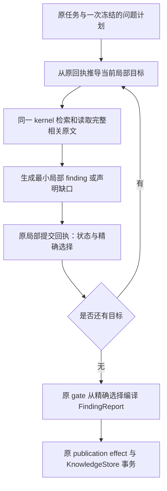

# 固定本地模型下的 Research：从第一性原理复查当前实现

日期：2026-11-01。检查开始时 HEAD 为 `64d2ab5a`，写报告时工作区 HEAD 已更新至 `02bf0093`。本轮没有修改生产代码、既有测试、历史实验或模型设置，没有启动新模型实验，也没有提交代码。新增本报告和独立离线审计资料；不把工作区其他变动记成本轮成果。

离线资料：`.e2e-artifacts/research-first-principles-20261101/audit.py`、`audit.json`。脚本读取固定时钟的 15 次最小题和后续 24 次复合题对照，共 131 个真实请求，以及两份 Qwen 原始反例；记录了 73 份输入文件的 SHA256。脚本执行前后 579 个生产 Python 文件的汇总指纹一致，原输入哈希未变化。这是脚本执行边界的校验，不是整个工作期间不存在其他活动的声明。

## 1. 判断：还有工程空间，但剩余问题已经不只是上下文长

**值得继续做，但下一轮应集中清理现有合同、缩小生成任务，不应再堆一套研究架构。**

目前同时存在三层问题：

1. **已发生、已被大量修复的执行负担。** 长历史、手抄全局 coverage、最终再改写、自审及修复空转，过去确实影响研究。当前局部 scope、原回执重建、精确选择、原 gate 编译和持久化重试预算已经落实，不能再把它们全列成待开发项。
2. **尚未清理的提示及合同负担。** 最新实际请求仍夹带与本轮局部结束协议不一致的全局指导，保存成功回执也仍指向旧的全局完成动作；还有不相关领域指导、可避免的状态组合和引用身份选择。
3. **固定部署的真实语义错误。** 证据完整进入请求以后，仍会漏原因、混淆对象、添加所问范围之外的错误解释、把没有依据的邻近事实声明为完整答案。上下文优化不能自动消灭这类错误。

现有证据既不支持“Codey 架构已经没问题，只是模型笨”，也不支持“再减几个 token 就一定能完成任意研究”。可实现的产品方向是：**有边界的资料调查、忠实的小范围回答、可追溯的原文、明确的未解部分**。跨来源推断、因果判断和完整性保证，不能靠结构校验自动获得。

12B 可以作为工程压力目标，但“12B 某套题通过 ⇒ 27B 一定通过”不成立。不同微调、量化、模板和工具训练会改变行为；无需更换模型，但实际部署仍应分别验收。

## 2. 直接核对最新原始记录，而不是只读历史总结

最近五道最小题的固定时钟材料位于：

`.e2e-artifacts/research-local-followup-20261101/batch4-fixed-minimal/`

来源、候选顺序、模型可见时钟、原 rubric 固定，采样 seeds 为 74/75/76。规划和阅读由 fixture 提供，通过原执行器产生回执；模型自行生成 finding、选择状态和结束，使用生产 kernel、知识事务及发布链。它验证的是给定材料后的局部工作，不是自主规划和联网检索。

| 原问题 | 按原内容判据通过 | 实际表现 |
| --- | ---: | --- |
| 单写者限制及原因 | 3/3 | 保留一个 WAL 文件、同一时刻一个 writer |
| 只读版本及全部 OR 条件 | 3/3 | 保留 3.22.0 和三个替代条件 |
| checkpoint 停止边界及原因 | 1/3 | 两次只回答何时停止，漏掉为什么 |
| checkpoint 记录进度及下次恢复 | 0/3 | 两次附加错误停止边界，一次混淆 WAL 与 wal-index |
| 只有并发和共享内存邻近证据 | 0/3 | 两次 no_progress；一次最终 unresolved，但此前保存缺口占位并误报 answered |

合计：**12 次 done，内容通过 7/15，38 个请求，提供方报告的输入 token 累计 129,301。** 内容分数沿用归档人工评分，并核对了实际生成正文与原文；不是由新脚本进行自动语义评分。累计 token 也不是扣除缓存后的计算量。

两个明确反例：

- 恢复题的原文完整包含：`The checkpoint remembers (in the wal-index) how far it got and will resume ... from where it left off on the next invocation.` seed 76 却写“在 WAL 文件中记录……（在 wal-index 中）”。不是网页没读到，而是对象关系被改坏。
- seed 74/75 回答恢复机制之前，自行添加“遇到读者正在使用的 WAL 页面时暂停”。原文边界是越过当前 reader 的 end mark；附加的概括改变了条件。所问恢复机制原本可以直接回答，无需重述停止机制。

归档 Qwen 也有绕开 Research 的反例：

- `artifacts/research-layered-qwen27b-20261030/sqlite-concurrency-l3-r1.json`：仅 **254 输入 token**，材料只支持读写可并发、写者串行，回答仍扩大成“显著提升并发读性能”“整体吞吐优于默认回滚日志模式”。标成“推论”没有补齐推断前提。
- `artifacts/research-convergence-quotes-20261030-b/comparator.json`：**785 输入 token** 的单条主张审查，把 high-dose combination therapy 解释为 single-drug treatment，错误放行比较对象被替换的结论。

这能证明：当前部署的语义错误不全由 Codey 长上下文引起。不能据此单独归罪参数量、Q4 量化、uncensored 微调、thinking 设置或后端，因为没有控制这些变量的对照。

历史局部工作批次曾达到 11/15，固定时钟最小题批次为 7/15。两批不具备完整单变量条件，不能据此断言某次提示修改造成了退步。

工作区随后新增了 `batch5-fixed-factorial/` 的 24 次同层对照，本轮又核对了其全部实际请求及配对首响应：

| 配置 | 关系拆分 | 历史投影 | 原整题内容通过 | 请求数 |
| --- | --- | --- | ---: | ---: |
| A | 否 | 否 | 2/6 | 19 |
| B | 是 | 否 | 0/6 | 30 |
| C | 否 | 是 | 0/6 | 15 |
| D | 是 | 是 | 2/6 | 29 |

这一轮同样没有证明某配置稳定胜出。尤其要保留两个动作错误：B-versions-74 正确保存引入版本后，立即空 unresolved，丢弃刚才的正确回答；C-versions 的三个 seed 则连续三次保存相同引入版本，没有进入选择及只读条件回答。这使“正确内容之后仍选错下一动作”成为另一个独立减负目标。

还核实了测量限制：A/C、B/D 的 12 个配对首请求 JSON payload（保留字段顺序，含 messages、seed、schema）相同，但三个 A/C versions 配对的首回复内容不同。不能把固定 seed 当成后端严格确定的保证，也不能从这些资料区分 seed 处理、数值差异或缓存状态。下一轮需要相同输入的重复观测，不能把一次输出变化全归因于刚改的代码。

## 3. 本次找到的具体工程缺口

### 3.1 同一次请求仍描述两种结束协议

最新 15 个首请求全部同时出现：

- 局部工作包：用 `submit_research_answer` 结束当前目标，不要调用全局 done。
- 初始任务指导：`Submit only report_sections.coverage to done`，并要求全局 rN 登记。
- 通用结尾：`Deliver the final answer with done`。

这些首请求的可见工具实际上只有 knowledge_read、save_finding、read_tool_result、submit_research_answer，没有 done。

对应代码：

- `operations/research_iteration.py:308` 在进入 kernel 前按 policy 创建稳定指导。
- `operations/task_guidance.py:50`、`research/completion_guidance.py:31` 尚不根据本轮 scope 切换完成协议。
- `operations/kernel_preparation.py:18` 已经拿到 TurnSnapshot，但仍直接拼入该稳定指导。
- `operations/kernel_prompt.py:76` 对普通 research 仍追加全局 done 和编码任务验证说明；只有 research_review 有单独的提交结尾。

18 次 save_finding 的后续实际请求还包含：

`Select fN in done.report_sections.coverage[].findings ...`

它来自 `research/findings.py:127` 的成功回执。历史裁剪清走了初始指导，下一次却又从最近工具结果带回旧协议。

**这不是“提示还可以再短一点”，而是提示、可见工具和实际提交合同没有完全一致。** 最新模型最终仍使用了局部提交，因此不能断言此矛盾导致了每条内容错误；但它是无需换模型即可修正的确定问题。

### 3.2 领域选择被普通词语误触发

`research/methods.py:35` 把“转移”作为 clinical 关键词。SQLite 问题“继续转移数据”因此在三个首请求中带入了癌症、临床试验、动物/人体适用性指导。当前纯函数也可重现。

不能靠不断添加“遇到 SQLite 就排除临床”来收口。应让领域指导成为可选建议，对这类多义词要求明确领域语境；已有局部 scope 时，默认只提供当前必要的通用证据约束。需要特殊方法时，再从原计划或明确任务要求提供，不增加一个独立分类服务。

### 3.3 局部合同的启用仍依赖模型填写可选字段

`tool_contract.py` 的 research_plan 只必填 questions；示例也只有 questions。

`local_scope.py:55` 却只有在原计划回执含 question_details 时，才认为存在局部计划；`kernel_context.py:351` 的一组历史投影又依赖该 scope。

本轮离线探针确认：只有 questions 的计划合法，但不会启用局部工作。最新 15 次 fixture 均提前填写了 question_details。

因此不能说“最新生产研究已经一律采用了实验中的减负流程”。这不是两套运行时，却是新任务可能进入两种合同的入口。未来验收通过后，新任务应由冻结合同明确采用局部计划；不能由模型碰巧有没有填一个可选字段来决定。旧请求继续按原版本恢复，兼容读取不等于继续为新任务保留两种默认行为。

现在不应跳过既有内容门槛直接强制切换；先修提示、验证内容，再收敛新任务入口。

### 3.4 schema 把本可消除的非法组合留给模型

局部提交把 state 和 findings 分开声明；执行时 `local_scope.py:280` 又要求：answered/partial 非空，unresolved 必须空。

按归档的实际 JSON Schema 检查：

- 38 个请求的采样声明均允许 `answered + []`。
- 其中 21 个请求还允许 `unresolved + [f1]`。

这是对声明的标准 JSON Schema 离线验证，不是新测 KoboldCpp 的语法编译行为。执行器仍会拒绝非法组合。最新这 38 个回复没有实际生成上述非法组合，因此不能把这项缺口冒充本批内容错误的直接原因；历史 batch6 中则出现过 unresolved 仍带 fN 的拒绝。

还需要注意实现边界：`toolchain/tool_spec.py:51` 的 ToolSpec 主要保存 properties 和 required；`:143` 的 Research 转换没有保留根层联合约束。直接在 TOOL_CONTRACTS 根节点写 oneOf，未必会传到真实请求。修这项要从同一冻结定义贯通 schema、文本签名、解析和执行，不能只改提供方 response_format。

最小第一步可以先在**没有任何可选 finding 的 scope** 中把 state.enum 收窄为 unresolved，避免声明 answered 空集合。存在候选时，再评估受当前后端支持的联合约束；不要为此引入另一份模型专用合同。

### 3.5 缺口反馈还残留相互争夺的指令

局部缺证据错误正文已经说明“改成 partial 不能补足直接证据，应空 unresolved”，但 `answer_focus.py` 的 allowed_actions 仍统一写 `select partial or unresolved`。最新 8 个请求里能看到这一尾句。

应由同一 ResearchIssue 生成一致的允许动作，并与本轮可见能力相交。不能只修改 message，却留下相反的结构化 actions 或 native 修复结尾。若材料已足且问题是局部表达错误，不应默认要求再次联网。

### 3.6 当前最难的剩余工作是“理解后重新表达”，不是搬运引用

`findings.py:15` 会验证 passage 已读、来源与版本、条件形状及版本字面量，然后保存模型生成的 claim。`interpretation_review=unreviewed` 是正确边界。

`report_proposal.py:93` 逐字采用这条 claim，避免最终再次改写，也已经正确收敛。但它同时意味着：**错误若在局部 claim 中形成，最终编译会忠实保留错误。**

当前少量证据任务仍同时要求模型完成：判断是否相关、保留全部必答关系、英文理解、中文表达、决定是否充分、选择工具及提交状态。一个几乎不用额外推理的恢复原句，被重新写成更长的“背景解释”，反而引入错误。这是下一批减负最应该针对的环节。

### 3.7 引用真实性与语义真实性是两种不同验收

原 gate 可检查：来源确实读过、引用精确版本、选择归属、格式、回执、字数、唯一发布及少数已知负向模式。它不能普遍证明中文主张被英文引文蕴含，也不能证明任意问题全部答完。

`operations/research_completion_checks.py:180` 对此已有诚实注释；任务覆盖保存为 model_reported_not_semantically_verified。不能为了“跑通”把保存成功改成语义认证，也不能靠扩充 count/checkpoint 等关键词规则建立通用研究理解器。

### 3.8 正确保存之后，模型还会在第二次选择时丢掉答案

新增四组对照的真实轨迹说明，问题并不都发生在阅读或中文表达：

```text
B-versions-74：save_finding(正确的 3.7.0 引入事实)
              → submit_research_answer(unresolved, [])
C-versions-74/75/76：save_finding(同一正确事实) × 3
                    → no_progress
```

现有候选幂等性和停滞保护能防重复写、停止无限循环，但它们没有替模型完成正确的动作选择。保留候选与采用的区别是合理的；让模型在下一轮重新判断一次刚写好的答案，也有可观测成本。

这支持在清理提示后，单独对照“本题回答与明确采用在一次模型响应中声明”的合同。仍必须由模型明确选择 answered/partial/unresolved；不能把 save 成功升级为 host 自动认定完整。该变更的持久化与恢复边界见后文，不能只在提示里要求连调两个工具来假装已经合并。

## 4. 从第一性原理，哪些工作不可省，哪些应交给程序

研究的必要工作是：

1. 明确要区分什么，以及哪些信息仍不知道。
2. 找到、读取能够回答它的材料。
3. 判断材料支持到哪里，保留条件、替代关系与比较对象。
4. 输出相应范围的答案，或明确缺口。

网络、格式、持久化、报告标题和引用编号是服务于这些工作的机制，并不是需要模型再次推理的研究步骤。

| 职责 | 建议拥有者 | 能省掉什么 |
| --- | --- | --- |
| 问题含义、资料相关性、主张范围 | 模型；难题保留人工核查 | 不能用正则或“保存成功”冒充理解 |
| 已读身份、精确版本、qN 绑定 | 原回执与冻结 scope | 不必让模型反复抄全局身份 |
| 当前目标、下一目标、修复预算 | 原计划和已结算回执的纯推导 | 不需要新 cursor 表或第二个调度器 |
| 局部中文正文 | 模型尽量只写一次 | 取消不必要的背景扩写、最终润色和重复复述 |
| 全局 coverage、实际调查状态 | 原局部选择和工具回执投影 | 不必每题重交整份报告 |
| 报告、引用、字数、发布 | 原编译器、gate、effect、KnowledgeStore 事务 | 不需要模型另写 evidence/counter/source table |

当前 strict 流程也没有在外层再次自动补查：`research/pipeline.py:417` 返回 strict_writer_owns_followup；`research_flow.py:384` 没有补查时直接返回已有结果。不能仅因为仓库保留了 PlanExecutor、pipeline 或 review 模块，就断言这些都在最新每轮模型中重复执行。

## 5. 建议的执行形态：继续使用现有一条链



这条链的主体已经存在。建议是把它的输入与输出合同清理完整，而不是创建 ResearchRuntimeV2。

单一事实来源不是“只能有一个文件或一张表”，而是同一事实只有一个权威写入者，其他形式由它确定性派生：

| 事实 | 权威依据 | 允许存在的派生形式 |
| --- | --- | --- |
| 实际调查了什么、读到了什么 | 原工具结算回执及固定来源版本 | ledger、当前阅读工作包、审计索引 |
| 模型生成的 claim | 原 KnowledgeStore 的精确版本 | 上下文预览、报告中引用的原文 |
| 本题采用什么、模型声明什么状态 | 原 submit_research_answer 结算回执 | 当前 scope、父问题 coverage、修复定位 |
| 已接受的最终输出 | 原 gate 接受并冻结的 FindingReport | UI、导出、知识 answer 与 synthesis 的同事务发布投影 |

不要增加可独立修改的 question_answers 表、当前问题缓存、报告草稿正文库或模型专用知识库。归档 JSON 只是实验记录，不进入运行时决策。

## 6. 具体修改顺序

### 第一批：只清理同源合同和实际请求，不改变研究语义规则

修改位置：

- `operations/kernel_preparation.py`
- `operations/kernel_prompt.py`
- `operations/task_guidance.py`
- `research/completion_guidance.py`
- `research/findings.py`
- `research/methods.py`
- `research/answer_focus.py`

实施要点：

1. **以已经冻结的 TurnSnapshot 作为本轮指导的依据。** 规划轮说明计划；局部轮只说明本题保存、选择和空缺口；全局旧合同只在相应已冻结请求中出现。不要在 render 时重新查询一个可能已变的 current_scope 来覆盖快照。
2. 将通用证据原则与阶段结束指导分开；局部首请求不再拼入全局 coverage、rN 逐项填报或已不存在的 done。计数、rN 保留在原计划与程序投影中，不从审计删除。
3. 让 kernel_prompt 的完成动作跟随快照中的实际提交工具。native 的修复结尾也一样；当前 `_completion_followup()` 的 native 分支仍可能沿用全局 final rule，不能只修 JSON 路径。
4. 保存回执优先返回事实数据：finding_ref、原 claim、证据身份、未审查状态、字数。去掉域层固定的全局 `next` 指令；下一轮如何结束由下一份冻结合同统一指导。旧已归档回执不重写。
5. 纯 research 无工作区编辑时，不追加编码测试、Shell、CodeMode 的无关说明。原授权与执行检查继续在 host 生效；不靠向模型重复这些说明来执行权限控制。
6. 修多义词领域路由，去掉临床误触发；不能给 WAL 添加专用例外来替代一般修复。
7. 让缺证据 Issue 的 message、allowed_actions、协议修复结尾一致；不更改负向检查的拒绝条件。

本批验收首先是**真实待发送 payload 的一致性**：局部轮没有全局提交指令，没有不相关领域条目；所有模型协议和恢复请求都从同一快照产生。同一固定材料再跑 15 次检验内容；提示一致只是工程通过，不预先宣布内容一定改善。

### 第二批：把局部生成从“写一段解释”收窄为“回答当前所问关系”

修改位置：`research/local_scope.py`、`research/context_view.py`、原 research_plan 契约，以及 fixture/矩阵脚本。

仍使用已有 qN 下的 work_units，不增加新计划存储：

- “何时停止、为什么停止”必要时分成两个完整局部目标。
- “记录进度的位置、下一次如何继续”分别提取；只问记录位置时不重写停止规则。
- 一个完整 OR 条件列表应作为同一关系保留；不能拆成多个彼此失去“或”联系的原子词条。
- 跨对象比较或因果判断是明确的后续目标，带入已有精确前提；不要让模型在每条 finding 中顺手完成全篇综合。

本题工作包仍提供完整父问题、必要原任务约束、完整相关条件段、当前候选和修复问题。**缩小回答范围，不等于静默删除原文条件。** 选择段落时要保留列表、否定、例外及必要上下文；不能只因字符串短就视为语义完整。

输出要求应是：直接回答当前目标，保留原文技术对象和逻辑关系；无需增加未被问及的背景、建议、性能推断或因果解释。示例和字段说明应是通用任务形状，不把本轮 WAL 正确答案硬编码进生产提示。

第一步可以继续保留 `save_finding → submit_research_answer`，以便先隔离正文收窄的收益。两次调用本身不是两套运行时；其间保留候选与采用的区别是有价值的。对新增第 3.8 节的动作错误，另做下面的单响应提交对照，不要与关系拆分同时变更后宣称各自因果收益。

不要自动把一个 save 成功转成 answered；如果模型遗漏了为什么，这样自动推进会进一步隐藏缺口。已有 partial/unresolved 继续是模型声明，需要原 rubric 人工核对。

### 第三批：减少可由 host 确定的身份和格式选择

修改位置：`kernel_protocol.py`、`local_scope.py::scoped_spec`、`tool_contract.py`、`toolchain/tool_spec.py`，必要时涉及参数规范化和已有执行结算入口。

优先做小变更：

1. 无候选时只允许 unresolved；有候选时评估联合 schema，使状态和集合约束在同一权威定义中表达，并保持执行校验。
2. 局部普通提取只展示有用的 save_finding 字段；复杂 comparison/conditions 仅在当前任务需要时展示。字段在同一 ToolSpec 的冻结投影中收窄，不发明另一种保存实现。
3. knowledge_read 只提供能解析的已观察身份或明确检索路径。s1 是网页来源定位，不是知识 note；最新缺口题曾因这个混淆增加一次无效读取。知识搜索与实际来源阅读的恢复路径必须继续可达。
4. 同一窗口避免同时暴露多种等价打开网页的操作；保留一个主要打开路径和必要定位/恢复动作。新的给定证据实验已经只有四个工具，不能把它的语义失败全部归因于生产的更大工具集合。

进一步减掉 question_ref 抄写时，要明确设计原始输入与有效输入：原始参数保留在 provider artifact，host 仅从**本次冻结 scope** 绑定缺省 qN，执行参数仍经原授权和校验；显式传了错误 qN 必须拒绝，不能默默修正。绑定依据及有效参数必须可重放。不要用运行时“最近的问题”补身份。

根层 oneOf 若需要通用 ToolSpec 支持，就应连同冻结、序列化、文本/native 请求、解析和恢复一起设计；不要只在某个本地 provider 上特判。该项能减少协议差错，不能认证语义，也不应抢在第一批一致性修复之前扩大重构。

### 第四批：验收后收敛新任务入口

局部流程通过有限内容门槛后，新 strict research 的 planning snapshot 明确要求原 question_details 合同，或者由 host 对明确给定的单题/题目列表建立对应原计划；复杂自然语言任务仍需解释问题范围，不能由逗号切分冒充语义规划。

旧已冻结请求按原合同恢复，新任务统一采用局部合同。不再依赖 optional question_details 的偶然出现，也不做“局部失败就切到弱全局完成”的隐式回退。

无 finding 的本题可以正常 unresolved；全部目标都没有支持时，仍沿当前 research_unresolved 结束，不发布“已证实结论”。界面可以明确区分调查正常结束、存在部分结论、完整性由模型声明及机械运行失败；不要把 no_progress 改名成功。

### 单独验证：把本题回答与明确采用放进一次模型响应

新增轨迹已经给出值得做这项对照的直接线索。可以在**原局部提交合同**中支持“采用已有精确 finding，或提交一条带原文依据的新 finding”，并同时由模型声明本题状态；由原保存逻辑和原结算链生成唯一选择。空 unresolved 不产生 finding。

实现时仍只有一个 `submit_research_answer` 领域入口、一套 `save_finding()` 保存逻辑、一种规范选择回执；不另存 answer 正文。已有引用分支验证原冻结 fN 版本，新 finding 分支验证本次冻结 passage 集合，并把该效果实际创建的精确版本作为选择依据。不能先执行写入，再偷偷修改原 scope 的 fN enum 来通过既有校验。

这需要解决：知识事务成功但选择回执未结算时的恢复、重试幂等身份、同一候选仅写一次、接受前不发布、接受后不重编译等真实边界。跨知识事务和 durable 回执的边界靠原 effect 恢复与幂等结算处理，不能仅因为是一个工具就声称它们已成为单个数据库原子事务。绝不能增加一个同时写 claim 和 answer 文本的旁路，或让 host 因保存成功擅自选择 answered。

这一改动消除的是保存后重新选择时的丢弃和重复机会，不保证第一次生成的 claim 正确。第一批清理合同更小、风险更低，应先做；随后比较同一材料的两种提交粒度，收益成立再迁移新任务，旧冻结请求保持原样恢复。

## 7. 哪些环节可以省略或退出默认路径

| 环节 | 建议 |
| --- | --- |
| 同模型对自己作全面语义认证 | 不恢复；历史短材料反例已显示会错误放行 |
| 最终整篇再写 summary/evidence/counter | 已去掉的自由改写继续保持；编译直接采用精确 claim |
| 每题重新填全局 task_refs 与 coverage | 从局部请求中去掉；计划登记一次，原回执汇总 |
| 只因保存了新 finding 就再来一次“反思” | 省略；只针对具体错误或明确缺证据继续工作 |
| 多个等价网页打开别名、无关领域方法 | 按当前真实工作收窄 |
| 为无证据问题生成一条“证据不足”的 fact | 省略；直接空 unresolved，不让占位正文进入事实选择 |
| 同一 finding 在结论、关键证据、coverage 三处完整复述 | 可在确定性展示层收敛，保留结构化出处和展开入口；这主要改善阅读，不是最新局部模型错误的直接修复 |
| 来源固定版本、完整条件、明确缺口、原效果回执及唯一发布 | 保留；这是可审计研究的必要成本 |
| 任意研究任务都自动做跨来源推论 | 退出默认行为；用户确实要求时作为显式局部推断任务，保留假设与限制 |

`finding_report.py:138` 当前“关键证据”主要重复所选 claim。若产品想强调可核对性，更有帮助的是从已有精确 evidence 版本展开原句，而不是再重复模型解释。源文与中文 claim 的显示是现有事实投影，不需要新的知识正文。已接受历史报告保持其原快照，新渲染若改变需明确版本和导出来源。

## 8. 下一轮如何判断值得继续，而不是继续循环改代码

先复用现有 `research_evidence_local.py`、`research_local_matrix.py`，不建新 benchmark runtime。

建议一次只比较一项：

1. 当前代码与清理同源提示后的版本：同模型、来源、窗口、任务、候选顺序、时钟、采样、停止预算。
2. 在干净提示上比较原局部目标与更小关系目标；父问题评分点不变。
3. 单独比较原两次调用与单响应显式采用，统计正确候选被丢弃、重复保存和状态误报；正文正确性继续按同一判据检查。
4. 必要时另测同部署的直接原文提取、中文最小转述、缺证据判断三个任务形态。诊断可直接调用模型，但生产仍只使用现有 kernel；不把诊断脚本变成产品执行器。

继续记录四维：遗漏、无依据附加、完成状态误报、缺证据结束。另记有证据却选择 unresolved 的比例，防止靠全答未知获得虚假改善；token 和耗时单列，不能用早停带来的低成本代表质量提高。

五道最小题的 15 次已知反例可作为第一道有限门槛，之后增加未参与提示修改的关系、版本、比较对象和缺证据题。三次 seed 全过只能说明已知反例暂时通过，不能证明普遍可靠。不要将人工评分答案或每题正确结论注入生产规则。

原实施清单的顺序仍合理：给定证据稳定后，再验收干扰候选、自主检索、复合问题、完整 WAL 与恢复。**不能用大量合同测试通过，跳过内容门槛推进推广。**

若清理协议、降低生成范围以后，直接完整原文上的最小中文转述仍稳定失败，应把瓶颈判定为这套固定部署在该任务形态上的能力边界，停止继续加外围机制。这时仍可以交付以精确原文和有限中文提要为中心的资料调查助手；关键跨语言关系与推论保留人工核对。若用户要求完整中文或严格结论，不能用英文原句替代后宣称要求已经完成。

thinking、采样或输出预算可以在同部署中作后续受控诊断，但不是这次已经证明的修复。不需要更换模型，更不需要增加同模型评审循环。

## 9. 本轮验证及结论边界

- 新增离线脚本读取了 39 次运行、131 个实际请求；最小题 15 次用于提示残留与 schema 统计，复合题 24 次用于动作及配对请求核对，分别保留结果，不混成同一成功率。另检查两个短输入 Qwen 反例和局部计划激活。没有访问模型端点。
- 直接核对了最新 checkpoint 停止/恢复和缺口的原文及输出，其他局部答案也对照归档正文检查。统计沿用原 rubric 和人工评分，不把程序扫描当成通用语义证明。
- 四个现有定点测试文件 `test_research_relation_targets.py`、`test_research_read_projection.py`、`test_research_answer_focus.py`、`test_research_contract.py`：**32 passed，18.25 秒**。这是本轮运行的相关合同/投影测试，不是全量测试或真实模型能力验证。
- 本报告的修改建议尚未实施或进行新的实机对照。不能把发现了协议矛盾、域误触发及 schema 缺口，直接解释为已经找到了所有内容错误的唯一原因。

**最终判断：当前仍有明确而且具体的工程空间，最优先是“一个冻结合同、一份一致指导、一个更小的语义任务”。经过这些收敛之后，还剩多少错误，才更接近固定模型的实际能力边界。现阶段既不应放弃，也不应承诺仅靠工程就能把 12B 变成普遍可靠的自主研究者。**
