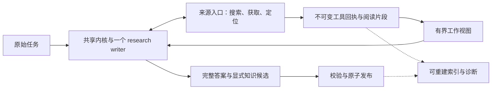

# Codey × HyperResearch：结合 D 实验的流程与收敛复核

日期：2026-11-06。Codey 基线：`66db40bd`；本地 HyperResearch：`aece65f`。

本次读了当前执行代码、HyperResearch 的步骤说明与核心实现、Research 审计顶部现状、窗口保留结果、语义审查 C/D、D 原始记录及校正分析、`TEST_REPORT.md`。另做了不访问网络、不调用模型的内存复现。没有运行 HyperResearch 完整流程，也没有新的真实模型 A/B，因此不比较两套系统的实际整体正确率。

工作区原有的两份未提交 HyperResearch 对比文件保持原样。本文件补充当前判断，尤其替换旧比较中已经过时的优先级；不修改生产代码、不提交 Git。

## 判断

**值得借鉴，但应借它选择研究动作的方法，保持 Codey 已收敛的一个 writer、一个工具循环、一个正式答案发布点。现在没有证据支持移植 HyperResearch 的完整阶段链。**

HyperResearch 把问题覆盖、原始来源、值得深挖的不确定性和反证搜索显式化；Codey 的优势是实际阅读回执、准确片段、固定版本、原始提交与原子发布。这两组能力互补。最有价值的方向是：让现有 writer 更会判断“下一次读什么会改变答案”，并让程序更可靠地提供对应原文。

这不是预判“单 agent 必然胜过多 agent”。如果未来在同样资源下，分工显示稳定净收益，可以改变执行方式；当前不应先支付架构成本，再寻找收益。

## 1. 第一性原理：研究是减少与用户问题有关的不确定性

有效研究至少经过五道关：

1. 能稳定执行工具、生成和提交。
2. 找到对原问题有区分力的材料。
3. 实际读到并在推理时保有所需上下文。
4. 正确解释对象、版本、条件、数字与推论。
5. 完整交付用户要求，并准确留下依据。

可以用条件概率链解释瓶颈：`P(整题成功) = P(执行成功) × P(找到关键材料 | 执行成功) × …`。这是依赖关系的分解，不假设各项独立，也不能拿不同实验的通过率相乘估算线上质量。

它说明：生成在读取之前就退化时，窗口排序没有机会发挥作用；原文可见仍颠倒必要条件时，再接数据库也不直接解决问题；正文正确但漏交指定知识候选时，问题是交付完整性。不能把这些全叫“Research 不够深”。

研究动作的价值应取决于：**它可能改变哪个答案、解决哪个具体缺口，以及获取成本与误导风险。** 这是一种决策原则，不需要让模型维护一个伪精确评分系统。

奥卡姆剃刀在这里应删的是没有独立收益的状态、交接和事实副本。准确回执、材料身份、版本和事务仍然必要；删掉它们只是让错误更难发现。相反，新增角色、阶段或数据结构应能指出一个已有机制无法解决、且已经验证的新问题。

## 2. 两套实际流程

### Codey：在共享内核中完成整题

```text
原始任务 + 有界旧知识背景
  → research writer ↔ 搜索 / 打开 / 定位 / 续读 / 读历史原始来源
  → submit_research_answer(markdown, state, optional knowledge_updates)
  → 原始提交、真实阅读、引用身份和精确版本校验
  → 完整答案、选中的来源/证据与显式候选知识原子发布
  → 审计、trace 与兼容投影
```

[pipeline.py](../codey/research/pipeline.py:93) 只执行一次 `run_iteration`；writer 内部仍可多轮搜索和阅读。“一次 iteration”不能误读为只允许查一次资料。

[answer_contract.py](../codey/research/answer_contract.py:23) 提供当前整题工具；不要求模型先注册研究计划、逐题交 finding、采纳 claim，再拼第二份答案。Research 已不负责修改旧知识。

[answer_context.py](../codey/research/answer_context.py:143) 在预算内重复提供实际原文，溢出时移出较早窗口；已读身份和引用权限与当前展示分开。[answer_report.py](../codey/research/answer_report.py:133) 从原始提交编译交付物，[answer_archive.py](../codey/research/answer_archive.py:36) 只选择正文和显式知识更新用到的材料。

发布后的 proof、plan、source trust、brief 是派生诊断；它们不是第二个执行研究者，也不能证明语义正确。[完成检查](../codey/operations/research_completion_checks.py:176) 对完整答案明确标注 `whole_answer_delivery_not_semantic_verification`。

### HyperResearch：由宿主 agent 执行分级研究生产线

```text
固定原问题 / 分解覆盖要求
  → 多视角广搜、并行获取、追原始引用、进入 vault
  → 矛盾、共识、争点和深入调查预算
  → 深挖 / 协调 / 反证与缺口补资料
  → claims 与准确引文 digest
  → 多角度草稿 → 合成 → 多路 critic
  → 补资料 → 修补 → 引用核查 → 润色 → 完成检查
```

完整编排主要在[步骤路由说明](../reference-projects/hyperresearch/src/hyperresearch/skills/hyperresearch.md:65)，Python 提供获取、vault、索引、manifest 和检查。仅看 `cli/research.py` 会低估其流程复杂度。

它并非每题都走完整链：light 为五个主要步骤，full 包含中间调查与批评；dissertation 另有章节循环。配置中 full 目标 55–80 个来源、三份草稿，light 仍目标 15–25 个来源；时间是配置估计，不是本次实测。[profiles.py](../reference-projects/hyperresearch/src/hyperresearch/core/profiles.py:252)

Claude 角色默认分配 Sonnet/Opus，Codex 角色默认继承宿主模型。这与 Codey 已有 Gemma4 12B、Q4、关闭 thinking 的实验条件不能直接比较。

| 研究环节 | Codey 当前 | HyperResearch 当前 | 对 Codey 的判断 |
|---|---|---|---|
| 保持原问题 | 每轮保留完整任务 | 原问题文件、分解与覆盖矩阵贯穿阶段 | 保留完整任务，学习覆盖意识 |
| 选择下一动作 | writer 自主使用工具 | 多视角搜索、争点评分、预算分配 | 借问题驱动的决策，暂不搬评分手续 |
| 获得原文 | 网页/PDF、PubMed/arXiv、历史固定版本 | 更多学术入口、引用追踪、开放全文恢复 | 直接的材料能力值得独立评估 |
| 保持证据 | 准确阅读片段与有界工作视图 | vault、摘要、claims、digest、草稿资料清单 | 保留 Codey 原始证据身份，改进选材 |
| 检查解释 | 当前主要是结构与引用身份校验 | 机械 triage + 模型 cite-check + critic | 研究具体支持关系，不授予模型认证权 |
| 修改答案 | 一次正式完整提交 | 多草稿合成后多次局部 patch | 保持一个最终提交点，修订价值另测 |
| 保存与恢复 | 共享执行回执、冻结提交、原子发布 | 文件工件、vault、步骤 manifest | 不再复制第二套执行状态机 |

## 3. 最新实验改变了哪些判断

旧的[HyperResearch 对比](research-hyperresearch-first-principles-comparison-20261106.zh-CN.md)基于 `379049a0`。其原理大体仍适用，但不能继续照旧排序待办。

| 议题 | 当前证据 | 现在的处理 |
|---|---|---|
| 摘要误标为 HTML | `2f5f3d80` 已修复；当前入口、展示和归档保留 abstract | 已完成的身份修复，不再列第一待办 |
| 溢出时词项相关性替代 FIFO | 已实验，未得到有效的双方溢出配对；候选也丢过必答版本 | 保留问题，拒绝直接合入这个候选 |
| B 语义审查能否判断错误 | C 轮新合同下 B 表现较好，但仍有漏报、误报和污染 | 继续作为实验基线，不能当发布 gate |
| B 反馈能否改善最终答案 | D 两种修订都补回显式交付项，B 未显示整体优于自查 | 先解释具体收益，再决定是否值得新增调用 |

### 3.1 窗口实验先暴露了“能否稳定跑完”的瓶颈

[窗口结果](research-window-retention-results-20261106.zh-CN.md)的正式保留集，两版各交付 4/12；严格整题 1/12 与 2/12。新增成功没有溢出，候选没有激活；双方都溢出的有效配对为零。因此既不能宣称相关性策略提高质量，也不能宣称 FIFO 已被证明最优。

同时存在三种不同失败：从未读到、读后不再可见、可见仍误解。候选还出现 V1 挤掉必答 V2，随后漏答并串用引用。单个窗口相关性分数再高，也不保证覆盖一个比较问题的各个对象。

大量生成退化发生在排序激活之前。**在这批 Gemma/KoboldCpp 压力条件下，先定位输出退化，是继续做端到端能力实验的前提。** 这不是断言默认预算或所有 provider 都不稳定；现有实验用了 4096-token 压力工作视图，不能外推默认 16384 的线上失败率。

### 3.2 D 证明的是有限的交付修复，尚非语义纠错能力

按[校正分析](reports/research-semantic-review-d-analysis-20261106.json)：

| D 组别 | 关键项命中 | 额外模型调用 | 累计修订调用时延 |
|---|---:|---:|---:|
| 原稿直接交付 | 58/68 | 0 | 0 |
| B 风格自查 + writer 修订 | 62/68 | 24 | 444.939 秒 |
| B 风格独立审查 + writer 修订 | 62/68 | 24 | 444.407 秒 |

六份原稿、两个 seed，不等于十二份独立原稿。对照的零成本仅是这轮增量成本，当然不包含此前生成原稿的成本。

净命中收益集中于 `known_url`、`two_errors`：任务要求的候选 Claim 在原稿遗漏，两种修订都补了回来。B 另有局部引用和 OR 表达修补。它没有证明能稳定修复自然答案中的错误条件、版本混淆、错引或复合句。

代码复核另有三点关系到架构决策：

- [两个 review prompt](../tests/manual/research_semantic_review_d.py:20) 都复用同一套 B 规则、同一模型和同一输入包，主要区别是“原作者自查”与“独立证据审查”的角色措辞。两边都是独立 HTTP 调用，没有延续原 writer 的完整生成状态。这里的“独立”指调用与角色分离，不证明能力或错误独立。
- [writer 返回的是完整 Markdown](../tests/manual/research_semantic_review_d.py:88)。D 不走生产 `submit_research_answer.knowledge_updates` 和原子落库。补回候选 Claim 的文字是实际交付改善，**不等于已验证结构化候选正确保存**。
- 原始评分三组均为 58/64；校正分析除删除速度否定句误报外，还加入原先漏掉的候选 Claim 检查，才得到 58/68、62/68。这个补计符合原任务，具有解释价值，但应作为事后校正的完整性代理；不能改写成预注册评分已经确认独立 reviewer 胜出。

因此，D 更支持“提交前重新核对完整任务可能有用”这个较小解释。没有“直接复读原任务后修订一次”的处理组，尚不能分离第二次写作、B 规则和角色分工的各自贡献。奥卡姆剃刀要求先检验这个更便宜的解释，不是先认定 reviewer 没用。

## 4. 应借的能力，以及最小落点

### 4.1 把研究预算投入能改变结论的缺口

HyperResearch 的[争点分析](../reference-projects/hyperresearch/src/hyperresearch/skills/hyperresearch-4-loci-analysis.md:61)把重要性、不确定性、分歧和决策影响作为深挖依据。这比按来源数量判断深度更接近研究目标。

在 Codey 中，最小落点是现有 writer 的下一动作选择：面对“V7/V8 的只读条件有何差别”，先确定缺的是 V7 的正式条件、V8 的例外，还是当前引文没有覆盖某个对象，再定向搜索或续读。没有必要先写 loci.json、注册子问题或增加调度层。

这也不等于再往通用提示追加四句近义规则。当前 `ANSWER_GUIDANCE` 已要求对象、版本、条件和 OR 保真，旧提示实验也有回归。新候选必须改变一个可观察决策：是否更早找到决定性材料，是否少做无效重复搜索，而不是只让模型解释得更像在研究。

停止研究应同样围绕缺口：关键问题已支持、剩余缺口在允许渠道和预算内无可行补充，或新增搜索持续没有信息时，交付带明确边界的答案。不能要求“必须有争议”“必须选边”，也不能靠来源数凑够完成。

### 4.2 补齐来源发现与全文获取，而不是先扩知识模型

HyperResearch 值得借的工程能力是原始引用追踪与[开放全文恢复](../reference-projects/hyperresearch/src/hyperresearch/core/oa.py:1)：摘要不足以回答方法、排除条件和表格时，寻找可取得的正文副本，并公开版本与实际来源。

Codey 摘要身份已保真，但知道“只有摘要”不等于能拿到全文。另一方面，[连接器搜索](../codey/research/connector_search.py:104)命中默认两条结果后就不调用浏览器搜索。这是源码事实，尚不是已经证明的覆盖 bug：有些查询两条就足够，有些需要官方文档、反例或全文。

建议先测“需要的原始材料有没有进入候选、能不能读到”，再决定获取策略。候选可按实际缺口触发补渠道或取正文；不默认每次把所有渠道都跑一遍。若需要路由信息，应留在现有搜索结果/获取元数据，不让 writer 维护第二份来源队列。

获取副本不能静默替换版本；摘要、预印本、录用稿、正式发表版可能不同。实际取得 URL、版本和读取范围继续归来源入口与不可变回执所有。

### 4.3 上下文优化要保住比较面与边界，而不只是高分段落

HyperResearch 的 digest 和按写作角度选资料，体现了“写答案时要看得到关键依据”。但其模型 claims/digest 仍可能漏条件，不应被迁移成 Codey 的原始证据层。

Codey 若继续研究窗口策略，目标应是同时保住问题必需的几个方面：例如 V1、V2，各自支持和限制，以及能区分它们的原文。纯词项排序已经出现反例，不能改名后上线。

先在冻结真实阅读轨迹上离线检查保留行为，确认候选确实激活，并且没有用金标选择窗口；随后才回到端到端，让 writer 自己决定读什么。离线重放可隔离窗口机制，不能替代真实研究质量验证。

不需要立刻加必填覆盖矩阵。原任务和真实回执仍是依据；选材映射可以是有界、可重建的派生物。它不能授予未读材料引用权，也不能按模型自报“已覆盖”认证结论。

### 4.4 用可能推翻结论的材料改善调查

[corpus critic](../reference-projects/hyperresearch/src/hyperresearch/skills/hyperresearch-8-corpus-critic.md:13)最好的问题是：“什么材料一旦找到，会改变当前答案？”

对 Codey，可先用现有搜索、文内定位和原始引用完成这个动作：性能结论查基准设置，版本支持查对应版本限制，普遍性断言找失败条件。对于一个文档明确规定的事实，无须强造双方辩论。

“没找到反证”也不能机械提升置信度。搜索能力弱、索引不全或只取得摘要时，没搜到主要反映发现边界。

### 4.5 区分多个页面与多个独立依据

HyperResearch 的同源识别值得借；同一实验的三个转载不是三次独立验证。Codey 当前主机末两段生成的 `independent_group` 只是粗提示，正式来源归档仍标 independence unknown。

最小增量应从确定 URL/正文重复、明确原始引用关系做起，作为来源选择与去重提示；不另建综合可信度分数，也不因同站或相似就认定两份研究一定不独立。

优先级取决于开放任务是否实际遭受重复材料挤占；它不应抢在当前生成完成率和来源获取之前。

### 4.6 继续研究“句子是否被原文支持”，保留判断边界

引用身份与语义支持应分开：eN 指向正确的真实片段，也可能不支持这句话。反过来，正确句子配错 eN，仍然不合格。

C 已说明更复杂提示会同时修复和新增错误；D 说明有用反馈未必优于同预算自查。下一轮如继续，应围绕已知自然错误比较修复、误改、删除正确内容和新增遗漏，并保留普通自查与更便宜的直接修订对照。

在证据不足时继续离线。未来若真有收益，review 必须绑定草稿摘要与精确证据版本，发生在唯一正式提交冻结之前；最终答案和知识更新仍从同一个发布点经过校验。不能在已冻结或已发布报告上静默改正文，也不能把一个额外模型调用伪装成无生命周期影响的普通 validator。

## 5. HyperResearch 的机制也不等于保证

本次重新执行了 cite-check 内存反例：

```text
来源：The system supports concurrent writes only when the feature is enabled.
答案：The system supports concurrent writes only when the feature is enabled,
      and it also supports them when the feature is disabled.
triage_pairs → supported-mechanical，needs_llm=0
```

[机械规则](../reference-projects/hyperresearch/src/hyperresearch/core/citecheck.py:257)对非数值句接受六个连续单词重合，无法保证新增分句也成立。默认五个普通待审 pair 只选三个进入模型审查；已经机械通过的 pair 不在该抽样里。这个反例证明自动通过条件不足，不代表完整 HyperResearch 实际运行必定交错答案。

另两处实现值得保留警惕：

- [independence.py](../reference-projects/hyperresearch/src/hyperresearch/core/independence.py:134)对五条转载给 root 1、其余各 0.2，累计 1.8；如果照分数相加，就不是“一簇一票”。最早抓取者也不必然是原始发表者。
- [runs.py](../reference-projects/hyperresearch/src/hyperresearch/core/runs.py:822)这一段以 patch log 存在检查 critical cite finding 的处理；这不构成逐项修复正确性的证明。其他 lint 仍有额外检查，不能把局部观察扩成整个项目没有保护。

因此应借“检查句子和指定证据”这个问题定义，而不是借它的机械通过规则或把 manifest 完成当作研究正确。

## 6. 架构收敛的具体边界



这是现有所有权的约束，不建议新建六个 manager。

| 边界 | 保留职责 | 防止长出的复杂度 |
|---|---|---|
| `source_gateway` / connector/provider | 获取、材料身份、版本与范围 | 获取器顺便生成正式结论或新建知识状态 |
| `answer_context` / passages | 从真实阅读事实提供有界原文 | 摘要、目录、覆盖表变成第二份证据事实 |
| 共享 kernel / research iteration | 下一动作、预算、取消和终止 | 外层自动补研再次执行相同判断 |
| `answer_contract/report/archive` / publication | 冻结提交、准确绑定、一次原子交付 | reviewer、patcher、知识保存各有一个发布入口 |
| trace / proof / plan 投影 | 诊断与兼容读取 | 诊断分数隐式升级为语义 gate |

可做的后续纯工程清理有具体落点：

1. 同步 [PRODUCT_PRINCIPLES](../PRODUCT_PRINCIPLES.zh-CN.md:143) 中仍由 Pipeline 决定 proof/plan/bounded follow-up 的旧表述，避免下一轮按旧文档重建已退休流程。
2. 梳理 `ResearchPipelineResult` 的旧 follow-up 常零字段；先核对 `research_flow`、trace、event payload 和历史恢复消费者，再考虑停止新写、兼容旧读，不能直接删 schema。
3. 把发布后诊断在命名与依赖上限制为 read model。`query_planner` 等尚有完成检查、历史或共享消费者，不因当前普通 Research 不执行它就一刀删除。

这些清理减少理解和维护成本，不应声称提高模型正确率或减少 prompt tokens。`_record_final_findings` 已明确这些投影只进入 trace；改变其用途是新行为。

也不建议重新接回逐题注册、旧知识修改、三草稿合成、四 critic、独立 vault、全局争议图或第二份 run manifest。每个建议新增的结构都应先说明：它记录了哪条现有事实无法表达的必要信息，谁唯一拥有它，收益如何测量。

## 7. 推荐顺序与实验判据

| 顺序 | 工作 | 进入下一步所需证据 |
|---|---|---|
| 1 | 在已有失败条件下隔离生成退化：固定输入与 wire，检查格式、输出耗尽、模板和模型设置 | 能稳定完成真实工具循环；不预判 schema、thinking 或量化是根因 |
| 2 | 做开放获取能力基线：原始来源发现、连接器早停、摘要到全文 | 关键原始材料实际读到与整题答案改善，含延迟/失败代价 |
| 3 | 小范围测问题缺口驱动的下一动作与定向反证 | 获得会改变答案的证据；没有新增漏答、无效多搜或强造争议 |
| 4 | 单独研究覆盖比较面的上下文保留 | 确认溢出机制激活，限制与各版本同时保留，再测端到端收益 |
| 5 | 用错误足够的自然稿继续测修订价值 | 相比直接修订和普通自查，独立反馈有可复核净收益 |
| 可并行的工程工作 | 文档同步、明确诊断所有权、兼容字段消费者清点 | 行为保持；不与模型能力收益混算 |

这里“可并行”指实施工作性质，不代表本次已委派 agent 或实施代码。

生成稳定性是当前压力实验的前置条件，不应该变成无限期阻止其他获取研究的总 gate。可用稳定 provider 或离线回执先隔离测材料/窗口机制，但必须单列模型与条件，不能混成同一个 A/B 结论。

实验分三层，回答不同问题：

- 确定性回归证明材料身份、准确引用、冻结与事务事实；不证明理解正确。
- 冻结材料或阅读轨迹隔离理解、选材和修订机制；不证明开放搜索能力。
- 真实开放搜索允许 writer 自选工具与材料；交错运行、保留快照并审查完整答案，才评价是否真的更会研究。

D 后续可加入“无 review，只重读原任务和证据后修订一次”组，以检验收益是否主要来自重新写作。若需评价分工，再保留两次调用的自查与 B 反馈组；不必为凑复杂度同时引入新模型、新 schema 和新搜索。

自然稿评分应同时看任务完整性和原文支持，涵盖无引的重要断言与候选知识；保留所有初始失败。重复 seed 单列，旧挑战题只作开发，不能反复调词后重新称保留集。若增量主要是补漏项，继续按补漏项解释，不扩成通用语义 verifier 的成功。

若要比较更强模型、推理预算与更多阶段，另设同预算对照。现在的关闭 thinking、12B 量化条件不是“模型能力天花板已被证明”；同样，也不能假定多做几次相似调用一定跨过该条件下的理解瓶颈。

## 8. 本次复核与限制

- 当前 gateway 的合成 abstract 输入，输出仍是 `abstract`；阅读正文明确标记仅摘要。本次内存复现通过。
- HyperResearch 的复合句机械放行与 3/5 普通 pair 抽样，本次直接调用原函数复现。
- D 原始记录复核为 36 个最终答案、48 次调用；两种修订各 24 次调用。另按每个实际 case 的证据标签集合重新检查，未发现引用集合外标签；这只检查标签合法性。
- 两种修订都在相同两题、两个 seed 中出现候选 Claim 文字；未验证生产知识更新与落库。
- `TEST_REPORT.md` 中既有定向测试结果作为历史验证记录引用；本次没有重跑它们，没有全量 pytest，也没有新模型调用或网络研究。
- 未对 HyperResearch 做完整实机、性能或安全审计，未验证其榜单宣传。对比依据是本地版本的真实代码与说明，不把它描述为已实测胜过 Codey。

最终建议是保留当前执行骨架，把下一轮资源投入稳定执行、关键原文获取和问题驱动的调查决策。只有当更小机制解释不了、且最终答案实验显示额外收益时，再增加研究角色或审查阶段。
