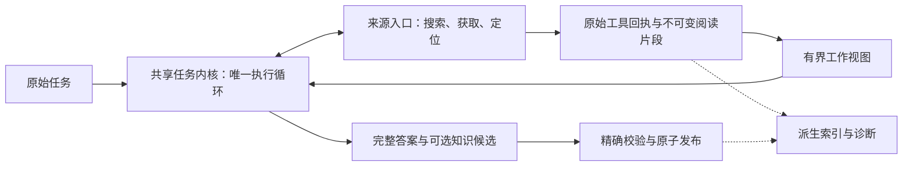

# Codey 与 HyperResearch：从研究能力到架构收敛

日期：2026-11-06。Codey 审查基线 `379049a0`；本地 HyperResearch 基线 `aece65f`。

本文依据本地源码、用户提供的审计报告及其最新单流程记录。没有运行新的真实模型 A/B，没有修改生产实现，也没有验证 HyperResearch README 的榜单宣传。以下分别标明代码事实、最小复现和待验证建议；不把架构上的合理性当作回答质量收益。

## 结论

**HyperResearch 能给 Codey 很好的启发，但应该借它分配研究注意力的方法，继续保留 Codey 的单流程与精确证据底座。**

最值得迁移的思想有四个：围绕用户问题组织证据；把阅读预算投入会改变答案的不确定性；主动检查反证及证据独立性；检查句子和原文之间的支持关系。它们不要求复制十六步、多份草稿、四个 critic 或新的知识库。

Codey 当前的主要问题已不是缺少一个研究编排框架。它已经有完整答案提交、实际阅读片段、精确版本绑定、原子保存和恢复。缺口主要是：**读到的材料究竟是什么、有限上下文留下什么、下一次阅读解决什么，以及模型是否正确理解条件。**

本轮发现一个可以先处理的具体问题：学术连接器返回的 `abstract` 在统一来源入口被转换成 `html`，模型展示也没有保留“仅摘要”的身份。这个数据流已经用最小代码复现。它比增加一套研究阶段更值得优先修正；但修正后能改善多少真实答案，仍须另外测量。

## 1. 第一性原理：研究究竟要完成什么

研究的产物是一个对原问题有用、受证据约束的答案。完成它至少需要：

1. 保留用户真正问的对象、时间、条件、比较项和交付要求。
2. 找到能区分几种可能答案的材料。
3. 实际读到决定结论的上下文，包括限制与例外。
4. 正确解释材料，区分来源陈述、推论与未知。
5. 交付答案，并留下可追溯、可复用的依据。

五项中任何一项失败，都可能导致整题失败。增加抓取量可以补第二项，却不能保证第三、四项；保存成功和引用合法主要保证第五项，也不能代替第四项。

因此，我会把目标定义为：**在给定成本和时间内，尽可能解决用户的关键不确定性，并准确交代仍无法解决的部分。** 来源数、字数、步骤数、结构检查通过数都只能是辅助信号。

对下一步操作可以使用一个非数值化的判断：它可能改变哪个结论，预计能消除什么不确定性，是否值得这次读取或搜索的成本。无须再让模型填写四维评分表；能够给出具体缺口就够了。

奥卡莫剃刀也不等于“删到最短”：应删去没有额外解释力的机制，保留维持任务真实性所必需的身份、证据、事务和恢复。复杂性应按模型必须维护多少状态、多少阶段交接、多少事实副本衡量，而不只看文件数量。

## 2. 两个项目当前真正的流程

### Codey：一个研究者在同一个工具循环里完成整题

当前普通严格 Research 的路径可以概括为：

```text
用户原任务 + 可用旧知识背景
  → 共享任务内核中的单个研究 writer
      ↔ 搜索 / 打开 / 文内定位 / 续读
      ↔ 查旧知识 / 读取固定版本的原始来源与证据
  → submit_research_answer(markdown, state, optional knowledge_updates)
  → 校验实际阅读、引用、原始提交和精确证据版本
  → 原子发布完整答案、选中的来源/证据及显式新候选知识
  → 诊断投影与追踪记录
```

关键事实：

- [answer_contract.py](D:/codey/codey/research/answer_contract.py:23) 只暴露当前研究所需的获取、读取和整篇提交工具；研究不再负责修改已存对象。
- [pipeline.py](D:/codey/codey/research/pipeline.py:93) 只运行一次 research iteration。外层查询计划与 proof review 用于诊断，没有再次启动搜索的外层循环。
- [answer_context.py](D:/codey/codey/research/answer_context.py:143) 优先保持放得下的实际原文；超预算时按较早阅读窗口移出展示，保留真实读过材料的引用身份和定位信息。
- [answer_report.py](D:/codey/codey/research/answer_report.py:133) 编译原始完整提交，不再从逐题 findings 拼接第二份答案。
- [research_completion_checks.py](D:/codey/codey/operations/research_completion_checks.py:176) 明确把整篇交付检查与语义正确性区分开。

这与审计报告正文里部分历史架构已经不同。不能据历史模块清单，得出当前仍有两条 Research、仍应恢复旧修订入口或逐题计划的结论。

### HyperResearch：宿主 agent 按程序说明运行研究生产线

它的完整路径大致是：

```text
保留原问题 / 分解要求
  → 多视角广搜、抓取、追原始引用、进入持久 vault
  → 找矛盾与共识
  → 选择值得深入的争点并分配预算
  → 深入调查、协调不同结论、寻找反证和资料缺口
  → 主张与原句证据索引
  → 三种角度的草稿 → 合成报告
  → 多路批评 → 定向补资料 → 局部修补
  → 引用支持核查 → 润色 → 发布检查
```

实际编排主要由 [入口与步骤说明](D:/codey/reference-projects/hyperresearch/src/hyperresearch/skills/hyperresearch.md:59) 驱动宿主 agent；Python 提供获取、存储、索引、状态和检查能力。不要把简易的 `cli/research.py` 搜索抓取命令误认作这套完整流程。

它有分级：light 跑五个主要步骤，full 跑完整链，dissertation 另有章节循环。不过轻档配置仍以 15–25 个来源、约 30–40 分钟为目标；full 默认三份草稿，默认角色模型配置使用 Sonnet/Opus。Codex 安装则默认继承宿主模型。它的复杂度和资源假设与 Codey 的低成本、多 provider 定位不同，不能直接外推到已有 Gemma4 12B 实验条件。

| 维度 | Codey 当前 | HyperResearch 当前 | 借鉴判断 |
|---|---|---|---|
| 执行形态 | 共享内核、一个研究循环 | 按步骤说明编排多个角色及阶段 | 保留 Codey 形态 |
| 原问题 | 每轮保留完整原任务 | 原问题文件、分解、覆盖矩阵贯穿 | 借覆盖意识，不恢复计划注册 |
| 获取 | 浏览器搜索 + PubMed/arXiv 连接器 | 多类学术/原始数据库、引用追踪、开放全文恢复 | 借材料能力与身份保真 |
| 深度分配 | 主要由 writer 自主选择 | 显式争点、预算、反证搜集 | 借决策方法，不搬评分手续 |
| 上下文 | 原始阅读窗口、超预算后移出较早窗口 | 多层摘要、证据索引、按草稿角度选资料 | 借选材；摘要继续只是派生物 |
| 引用 | 绑定真实读过的不可变片段、快照及版本 | 引用到 vault note，机械预筛 + 模型核查 | 保留 Codey 精确绑定，研究支持关系核查 |
| 长期复用 | 候选知识与被选择的来源/证据 | 抓取来源广泛进入可搜索 vault | 借可发现性，避免资料库膨胀 |
| 完成含义 | 交付与证据完整性，不承诺语义认证 | 步骤、工件、内容 lint 与 findings 检查 | 两者都不能把通过等同事实正确 |

## 3. 最值得借鉴的五个机制

### 3.1 首先保真“读到的到底是什么”

HyperResearch 的开放全文恢复直接针对一个重要失败：系统抓到了论文摘要，后续写作者却像读过论文正文一样推理。其 [oa.py](D:/codey/reference-projects/hyperresearch/src/hyperresearch/core/oa.py:1) 会尝试开放副本，并区分取得的稿件版本。

Codey 已有学术连接器，缺口不只是“再接几个 API”。当前数据流是：

1. [source_connectors.py](D:/codey/codey/research/source_connectors.py:917) 用连接器命中的摘要构造材料，`content_kind="abstract"`。
2. [connector_search.py](D:/codey/codey/research/connector_search.py:422) 把这个身份传给 provider 返回值。
3. [source_gateway.py](D:/codey/codey/research/source_gateway.py:185) 只单独处理 PDF，其他情况通过 `SourceDocument.html(...)`，因而把 abstract 改成 html。
4. [source_rendering.py](D:/codey/codey/research/source_rendering.py:87) 只为 PDF 输出材料类别说明，普通工作视图也未保留摘要身份。

最小复现确认：连接器页是 abstract，gateway 输出是 html，读取结束只提示“本快照可用提取文本已结束”。该提示对于快照本身成立，但没有说明快照只有摘要。

**建议先做窄修复：保留既有材料类别，并把“仅摘要”传到阅读结果、工作视图和存档来源。** 摘要可以支持摘要中明确说出的内容；它不能自动支持正文方法、排除条件、表格或附录。

后续若接开放全文，必须保留摘要 URL、实际取得的全文 URL、版本和范围信息。可以先保留已有字段，再根据实际需求区分“传输格式”与“材料范围”；无需立刻扩成大型文献 schema。`truncated=false` 只能说明提取结果未被截断，不能说明读到了整篇作品。

这是已确认的表示问题；目前没有证据量化它在真实任务中造成的错误比例。

### 3.2 把上下文预算分配给问题相关的原文

HyperResearch 的 evidence digest 和每份草稿的资料清单，解决的是同一个约束：**搜得到不等于写答案时还能看到决定性的证据。**

Codey 当前已经解决“放得下就完整显示”和真实阅读身份问题。不应再把一个模型生成的摘要文件升级成原始证据。更值得实验的是 [answer_context.py](D:/codey/codey/research/answer_context.py:154) 的溢出选择：它目前移出最早窗口，不判断该窗口是否包含仍需要的核心条件。

一个待验证候选：

- 放得下时保持现在的完整原文行为。
- 只有溢出时，按原问题中的对象、版本、比较项和条件，选择相关的完整阅读窗口；保留问题覆盖与来源多样性，避免仅按阅读先后淘汰。
- 条件与例外需要上下文，应优先保留完整窗口；不要只摘看起来吻合的半句。
- 被移出的材料仍是真实读过的材料，稳定 `[eN]` 与精确恢复入口保持有效。
- 目录只用于定位；不要因为一个标题相关就生成新的已读证据。

可先用低成本、可解释的词项匹配与窗口去重作候选。它不能理解所有同义表达或逻辑关系，必须与 FIFO 现状比较，特别测试“早先读到的限制 + 后来读到的支持”是否同时保住。

这个方案改变的是证据选择，不是再次增加“已读/未读”提示。因此它与 11 月 6 日失败的长文导航展示实验不是同一个处理；也不能因此预先声称它会有效。

### 3.3 以会改变结论的缺口驱动搜索

HyperResearch 最有价值的部分是 [loci analysis](D:/codey/reference-projects/hyperresearch/src/hyperresearch/skills/hyperresearch-4-loci-analysis.md:1) 和 [corpus critic](D:/codey/reference-projects/hyperresearch/src/hyperresearch/skills/hyperresearch-8-corpus-critic.md:1)：发现材料中的争点，再问什么证据可能推翻当前方向。

Codey 可以在原 writer 内采用同样的判断：

> 我现在缺的是哪个具体版本、哪种操作、哪段限制或哪份原始材料？读到它是否可能改变答案？

例如，知道“某功能支持并发”还不够回答“在指定版本、只读模式和特定文件条件下是否支持”。下一步应该定位对应条件或版本文档，而不是继续搜同一句笼统描述。

源码还有一个值得单独测量的获取策略：[connector_search.py](D:/codey/codey/research/connector_search.py:104) 在连接器命中达到阈值时就跳过浏览器搜索，默认阈值为两条。它有降低成本的理由，但“有两条结果”不表示已覆盖问题，也不表示存在两份独立证据。先用开放题诊断是否真的造成覆盖不足，再决定是否调整合并策略；不应一律同时搜索所有渠道。

同时要保留认识上的边界：没有搜到反证，只有在搜索具有足够发现能力时才可能增加信心。HyperResearch 步骤说明里“没找到推翻来源就提高信心”的做法不应直接复制到受限搜索、小预算或仅摘要材料的任务。

不需要为此恢复外层 follow-up 调度器、注册逐题计划或强制每题反证搜索。下一步研究动作仍由同一个 writer 选择，并受现有预算与无进展止损约束。

### 3.4 区分多份材料和多份独立证据

HyperResearch 会识别 URL 重复、正文近重复及通讯社转载。这比按网站数量衡量共识更接近研究需求。

Codey [ledger.py](D:/codey/codey/research/ledger.py:607) 的 `independent_group` 主要由主机名末两段推导，是粗粒度来源提示；它不能识别跨站转载、共同引用同一研究，也不能证明同站材料互不独立。原子归档对新来源的独立性仍明确记为 unknown。

可借鉴的是：在来源层识别“可能同源”的材料，帮助选择下一份资料或避免重复占用上下文。先做确定重复与显式引用关系，近重复仅作提示；未知保持未知。不要急于推出“可信度 87 分”或把正文相似等同同一实验。

即使三份独立材料一致，也不自动证明结论正确；研究方法、样本、时间、适用条件及共同系统误差仍然重要。对版本事实，一份直接相关的官方原文也可能比多份新闻转述更有用。

### 3.5 检查句子与原文之间的支持关系

Codey 已能回答“这个引用是否来自本任务真实读过、准确保留的片段”。当前 [citation_occurrences / submit_answer](D:/codey/codey/research/answer_contract.py:128) 不负责证明每个正文分句都由引用推出。

HyperResearch 的 [cite-check](D:/codey/reference-projects/hyperresearch/src/hyperresearch/skills/hyperresearch-14-5-cite-check.md:1) 在研究对象上更进一步：把报告句子和被引来源成对检查。这值得研究，尤其对应 Codey 已知的 AND/OR、必要/充分、版本和对象混淆。

但“让 writer 加一句自查提示”与“由单独任务检查具体句子和精确原文”是不同机制。11 月 6 日的短引文提示实验未证实前者有效，既不能把后者视作已失败，也不能据此假定后者有效。

**建议先作为离线诊断实验，而非立即增加发布关口。** 用现有正式答案和精确引用片段，让检查者指出哪个分句超出了支持范围，同时记录漏报和误报。检查应覆盖任务完成情况与知识候选，不能只检查“已经附引用”的句子而放过无引的重要断言。

若之后证明有净收益，再讨论是否接入同一提交路径。届时必须把 review 绑定到正文摘要和证据版本，复用既有请求预算、冻结与恢复；模型审查不能另写最终答案或自动采纳知识。语义判断仍然可能错，不能变成事实认证。

接入成本也不能低估：当前提交回执会进入完成与发布，增加异步模型审查会影响取消、重试、恢复和何时允许发布。这应是独立、后置的行为改动，不能伪装成一个普通校验函数。

## 4. 不应直接照搬的设计

| HyperResearch 设计 | 对 Codey 的问题 | 更小的做法 |
|---|---|---|
| full 固定完整阶段链 | 增加交接、状态和弱模型协议负担 | 同一循环按缺口重复获取与阅读 |
| 三草稿 + 合成 + 四 critic | 成本高，同模型错误仍可能相关，合成会丢条件 | 先测具体错误的定向核查 |
| 来源数、字数、引文密度门槛 | 可能鼓励凑量，不能代表支持关系 | 以原问题、适用条件及有效证据评估 |
| 强制争点、必须选边 | 有些问题应回答未知或条件不足 | 有争议才调查，允许诚实的 partial/unresolved |
| 模型提取 claims 作为“主要证据层” | 提取也可能错，容易让派生物获得原文身份 | claims/索引只作线索，引用继续绑定真实原文 |
| 全面来源质量综合评分 | 权威、引用量与图中心性不等于本题正确 | 分开记录具体信号，不自动授予语义通过 |
| 只许局部 patch，绝不重写 | 局部修补适合小错，核心解释错时会阻碍纠正 | 修正后的完整答案仍经同一提交与冻结 |
| 再建一份步骤 manifest 与状态机 | Codey 已有共享执行、回执和恢复 | 继续由现有运行时拥有执行状态 |

“按需加载”可以借，但应先判断负担来源。Codey 已按任务缩窄工具、通过工作视图提供当前规则；不能为重新按需展示工具，再引入一轮展开手续。审计记录里的按需修订尝试已经有回退历史。

## 5. HyperResearch 自身的边界：三个值得警惕的细节

这些用于说明为什么应迁移原理而非原样移植实现，不代表对整个项目做了完整漏洞审计。

**第一，机械支持不是语义支持。** [citecheck.py](D:/codey/reference-projects/hyperresearch/src/hyperresearch/core/citecheck.py:257) 对非数值句可用六个连续相同单词自动通过。本轮直接调用原函数：

```text
来源：The system supports concurrent writes only when the feature is enabled.
报告：The system supports concurrent writes only when the feature is enabled,
      and it also supports them when the feature is disabled.
输出：supported-mechanical
```

报告保留了真子句，却追加相反结论；机械匹配仍通过。这不是完整模型流程的实测失败，但足以证明该自动通过规则不能作为语义保证。

此外，`sample_needs_llm` 默认检查全部待核查 strong 句及约 60% 的其他待核查句；机械已通过的句子不再进入该抽样。不能把它称为每个分句都做了模型级验证。

**第二，独立性分数与“一簇一票”存在落差。** [independence.py](D:/codey/reference-projects/hyperresearch/src/hyperresearch/core/independence.py:134) 给一个五条转载簇的 root 1.0，其余每条 0.2。最小复现得到簇总分 1.8，而步骤说明同时提出“一簇一票”和按分数之和判断共识。若按后者累加会高估。Codey 若借鉴，应显式按来源簇计数；也不要把最早抓到的转载自动认定为最初发表者。

**第三，发布检查仍有工件代理指标。** [runs.py](D:/codey/reference-projects/hyperresearch/src/hyperresearch/core/runs.py:823) 在存在 critical cite-check finding 时检查 patch log 是否存在，这一段没有逐项证明 finding 已被正确解决。[quote-integrity lint](D:/codey/reference-projects/hyperresearch/src/hyperresearch/cli/lint.py:110) 检查引文能否在库中某条笔记命中，也不等同于引文来自该句引用的指定来源。

这些不否定独立核查的价值，但说明“有检查器”与“检查了需要保证的命题”是两回事。Codey 应保持现在对完成证明边界的诚实描述。

## 6. 架构如何进一步收敛

建议保持现有模块所有权，只把职责明确为四个边界；不是要求新建四套系统。



| 边界 | 当前所有者 | 应保持的原则 |
|---|---|---|
| 获取材料 | `source_gateway`、provider/connector | 来源策略集中；不生成研究结论；保留材料身份 |
| 展示证据 | `answer_context`、passages、定位投影 | 只从真实回执派生；排序不改变实际阅读事实 |
| 执行与终止 | 共享 kernel、Research iteration；pipeline 管生命周期与结果投影 | writer 拥有研究动作；不再增加外层研究循环 |
| 提交与保存 | `answer_contract/report/archive`、现有 publication | 原始正文、证据与显式候选一次确定；一个发布 owner |

收敛需要坚持三个“一”：**一个执行循环、一个证据事实来源、一个正式答案发布点。**

原始回执、阅读片段、编译报告分别承担执行事实、引用身份和冻结交付的职责；它们不是应被一概合并的重复。相反，模型生成的计划、摘要、图、评分和 trace 都不能绕过它们另行定义事实。

具体约束：

- 当前 `[eN]` 继续是唯一模型可用的原始证据通道；不再并行增加 claim ID、局部计划 ID 和草稿采纳手续。
- 研究思考可以分解问题，但不要求模型注册分题或维护进度表。
- 可选 `knowledge_updates` 已有条件、限制和反证关系；利用现有表示，不再建设一套争议知识图状态机。
- 历史结论继续是线索；核查所需前提通过固定版本来源读取，不自动采纳旧 claim。
- 派生诊断若只写 trace，删除它主要节省维护与程序开销，不能声称减少模型 token。让它影响 prompt 则是新行为，必须单独验证。
- `ResearchPipelineResult` 的历史零计数等可在消费者迁移后再清理；不要把 UI/trace 兼容投影误判成第二个执行流程。
- 产品原则中仍描述外层 proof/plan/follow-up 的部分，宜与当前单 writer 事实同步，避免文档把下一轮设计带回旧架构。

长期来源复用可以后置考虑：HyperResearch 抓取来源直接进入可搜 vault；Codey 当前正式知识归档主要选择正文引用和知识更新使用的材料，其他获取内容留在运行回执中。**持久回执存在不等于跨任务能方便检索。** 若出现实际复用需求，可在现有回执/来源上做可重建的受权限约束索引，作为 `knowledge_search` 的线索来源；不必全量把每篇抓取材料变成有效知识，也不必复制一套 vault。

## 7. 推荐实施顺序与验证方式

| 优先级 | 内容 | 当前证据 | 验证重点 |
|---|---|---|---|
| P0 | 修正摘要身份在来源入口、工作视图与归档中的丢失 | 源码与最小复现确认 | 摘要/正文/PDF 身份；读取结束不夸大材料范围；恢复兼容 |
| P1 | 仅在上下文溢出时，试验按原问题选择完整原文窗口 | FIFO 淘汰是代码事实，收益未知 | 早期限制保留、跨来源比较、中间章节、无新增漏答 |
| P1 | 诊断连接器早停与原始来源发现是否限制覆盖 | 早停是代码事实，实际损失未知 | 开放查询的相关性、覆盖、独立来源、延迟与失败 |
| P2 | 在 writer 内实验定向追原文、反证和边界读取 | HyperResearch 提供方法，Codey 尚无本轮收益证据 | 真正增加决定性证据，避免无效多搜和强造争议 |
| P2 | 离线评估句子—精确片段核查 | 对应已知语义失败，检查者收益未知 | AND/OR、必要/充分、对象、版本、数字、误报与漏报 |
| P3 | 全文恢复、来源同源提示、跨任务来源检索 | 有合理能力需求，接入成本各异 | 版本/范围保真、误合并、权限和真实跨任务收益 |

不能只沿用冻结官方选段题：它们适合测条件理解，却不能评价开放搜索与排名。建议分开三层：

1. **确定性边界验证**：摘要范围、精确片段、引用身份、原子发布、取消恢复。证明程序保持什么事实。
2. **冻结材料的模型实验**：条件逻辑、比较对象、长文中段/末段、支持与限制分离、多层历史结论。证明给定材料下的行为变化。
3. **开放搜索实验**：同一时间窗口、记录搜索与抓取快照、交错运行，按有效原始材料及完整答案评价。证明是否真的更会找资料。

每次只改变一个主要机制，固定并记录模型、thinking、输出预算和检索预算；新 seed 与未见题复核。基线成功变失败要逐例保留，后端中断、输出截断和预算失败分开统计，不能删掉失败重跑后只报告成功结果。

至少分别记录：完整任务正确交付、关键条件错误、无依据断言、关键证据实际读到率、引用接线、知识候选正确性、调用与 token 成本、延迟。引用接线和保存成功不能替代整题正确率。

已有 11 月 6 日三个候选的结论应保持：短引文提示未改善正文，准确来源入口样本不足且原版也正确，额外长文导航出现截断与漏答；本轮不建议把它们重新包装后直接上线。其脚本只测试了特定展示处理，不是对 HyperResearch 整体方法的消融。

## 8. 最终取舍

如果接下来只做两件事，我会选择：

1. **先修材料身份：确保模型知道拿到的是摘要、节选还是已取得的正文。**
2. **再试证据选择：有限上下文里，保住回答原问题所需的条件、反例和比较材料。**

等这两项的效果清楚，再决定定向语义核查能否带来值得付出的收益。如果精确原文已完整可见、任务也清楚，模型仍反复颠倒条件，就需要正面评估模型能力、推理预算或检查者能力，而不是继续增加数据库字段和近义提示。

对 Codey 最适合的方向是：**用更少的手续，让模型在关键时刻看到更相关、更完整、身份更准确的原文，并明确承认仍未解决的问题。** 这能同时服务研究能力与架构收敛；完整复制 HyperResearch 的生产线则未必能做到。

## 主要依据

- [用户提供的审计报告：顶部当前状态](D:/codey/docs/research-complete-branch-review-20261103.zh-CN.md:3)
- [单流程收敛与恢复边界](D:/codey/docs/research-single-flow-convergence-20261104.zh-CN.md:1)
- [既有 HyperResearch 启发实验及具体处理](D:/codey/tests/manual/research_hyperresearch_inspiration_ab.py:1)
- [Codey 产品原则](D:/codey/PRODUCT_PRINCIPLES.zh-CN.md:1)
- [HyperResearch 入口与分级](D:/codey/reference-projects/hyperresearch/src/hyperresearch/skills/hyperresearch.md:84)
- [HyperResearch 获取、覆盖与冗余处理](D:/codey/reference-projects/hyperresearch/src/hyperresearch/skills/hyperresearch-2-width-sweep.md:30)
- [最小复现的输入与结果](D:/codey/docs/reports/research-hyperresearch-comparison-probes-20261106.json)
